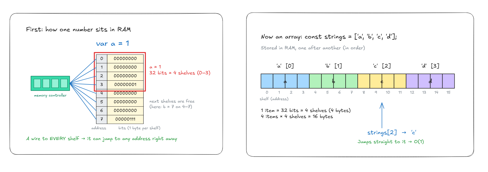
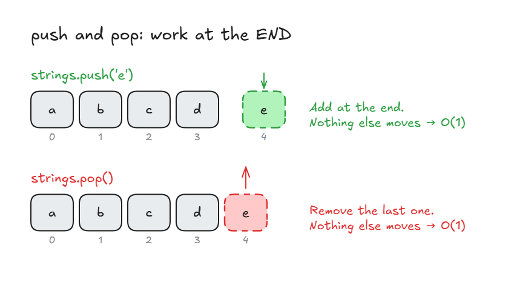
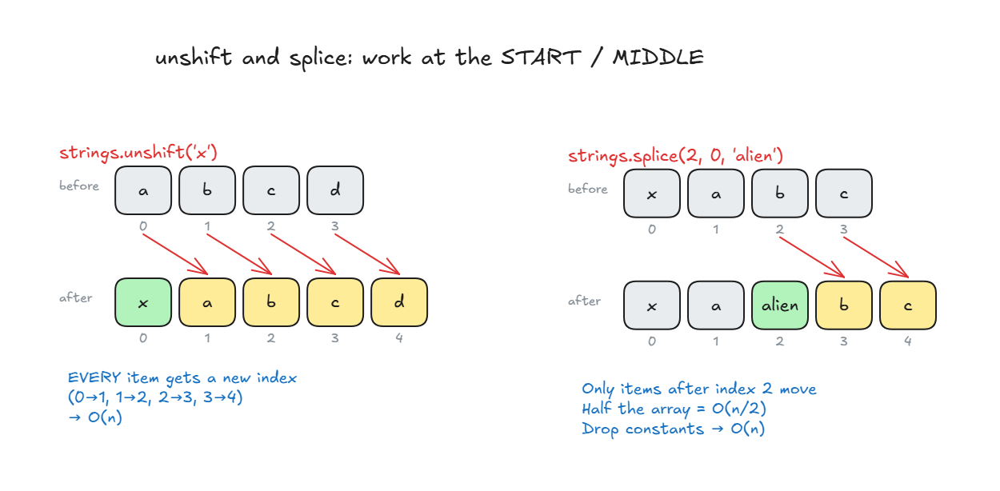
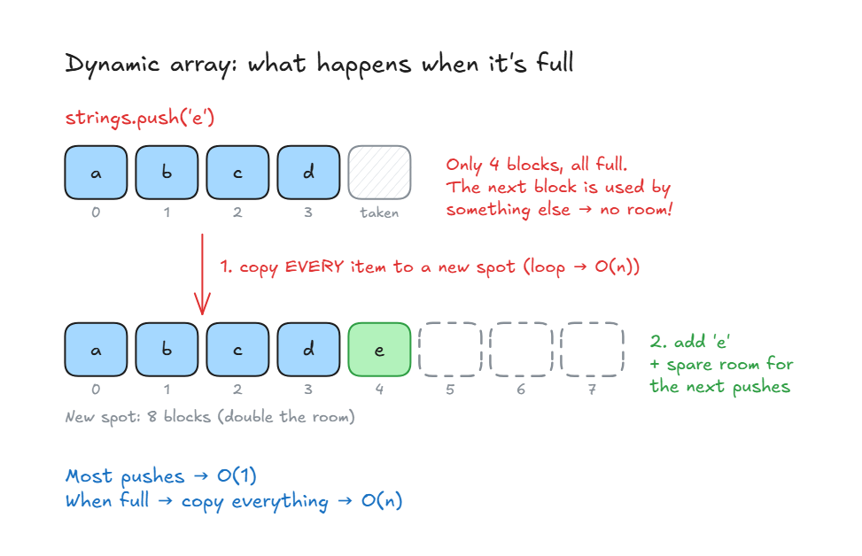

# Arrays Introduction

## Arrays Introduction

- **Array** (also called a **list**) = items kept **in order, one after another** in memory.
- The simplest and most used data structure.
- Fewest rules, and uses the **least memory** of any data structure.
- **Best for:** storing data and going through it one by one, especially when you know the **index** (the position number, starting at 0).

| Operation  | Big O | Why                                 |
| ---------- | ----- | ----------------------------------- |
| **Lookup** | O(1)  | Jumps straight to the index         |
| **Push**   | O(1)* | Adds at the end, nothing else moves |
| **Insert** | O(n)  | Items after it must shift over      |
| **Delete** | O(n)  | Items after it must shift back      |

\* Can be O(n) when the array is full and has to be copied. See [Static vs Dynamic Arrays](#static-vs-dynamic-arrays).

**How it sits in memory:**

```js
const strings = ["a", "b", "c", "d"];
```

- On a 32-bit system, each item takes **4 shelves** (4 bytes) in RAM.
- 4 items × 4 shelves = **16 bytes**.
- The items sit side by side, so the computer knows where each one is.



```js
strings[2]; // "c"  -> O(1), goes straight to index 2
```

**Methods (JavaScript):**

<!-- prettier-ignore -->
```js
const strings = ["a", "b", "c", "d"];

strings.push("e");             // ["a","b","c","d","e"]       O(1)
strings.pop();                 // ["a","b","c","d"]           O(1)
strings.pop();                 // ["a","b","c"]               O(1)
strings.unshift("x");          // ["x","a","b","c"]           O(n)
strings.splice(2, 0, "alien"); // ["x","a","alien","b","c"]   O(n)
strings.shift();               // ["a","alien","b","c"]       O(n)
```

| Method                             | What it does                                         | Big O |
| ---------------------------------- | ---------------------------------------------------- | ----- |
| `push(item)`                       | Add to the **end**                                   | O(1)  |
| `pop()`                            | Remove the **last** item                             | O(1)  |
| `unshift(item)`                    | Add to the **start**                                 | O(n)  |
| `shift()`                          | Remove the **first** item                            | O(n)  |
| `splice(start, deleteCount, item)` | Add or remove in the **middle** (from index `start`) | O(n)  |



- **push / pop:** no loop, the computer knows where the last item is → O(1).



- **unshift:** every item gets a new index (0→1, 1→2...). That's a loop over all items → O(n).
- **shift:** the opposite of unshift. Every item moves back one index (1→0, 2→1...) → O(n).
- **splice:** only items after the start index move. Half the array = O(n/2) → drop constants → **O(n)**.

> **Key idea:** Arrays are fast at reading by index and adding/removing at the end (O(1)). Adding/removing at the start or middle is slow (O(n)), because the other items have to shift.

## Static vs Dynamic Arrays

**2 types of arrays:**

|                     | Static                                   | Dynamic                                        |
| ------------------- | ---------------------------------------- | ---------------------------------------------- |
| **Size**            | Fixed: you set it **before** you use it  | Grows by itself as you add items               |
| **Need more room?** | You copy the whole array to a new spot   | It copies itself to a bigger spot, on its own  |
| **Languages**       | C++                                      | JavaScript, Python (list), Java (ArrayList)    |

- **Why a fixed size?** An array needs memory blocks **side by side**. Once it's made, there's no promise the next blocks are free.

**Static array in C++:**

<!-- prettier-ignore -->
```cpp
int a[20];                  // space for 20 items
int b[5] = {1, 2, 3, 4, 5}; // 5 items, now full
```

- To add a 6th item to `b`, you must copy the whole array to a new spot in memory with more room.

**Who manages memory?**

- **Low-level languages (C++):** you manage memory yourself. That gives you more control, so the code can be faster.
- **High-level languages (JavaScript):** the computer manages it for you. That's easier, and you never set a size.

**Push is O(1)... most of the time:**



- The array is full, so on `push` the computer **loops over every item** and copies it to a new spot with more room (here 4 → 8 blocks).
- That one push is **O(n)**. All the other pushes are **O(1)**.
- In interviews you'll use dynamic arrays, so you can treat push as O(1).

> **Key idea:** Static arrays have a fixed size. Dynamic arrays grow by themselves by copying to a bigger spot, so push is O(1) most of the time and O(n) when the array is full.
