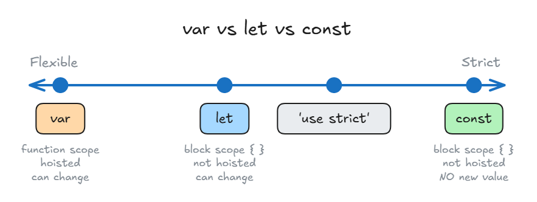

# JavaScript Basics

## const vs let vs var



| Keyword   | Scope (where it can be used) | Hoisted? (usable before its line)      | Give it a new value? |
| --------- | ---------------------------- | -------------------------------------- | -------------------- |
| **var**   | Whole **function**           | Yes, but the value is `undefined`      | Yes                  |
| **let**   | Only its **block** `{ }`     | No, you get an error                   | Yes                  |
| **const** | Only its **block** `{ }`     | No, you get an error                   | **No**               |

- **Scope** = where in the code the variable can be used.
- **Block** = anything between `{ }`, like an `if` or a loop.
- **Hoisting** = JavaScript moves `var` declarations to the top of the function. Only the name moves, not the value.

**var: function scope + hoisting**

<!-- prettier-ignore -->
```js
(function () {
  console.log(i);   // undefined (no error, because of hoisting)
  if ("5" === "5") {
    var i = 100;
  }
  console.log(i);   // 100 (still works outside the if)
})();
```

What JavaScript really runs (hoisted):

<!-- prettier-ignore -->
```js
(function () {
  var i;            // name moved to the top, no value yet
  console.log(i);   // undefined
  if ("5" === "5") {
    i = 100;        // value given here
  }
  console.log(i);   // 100
})();
```

**let: block scope, no hoisting**

<!-- prettier-ignore -->
```js
(function () {
  console.log(i);   // Error: i is not defined
  if ("5" === "5") {
    console.log(i); // Error (used before its line)
    let i = 100;
    console.log(i); // 100 (only works here, after its line)
  }
  console.log(i);   // Error: i is not defined (outside the block)
})();
```

**const: like let, but can't get a new value**

<!-- prettier-ignore -->
```js
const message = "what up";
message = "bye";              // Error: can't give a const a new value
```

- With an **object**, you **can** change or add its properties, but you **can't** replace the whole thing:

<!-- prettier-ignore -->
```js
const message = { body: "what up", title: "rcs" };
message.body = "bye";         // OK: change a property
message.send = true;          // OK: add a property
message = 100;                // Error: can't replace it
```

**What is `'use strict'`?**

- A line at the **top of a file or function** that turns on **strict mode**.
- Strict mode turns silent mistakes into **errors**. For example, you **must** declare a variable with `let`, `const` or `var` first.
- It's not a way to make a variable. It's on the chart because it makes JavaScript **stricter**.
- You usually don't need to write it: code inside a **class** or a **module** (`import`/`export`) is already in strict mode.

<!-- prettier-ignore -->
```js
"use strict";
x = 10;           // Error: x is not defined (forgot let/const/var)
```

Without `'use strict'`, `x = 10` quietly creates a global variable, with no error.

> **Key idea:** `var` is the most flexible (function scope, hoisted). `let` stays in its block. `const` stays in its block and can't get a new value. Its object properties can still change.
