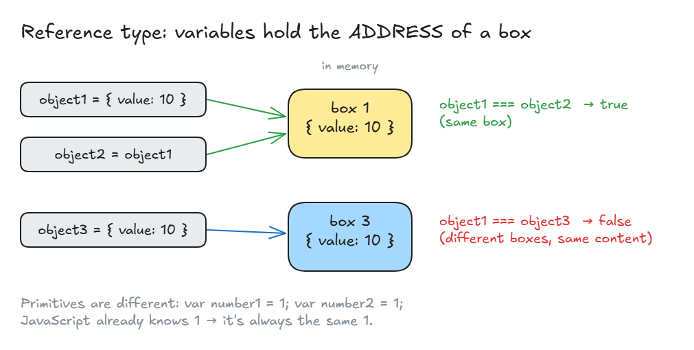
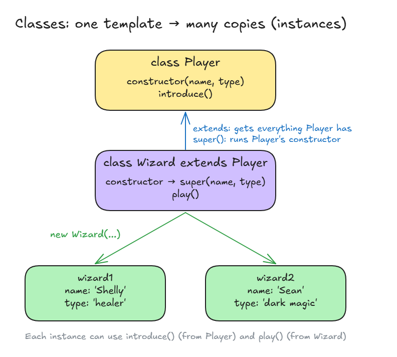

# Classes In JavaScript

## Classes In JavaScript

**Important ideas about objects:**

1. Primitive types (to compare with reference types)
2. Reference type
3. Context (`this`)
4. Instantiation (classes)

### 1. Primitive types

- **Primitive** = a simple, single value that is **defined by JavaScript** itself.
- It can't be changed (it's **immutable**). `1` is always the same `1`.

| Type        | Example              |
| ----------- | -------------------- |
| `number`    | `1`, `3.14`          |
| `string`    | `"hello"`            |
| `boolean`   | `true`, `false`      |
| `null`      | `null` (empty on purpose) |
| `undefined` | `undefined` (no value yet) |
| `symbol`    | `Symbol("id")` (a unique value) |

- Compared **by value**: same value → equal.

<!-- prettier-ignore -->
```js
var number1 = 1;
var number2 = 1;
number1 === number2;  // true (JavaScript knows 1, it's the same 1)
"hi" === "hi";        // true
```

### 2. Reference type

- **Objects and arrays** are **reference types**: **you** create them.
- A variable doesn't hold the object itself. It holds the **address** of the box where the object is kept.

<!-- prettier-ignore -->
```js
[] === [];          // false (2 different boxes)
[1] === [1];        // false (2 different boxes)

var object1 = { value: 10 };
var object2 = object1;          // same box as object1
var object3 = { value: 10 };    // new box ({ } makes a new one)

object1 === object2;            // true  (same box)
object1 === object3;            // false (different boxes, same content)

object1.value = 15;
object2.value;                  // 15 (same box, so it changed too)
object3.value;                  // 10 (its own box, not changed)
```



### 3. Context (`this`)

- **Scope** = which variables you can use. It's made by `{ }`.
- **Context** = **which object you're inside** right now.
- **`this`** = the object you're inside. Easy rule: **`this` is whatever is to the left of the dot.**

<!-- prettier-ignore -->
```js
this === window;          // true (at the top level, you're inside window)
this.alert("hello");      // same as window.alert("hello")

function a() {
  console.log(this);
}
a();                      // window (because a() is really window.a())

const object4 = {
  a: function () {
    console.log(this);
  },
};
object4.a();              // object4 (it's to the left of the dot)
```

**When does `this` change? (how to give it a new context)**

`this` is decided **when the function is called**, not when it's written.

| How the function is called       | `this` is...                          |
| -------------------------------- | ------------------------------------- |
| Top level / plain call `a()`     | `window` (`undefined` in strict mode) |
| As a method: `object4.a()`       | The object left of the dot (`object4`) |
| With `new`: `new Player()`       | The **new copy** being made           |
| With `call` / `apply` / `bind`   | Whatever object **you** pass in       |
| Arrow function `() => {}`        | No own `this`: uses the outer one     |

**1. Top level / plain call `a()` → `window`**

- No dot in front, so there's no object. `this` falls back to `window`, the global object.
- In strict mode (and inside classes and modules) it's `undefined` instead.
- **Why?** `"use strict"` turns off the fallback to `window`. So a mistake like `this.name = "Sam"` throws an error, instead of quietly making a global variable.

<!-- prettier-ignore -->
```js
function a() {
  console.log(this);
}
a();                    // window (same as window.a())

function b() {
  "use strict";         // strict mode for this function only
  console.log(this);
}
b();                    // undefined
```

**2. As a method: `object4.a()` → the object left of the dot**

- When a function is called **through an object**, `this` is that object.
- Take the function out of the object and call it with no dot, and `this` is lost.

<!-- prettier-ignore -->
```js
const player = {
  name: "Sam",
  hi() {
    console.log(this.name);
  },
};

player.hi();            // "Sam" (player is left of the dot)

const hi = player.hi;   // take the function out
hi();                   // not "Sam" (no dot → this is window)
```

**3. With `new`: `new Player()` → the new copy**

- `new` makes a **brand new empty object**, and `this` points to it inside the `constructor`.
- Every `new` makes a different copy, so each one has its own `this`.

<!-- prettier-ignore -->
```js
class Player {
  constructor(name) {
    this.name = name;   // this = the new copy
    console.log(this);  // shows which copy this is right now
  }
}

const p1 = new Player("Shelly");
// this = p1 → this.name = "Shelly" → logs Player { name: "Shelly" }

const p2 = new Player("Sean");
// this = p2 → this.name = "Sean"   → logs Player { name: "Sean" }

p1.name;                // "Shelly"
p2.name;                // "Sean"
```

**4. With `call` / `apply` / `bind` → the object you pass in**

- **The problem:** `hi` below is not inside any object, so there's no "left of the dot". What should `this` be?
- **The fix:** `call`, `apply` and `bind` let **you** choose what `this` is.
- **1st argument** = the object to use as `this`. **The rest** = the normal arguments of the function.

| Method  | Runs the function now?          | How you pass the other arguments | Gives back           |
| ------- | ------------------------------- | -------------------------------- | -------------------- |
| `call`  | Yes                             | One by one: `"Hello"`            | The result           |
| `apply` | Yes                             | In an array: `["Hey"]`           | The result           |
| `bind`  | **No**, it waits                | One by one (now or later)        | A **new function**   |

Tip to remember: **c**all = **c**omma (one by one), **a**pply = **a**rray.

<!-- prettier-ignore -->
```js
function hi(greeting) {
  console.log(`${greeting}, ${this.name}`);
}

const mia = { name: "Mia" };
const sam = { name: "Sam" };
```

**`call`: set `this`, run now**

<!-- prettier-ignore -->
```js
hi.call(mia, "Hello");          // "Hello, Mia"
// this = mia, greeting = "Hello"

hi.call(sam, "Hello");          // "Hello, Sam"
// same function, different this
```

**`apply`: same as `call`, but arguments go in an array**

<!-- prettier-ignore -->
```js
hi.apply(mia, ["Hey"]);         // "Hey, Mia"
// this = mia, greeting = "Hey" (taken out of the array)
```

**`bind`: set `this` now, run later**

<!-- prettier-ignore -->
```js
const hiMia = hi.bind(mia);     // nothing runs yet, makes a new function
// hiMia = a copy of hi where this is ALWAYS mia

hiMia("Hi");                    // "Hi, Mia"
hiMia("Bye");                   // "Bye, Mia" (still mia every time)
```

- **When to use `bind`:** when you give a function to something that calls it **later** (like a button click or a timer) and you don't want to lose `this`.

<!-- prettier-ignore -->
```js
const player = {
  name: "Sam",
  hi() {
    console.log(this.name);
  },
};

setTimeout(player.hi, 1000);                // not "Sam" (called later with no dot → this lost)
setTimeout(player.hi.bind(player), 1000);   // "Sam" (this locked to player)
```

**5. Arrow function `() => {}` → uses the outer `this`**

- A **normal function** gets its `this` from **how it's called** (rules 1–4 above). Most often that's the object on the **left side of the dot** (`team.show()` → `this` = `team`).
- An **arrow function** has **no `this` of its own**. It looks **outside**, to where it was **written**, and uses that `this`.
- Think of it like a variable: if it's not inside, JavaScript looks one step out.

| | Normal function | Arrow function |
| --- | --- | --- |
| `this` comes from | **How** it's called | **Where** it's written |
| Can `call` / `bind` change `this`? | Yes | **No** |
| Good as an object method? | **Yes** | No |
| Good as a function inside a method? | No (loses `this`) | **Yes** |

**Example 1: a function inside a method**

<!-- prettier-ignore -->
```js
const team = {
  name: "Wizards",
  show() {
    // here this = team (team.show() → team is left of the dot)

    const normal = function () {
      console.log(this.name);
    };
    const arrow = () => {
      console.log(this.name);
    };

    normal();           // not "Wizards" (plain call, no dot → this is window)
    arrow();            // "Wizards" (no own this → uses show's this = team)
  },
};

team.show();
```

**Example 2: a timer inside a method (very common)**

<!-- prettier-ignore -->
```js
const player = {
  name: "Sam",
  waitNormal() {
    setTimeout(function () {
      console.log(this.name);   // not "Sam" (the timer calls it later with no dot)
    }, 1000);
  },
  waitArrow() {
    setTimeout(() => {
      console.log(this.name);   // "Sam" (uses waitArrow's this = player)
    }, 1000);
  },
};

player.waitNormal();   // inside waitNormal: this = player, inside the timer function: this = window
player.waitArrow();    // inside waitArrow:  this = player, inside the arrow: this = player too
```

**Example 3: looping inside a method**

<!-- prettier-ignore -->
```js
const team = {
  name: "Wizards",
  members: ["Shelly", "Sean"],
  listNormal() {
    this.members.forEach(function (member) {
      console.log(`${member} is in ${this.name}`);  // this = window (forEach calls it with no dot)
    });
  },
  listArrow() {
    this.members.forEach((member) => {
      console.log(`${member} is in ${this.name}`);  // this = team (uses listArrow's this)
    });
  },
};

team.listNormal();
// "Shelly is in "   (this.name is not "Wizards")
// "Sean is in "

team.listArrow();
// "Shelly is in Wizards"
// "Sean is in Wizards"
```

**Example 4: DON'T use an arrow as the method itself**

<!-- prettier-ignore -->
```js
const player = {
  name: "Sam",
  hiNormal() {
    console.log(this.name);
  },
  hiArrow: () => {
    console.log(this.name);
  },
};

player.hiNormal();      // "Sam" (normal: this = player, left of the dot)
player.hiArrow();       // not "Sam" (arrow: ignores the dot, uses the outer this = window)
```

**Why `hiArrow` doesn't print "Sam":**

1. An arrow has **no `this` of its own**, so it looks **outside** to where it was **written**.
2. It was written inside the object's `{ }`. But an object's `{ }` is **not** a function, so it has **no `this`** to give.
3. The arrow keeps looking out, and the next place with a `this` is the **top level**, where `this` = `window`.
4. So inside `hiArrow`, `this` = `window`, and `this.name` = `window.name`, which is an empty string `""`.
5. The dot in `player.hiArrow()` **doesn't matter**: arrows ignore how they're called.

<!-- prettier-ignore -->
```js
// Where hiArrow looks for this:
//
// top level        → this = window   ← found it, uses this one
//   const player = {                  ← object { }, no this here
//     hiArrow: () => { this.name }    ← arrow, no own this, look out
//   }
```

> **Important:** Only a **function** can give `this`. An **object can't**.
>
> - **Examples 1–3:** the arrow was written **inside a method** (`show`, `waitArrow`, `listArrow`). A method is a function, so it **gives its `this`** (= the object) to the arrow. ✅
> - **Example 4:** the arrow **is** the method, written straight inside the object `{ }`. The object can't give `this`, so the arrow gets `window`. ❌
> - Also: `if { }` and loop `{ }` blocks don't give `this` either.

**Example 5: `call` / `bind` can't change an arrow's `this`**

<!-- prettier-ignore -->
```js
const mia = { name: "Mia" };

const hiArrow = () => {
  console.log(this.name);
};

hiArrow.call(mia);      // not "Mia" (arrow keeps its outer this, call is ignored)
hiArrow.bind(mia)();    // not "Mia" (bind is ignored too)
```

**Rule of thumb:**

- **Method on an object or class** → use a **normal** function.
- **Function inside a method** (timer, loop, callback) → use an **arrow** function.

**Summary of all 5:**

- **The same function** can have a **different `this`** depending on how you call it.
- That's why `this` is in classes: inside `constructor`, `this` is the **new copy** made by `new`.

### 4. Instantiation (classes)

- **Instantiation** = making **copies (instances)** of an object from one template.
- Example: a game with many players. Without it, you'd write a new object for every player, which is lots of repeated code.

<!-- prettier-ignore -->
```js
class Player {
  constructor(name, type) {
    this.name = name;
    this.type = type;
  }
  introduce() {
    console.log(`Hi I am ${this.name}, I'm a ${this.type}`);
  }
}

class Wizard extends Player {
  constructor(name, type) {
    super(name, type);    // runs Player's constructor first
  }
  play() {
    console.log(`WEEEEE I'm a ${this.type}`);
  }
}

const wizard1 = new Wizard("Shelly", "healer");
const wizard2 = new Wizard("Sean", "dark magic");

wizard1.play();           // WEEEEE I'm a healer
wizard1.introduce();      // Hi I am Shelly, I'm a healer
wizard2.introduce();      // Hi I am Sean, I'm a dark magic
```



| Keyword       | What it does                                                        |
| ------------- | ------------------------------------------------------------------- |
| `class`       | Makes a template you want to copy. Name starts with a capital letter |
| `constructor` | Runs **first** every time a copy is made. Sets the properties       |
| `this`        | The copy being made, e.g. `this.name`                               |
| `extends`     | Takes everything from another class and adds more on top            |
| `super()`     | Runs the parent class's constructor                                 |
| `new`         | Makes a new copy (instance) of the class                            |

**What happens on `new Wizard("Shelly", "healer")`:**

1. Go to the `Wizard` constructor.
2. `super(name, type)` runs the `Player` constructor, which sets `name` and `type`.
3. Then the rest of `Wizard` runs, and adds `play()`.

- You **must call `super()` before using `this`** in a class that `extends`. Otherwise you get a `ReferenceError`.
- **The old way** was prototypes ("classical inheritance"). It's longer and harder to read. `class` (ES6) is the cleaner way, used in React today.

**Example: why the 2 logs of `this` are different**

<!-- prettier-ignore -->
```js
class Player {
  constructor(name, type) {
    console.log("player", this);    // runs BEFORE name and type are set
    this.name = name;
    this.type = type;
  }
  introduce() {
    console.log(`Hi I am ${this.name}, I'm a ${this.type}`);
  }
}

class Wizard extends Player {
  constructor(name, type) {
    super(name, type);              // runs Player's constructor
    console.log("wizard", this);    // runs AFTER super() set name and type
  }
  play() {
    console.log(`WEEEEEEE I'm a ${this.type}`);
  }
}

const wizard1 = new Wizard("Shelly", "Healer");
// player Wizard {}
// wizard Wizard {name: "Shelly", type: "Healer"}
```

- **`new` creates a brand new empty object `{}`**, and `this` points to that object. The constructors then fill it in.
- **Both logs show the same object**: the new copy `wizard1`. That's why both say `Wizard`, even the one inside `Player`.
- **`player Wizard {}` is empty** because it logs **before** `this.name` and `this.type` are set.
- **`wizard Wizard {name, type}` is full** because it logs **after** `super()` has finished setting them.
- **Order:** `new Wizard` → `super()` → Player's constructor (log "player", set name and type) → back in Wizard (log "wizard").

> **Key idea:** Objects are stored by reference (an address to a box). `this` is the object to the left of the dot. Classes let you make many copies of an object with `new`.
