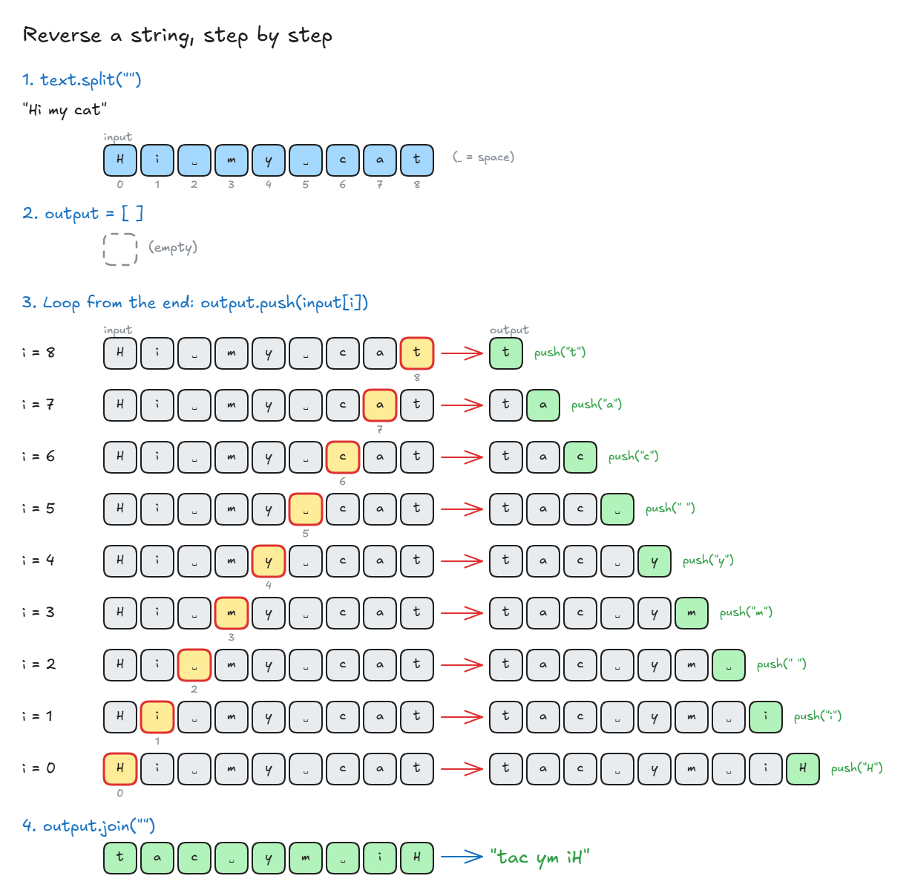

# Reverse A String

## Strings and Arrays

- **Interview trick:** treat any **string** question as an **array** question.
- A string is just an **array of characters**: `"hi"` → `["h", "i"]`.

**You need to:**

1. Turn the string into an array (e.g. `split("")` in JavaScript).
2. Work on the array (a loop or an array method).
3. Turn it back into a string (e.g. `join("")`).

<!-- prettier-ignore -->
```js
"hello".split("");                  // ["h", "e", "l", "l", "o"]
["h", "e", "l", "l", "o"].join(""); // "hello"
```

> **Key idea:** String question? Turn it into an array, solve it, then turn it back into a string.

## Exercise: Reverse A String

**Task:** write a function that reverses a string.

<!-- prettier-ignore -->
```js
reverse("Hi My name is Andrei");   // "ierdnA si eman yM iH"
```

- Use what you know about **arrays** to solve it.
- There are **many ways** to solve it. A different answer is fine.
- What matters: you can **think through** the problem and **explain why** you chose your way.

👉 Code file: [code/reverse-a-string.ts](code/reverse-a-string.ts)

## Solution: Reverse A String

**Key points from the lecture:**

- **Check the input first.** Don't assume you always get a string. It could be `undefined` or a number.
- If the string has **fewer than 2 letters**, it's already "reversed", so there's nothing to do.
- **Return a string**, not an array. Use `join("")` at the end.
- In JavaScript, you can read a string **like an array** without `split`: `"cat"[0]` → `"c"`.
- There are **many ways** to solve it. What matters is **explaining why** you chose yours and knowing the pros and cons.

**My solution:**

<!-- prettier-ignore -->
```ts
function reverse(text: string) {
  let input: string[] = text.split("");          // string → array of letters

  let output: string[] = [];

  for (let i = input.length - 1; i >= 0; i--) {  // start at the last letter, go back
    output.push(input[i]);                       // add each letter to the end of output
  }

  console.log(output.join(""));                  // array → string again
}

reverse("Hi My name is Andrei");                 // "ierdnA si eman yM iH"
```



**Other ways (from the lecture):**

**1. Loop + input check** (no `split`: read the string like an array)

<!-- prettier-ignore -->
```ts
function reverse(str: string): string {
  if (!str || str.length < 2 || typeof str !== "string") {
    return "hmm that is not good";              // bad input or nothing to reverse
  }

  const backwards: string[] = [];
  const totalItems = str.length - 1;            // last index

  for (let i = totalItems; i >= 0; i--) {
    backwards.push(str[i]);                     // str[i] works like an array
  }

  return backwards.join("");
}
```

**2. Built-in `reverse()`** (shorter and easier to read)

<!-- prettier-ignore -->
```ts
function reverse2(str: string): string {
  return str.split("").reverse().join("");      // string → array → reversed → string
}
```

**3. One-line arrow function** (ES6)

<!-- prettier-ignore -->
```ts
const reverse3 = (str: string): string => str.split("").reverse().join("");
```

**4. Spread operator `...`** (no `split` needed)

<!-- prettier-ignore -->
```ts
const reverse4 = (str: string): string => [...str].reverse().join("");
// [..."cat"] → ["c", "a", "t"]
```

| Way             | Good                                     | Not so good                     |
| --------------- | ---------------------------------------- | ------------------------------- |
| Loop            | Shows you understand how it works        | More code                       |
| `reverse()`     | Short, easy to read                      | Hides how it works              |
| Arrow one-line  | Shortest, modern                         | Harder to read for beginners    |
| Spread `[...]`  | No `split` needed                        | Newer syntax, must know `...`   |

- All 4 are **O(n)**: every letter is visited once.

> **Key idea:** Check the input, turn the string into an array, reverse it, and join it back. Any way is fine if you can explain why you chose it.
