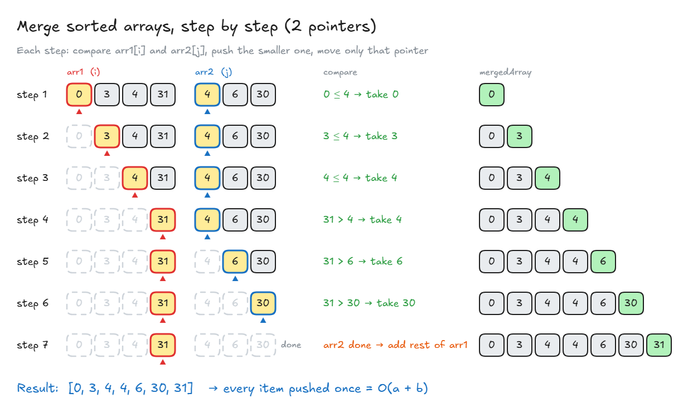

# Merge Sorted Arrays

## Exercise: Merge Sorted Arrays

**Task:** you get 2 arrays that are already **sorted**. Merge them into **one big array that is still sorted**.

<!-- prettier-ignore -->
```ts
mergeSortedArrays([0, 3, 4, 31], [4, 6, 30]);   // [0, 3, 4, 4, 6, 30, 31]
```

👉 Code file: [code/merge-sorted-arrays.ts](code/merge-sorted-arrays.ts)

## Solution: Merge Sorted Arrays

**Key points from the lecture:**

- **Check the input first.** If one array is **empty**, just return the other one: it's already sorted. No extra work.
- A `while` loop fits well: "keep going **while** there are items left".
- **Test as you go.** The teacher wrote a lot of code without running it, and the browser crashed (an endless loop). Use `console.log` to see the values in each loop.
- **Watch for `undefined`:** when one array runs out, `array[i]` is `undefined`. Comparing with `undefined` is always `false`, which can send your code down the wrong path.
- **Readable code matters.** If you need a long explanation for a line, it's not clear enough. Move tricky checks into small named functions, e.g. `shouldPushArray1Item()`.
- No time to clean it up in the interview? **Tell the interviewer** how you would improve it. That's almost as good as doing it.

**My solution:**

<!-- prettier-ignore -->
```ts
function mergeSortedArrays(arr1: number[], arr2: number[]): number[] {
  let mergedArray: number[] = [];

  let i = 0;                                    // position in arr1
  let j = 0;                                    // position in arr2

  while (i < arr1.length && j < arr2.length) {  // while BOTH arrays have items
    if (arr1[i] <= arr2[j]) {                   // take the smaller one
      mergedArray.push(arr1[i]);
      i++;
    } else {
      mergedArray.push(arr2[j]);
      j++;
    }
  }

  if (i < arr1.length) {                        // arr2 finished first:
    while (i < arr1.length) {                   // add the rest of arr1
      mergedArray.push(arr1[i]);
      i++;
    }
  }

  if (j < arr2.length) {                        // arr1 finished first:
    while (j < arr2.length) {                   // add the rest of arr2
      mergedArray.push(arr2[j]);
      j++;
    }
  }

  return mergedArray;
}

mergeSortedArrays([0, 3, 4, 31], [4, 6, 30]);   // [0, 3, 4, 4, 6, 30, 31]
```

- **2 pointers:** `i` walks through `arr1`, `j` walks through `arr2`. Each step takes the **smaller** item and moves only that pointer.
- When one array runs out, the rest of the other is already sorted, so just **add the leftovers**.
- **Big O: O(a + b)**, because every item is pushed once (`a`, `b` = lengths of the 2 arrays).



**Lecture's version** (moves to the next item instead of using `i` in the check):

<!-- prettier-ignore -->
```ts
function mergeSortedArrays(array1: number[], array2: number[]): number[] {
  const mergedArray: number[] = [];
  let array1Item = array1[0];                   // current item in array1
  let array2Item = array2[0];                   // current item in array2
  let i = 1;                                    // next index in array1
  let j = 1;                                    // next index in array2

  if (array1.length === 0) return array2;       // empty → return the other
  if (array2.length === 0) return array1;

  while (array1Item !== undefined || array2Item !== undefined) {
    if (array2Item === undefined || array1Item < array2Item) {
      mergedArray.push(array1Item);             // take from array1
      array1Item = array1[i];                   // move to its next item
      i++;
    } else {
      mergedArray.push(array2Item);             // take from array2
      array2Item = array2[j];
      j++;
    }
  }

  return mergedArray;
}
```

- ⚠️ The lecture writes `while (array1Item || array2Item)` and `if (!array2Item || ...)`. That breaks when an item is **`0`**, because `0` counts as "false" in JavaScript (e.g. `[1]` + `[0]` gives `[1]`: the `0` is lost). Checking `=== undefined` fixes it.

> **Key idea:** Use 2 pointers: compare the current items, push the smaller one, move that pointer, then add the leftovers. Check for empty inputs first, and keep the code easy to read.
