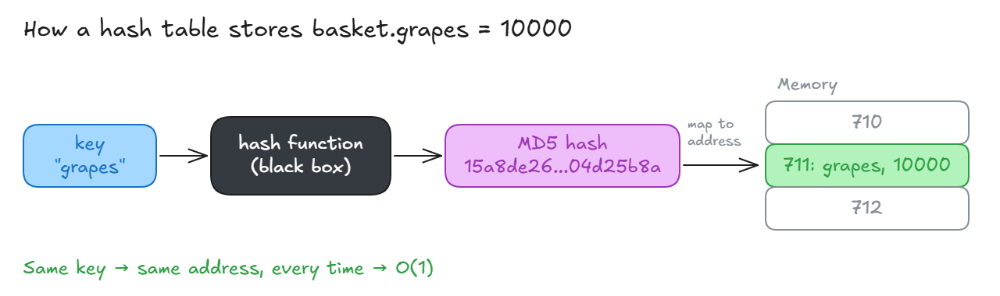

# Hash Function

## Hash Function

- A **hash function** takes any input and turns it into a **fixed-length** jumble of characters (a "hash").
- There are many types: **MD5**, **SHA-1**, **SHA-256**, **SHA-512**, **SHA-3**, **bcrypt**, **MurmurHash**, **xxHash**, **SipHash**, and more.

**Example (MD5):**

| Input   | Output (hash)                      |
| ------- | ---------------------------------- |
| `hello` | `5d41402abc4b2a76b9719d911017c592` |
| `Hello` | `8b1a9953c4611296a827abf8c47804d7` |
| `grapes` | `15a8de26589689d0fa41acee04d25b8a` |

**Key points:**

- **One way:** you can turn `hello` into a hash, but you can't turn the hash back into `hello`.
- **Same input → same output**, every time. The fancy word for this is **idempotent**.
- **A tiny change → a totally different output** (just `h` → `H` changes everything).

**Why hash tables use it:**

1. The key (`grapes`) goes into the hash function.
2. The hash is turned into a **memory address**.
3. To find `basket.grapes` later, hash `grapes` again → same address → found straight away.



> 💡 **Behind the scenes: the hash is not the memory address**
>
> It takes **two steps** to get from the key to the memory spot:
>
> 1. **Hash function:** `"grapes"` → `15a8de26...04d25b8a` (a huge number).
> 2. **Conversion:** that huge number is shrunk to a small **slot number** that fits the table.
>    - A common way: divide by the number of slots and keep the remainder.
>    - e.g. 1000 slots: `15a8de26...04d25b8a % 1000` → `770`.
>
> ```
> "grapes"  →  hash  →  slot number  →  memory spot
> ```
>
> - The slot number is like an **array index**. The computer knows where each slot sits in memory.
> - `711` in the diagram is a made-up example. With real numbers, `grapes` would land in slot `770`.
> - The language does both steps for you, fast → **O(1)**.

**Doesn't hashing slow things down?**

- It runs on **every** add and every lookup, so it must be **very fast**.
- Languages build in a fast hash function for their hash tables, so you don't write your own.
- Slow hash functions like **SHA-256** are made slow on purpose and used for security (cryptography), not hash tables.
- Hashing is so fast that we count it as **O(1)**.
