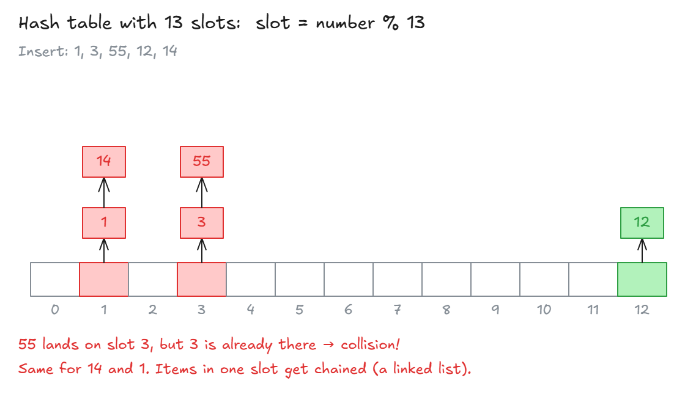
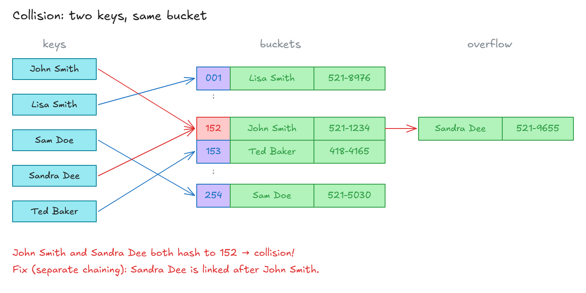

# Hash Collisions

## Hash Collisions

**Hash table speed (usually):**

| Action | Big O    | Why                                                   |
| ------ | -------- | ----------------------------------------------------- |
| Insert | **O(1)** | Hash the key → put it at that spot                    |
| Lookup | **O(1)** | Hash the key → go straight to that spot               |
| Delete | **O(1)** | Hash the key → remove it. No shifting like in arrays. |
| Search | **O(1)** | Hash the key → check that spot                        |

**Example:**

```js
let user = {
  age: 54,
  name: "Kylie",
  magic: true,
  scream: function () {
    console.log("ahhhhh!");
  },
};

user.age; // 54 → O(1)
user.spell = "abracadabra"; // add a new key → O(1)
user.scream(); // run the function → O(1)
```

- Each key and value gets its own spot in memory, picked by the hash function.

**The problem: collisions**

- A hash table only gets a **small amount of memory** (a few slots), not all of it.
- The hash function tries to spread data out, but it **can't promise** every key gets its own slot.
- **Collision** = two keys land in the **same slot**.



- Each slot is called a **bucket**. It stores both the key and the value.



**Why collisions are bad:**

- With lots of data and little memory, collisions **will** happen.
- If many keys pile up in one bucket, you have to check them **one by one**.
- That slows things down to **O(n/k)** (k = size of the table) → drop the constant → **O(n)**.

**How to fix collisions:**

- **Separate chaining:** link the items in the same bucket together, using a **linked list**. This is the one shown above.
- **Open addressing:** put the item in another empty slot.
- **Robin Hood hashing:** another way.

**Good to know:**

- You'll almost never build this yourself. Languages handle it for you.
