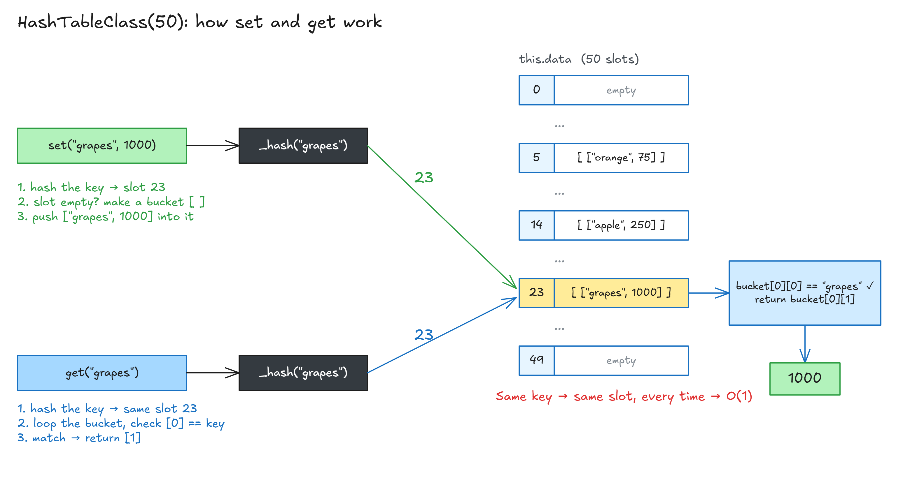

# Implement A Hash Table

## Solution: Implement A Hash Table

**The plan:**

| Part              | What it does                                               | Big O                      |
| ----------------- | ---------------------------------------------------------- | -------------------------- |
| `constructor()`   | Makes an array with `size` empty slots (shelves)           | —                          |
| `_hash(key)`      | Turns the key into a slot number (0 to size - 1)           | O(1)                       |
| `set(key, value)` | Hashes the key, puts `[key, value]` in that slot's bucket  | O(1)                       |
| `get(key)`        | Hashes the key, looks in that slot's bucket, returns value | O(1), O(n) if collisions   |
| `keys()`          | Loops every slot, returns all keys                         | O(n) (n = number of slots) |

**The code:**

<!-- prettier-ignore -->
```js
class HashTableClass {
  constructor(size) {
    this.data = new Array(size);                  // size empty slots
  }

  // Key → slot number
  _hash(key) {
    let hash = 0;
    for (let i = 0; i < key.length; i++) {
      hash = (hash + key.charCodeAt(i) * i) % this.data.length;
    }
    return hash;
  }

  // Add a key and value - O(1)
  set(key, value) {
    let address = this._hash(key);                // which slot?
    if (!this.data[address]) {
      this.data[address] = [];                    // empty slot → make a new bucket
    }
    this.data[address].push([key, value]);        // add to the bucket
  }

  // Get a value by key - O(1) (O(n) with many collisions)
  get(key) {
    let address = this._hash(key);                // same key → same slot
    let currentBucket = this.data[address];
    if (currentBucket) {
      for (let i = 0; i < currentBucket.length; i++) {
        if (currentBucket[i][0] == key) {         // [0] = key
          return currentBucket[i][1];             // [1] = value
        }
      }
    }
    return undefined;                             // nothing there
  }

  // Get all keys - O(n), loops every slot
  keys() {
    const keyArray = [];
    for (let i = 0; i < this.data.length; i++) {
      if (this.data[i]) {                         // skip empty slots
        keyArray.push(this.data[i][0][0]);        // bucket → 1st item → key
      }
    }
    return keyArray;
  }
}
```



**`_hash`:**

- `_` = "private" by convention only. JS still lets you call it.
- `charCodeAt(i)` → letter's number code. `* i` → more unique. `% this.data.length` (array size, since `this.data` is an array → 50) → stays inside 0–49.
- `"grapes"`: 0 → 14 → 8 → 44 → 48 → **23**.

**`set`:**

- Hash key → address. Empty slot → make a bucket `[]`. Then push `[key, value]`.
- Always push (no `else`), so collisions don't overwrite old data.

**`get`:**

- Hash key → same address. Loop the bucket, match `[i][0]`, return `[i][1]`. Nothing there → `undefined`.

**With 2 slots (collision):**

<!-- prettier-ignore -->
```js
// [ [["apple", 250]], [["grapes", 1000], ["orange", 75]] ]  ← slot 1 has 2 items
```

**Big O:**

- `_hash` → **O(1)**. It loops, but only over the letters of the key (short), so it's very fast.
- `set` → **O(1)**. No loop, just hash and push.
- `get` → **O(1)** most of the time (1 item in the bucket).
- `get` → **O(n)** if many keys collide into one bucket (small table or bad hash function), because it loops the bucket one by one.

👉 Code file: [code/implementing-a-hash-table.js](code/implementing-a-hash-table.js)

> **Key idea:** A hash table is an array of buckets. The hash function picks the slot. `set` pushes `[key, value]` into that slot's bucket, and `get` loops only inside that one bucket.

## keys()

<!-- prettier-ignore -->
```js
keys() {
  const keyArray = [];
  for (let i = 0; i < this.data.length; i++) {
    if (this.data[i]) {                         // skip empty slots
      keyArray.push(this.data[i][0][0]);        // bucket → 1st item → key
    }
  }
  return keyArray;
}
```

- Returns **all keys** in the hash table.
- Loops **every slot** (all 50), skips empty ones.
- Why `[0][0]`? `set` first makes an **empty array** (the bucket) in the slot, then pushes `[key, value]` (another array) into it → **array inside an array**.
  - `this.data[i]` = bucket → `[ ["grapes", 1000] ]`
  - `[0]` = first item in the bucket → `["grapes", 1000]`
  - `[0]` again = its key → `"grapes"`

<!-- prettier-ignore -->
```js
hashTable.keys();    // ["orange", "apple", "grapes"] → slot order (5, 14, 23), not the order you added them
```

**Downsides of hash tables (vs arrays):**

- Looping is **slow**: 3 items, but 50 loops (an array would loop 3 times).
- **No order**: items sit in random slots, so they come back in slot order.
- Same for `for...in` over a JS object.

## Extra: keys() Without Collision

- The `keys()` above only takes the **first** key in each bucket, so collided keys are **missed**.
- This version also loops **inside each bucket** (`j` loop) to get every key.

```js
keys() {
  if (!this.data.length) {
    return undefined;
  }
  let result = [];
  // loop through all the elements
  for (let i = 0; i < this.data.length; i++) {
    // if it's not an empty memory cell
    if (this.data[i] && this.data[i].length) {
      // but also loop through all the potential collisions
      if (this.data.length > 1) {
        for (let j = 0; j < this.data[i].length; j++) {
          result.push(this.data[i][j][0]);
        }
      } else {
        result.push(this.data[i][0]);
      }
    }
  }
  return result;
}
```

## Hash Tables VS Arrays

| Action | Arrays | Hash Tables |
| ------ | ------ | ----------- |
| search | O(n)   | **O(1)**    |
| lookup | O(1)   | O(1)        |
| push\* | O(1)   | —           |
| insert | O(n)   | **O(1)**    |
| delete | O(n)   | **O(1)**    |

**Hash tables are better for:**

- **Search:** fast. An array has to loop every item.
- **Insert:** no shifting indexes like an array. Collisions are rare, so treat it as O(1).
- That's why databases use them.

**Same in both:**

- **Lookup by key** is fast in both.
- Array keys = indexes, always `0, 1, 2...`. You **can't pick them**.
- Hash table keys = **you pick them** (`"grapes"`). A hash table is like an array with flexible keys.

**Hash table downside:**

- **No order.** Array items sit next to each other in memory. Hash table items are spread all over.

> **Key idea:** Use a hash table for fast search and insert with your own keys. Use an array when order matters.
