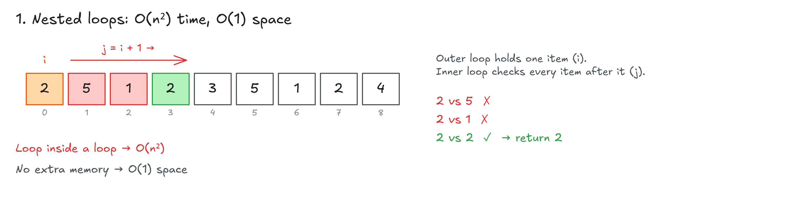
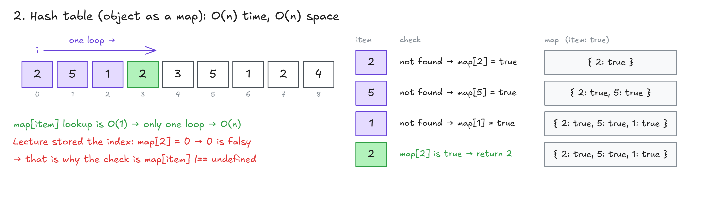
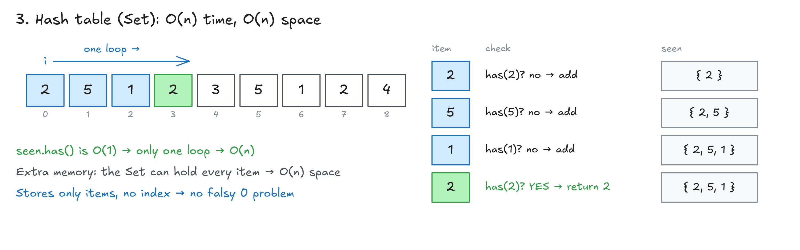
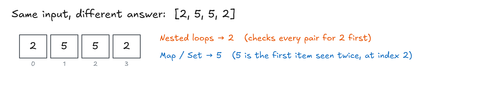

# First Recurring Character

## Exercise: First Recurring Character


## Solution: First Recurring Character

**1. Naive: nested loops**

```ts
function firstRecurringCharacter1(input: number[]): number | undefined {
  for (let i = 0; i < input.length; i++) {
    for (let j = i + 1; j < input.length; j++) {
      if (input[i] === input[j]) {
        return input[i];
      }
    }
  }
  return undefined;
}
```

- Take one item (`i`), compare it with every item after it (`j`).
- `j = i + 1`: start one to the right, so an item isn't compared with itself.
- Time **O(n²)** (loop inside a loop). Space **O(1)**.



**2. Better: hash table (object as a map)**

```ts
function firstRecurringCharacter2(input: number[]): number | undefined {
  const map: Record<number, boolean> = {};

  for (let i = 0; i < input.length; i++) {
    if (map[input[i]] !== undefined) {
      return input[i];
    } else {
      map[input[i]] = true;
    }
  }
  return undefined;
}
```

- One loop. Key already in `map` → return it. Not there → add it (`item: true`).
- Time **O(n)**. Space **O(n)** (the map can hold every item).
- Trade-off: faster, but uses more memory.
- **Catch:** the lecture stored the index (`map[input[i]] = i`). Then `map[2] = 0`, and `0` is **falsy**, so a plain `if (map[input[i]])` would miss it. `!== undefined` works for any value.



**What `map[input[i]]` does (read inside out):**

| Part | Example (`i = 3`) | Gives |
| --- | --- | --- |
| `input[i]` | `input[3]` | `2` (the current item) |
| `map[input[i]]` | `map[2]` | `true` if the object already has the key `2`, `undefined` if not |
| `map[input[i]] !== undefined` | `true !== undefined` | `true` → the object already has the key `2` → `return input[i]` (2) |
| `map[input[i]] = true` | `map[2] = true` | adds key `2` to the map |

**3. My solution: hash table (Set)**

```ts
function firstRecurringCharacter(numbersArray: number[]): number | undefined {
  const seen = new Set<number>();

  for (let i = 0; i < numbersArray.length; i++) {
    if (seen.has(numbersArray[i])) {
      return numbersArray[i];
    }
    seen.add(numbersArray[i]);
  }

  return undefined;
}
```

- Same idea as the map, but stores **only the items** (no index needed).
- No falsy `0` problem: `has()` returns `true` / `false`.
- Time **O(n)**. Space **O(n)**.



**Same input, different answer:**

| Input                         | Nested loops | Map / Set |
| ----------------------------- | ------------ | --------- |
| `[2, 5, 1, 2, 3, 5, 1, 2, 4]` | 2            | 2         |
| `[2, 1, 1, 2, 3, 5, 1, 2, 4]` | **2**        | **1**     |
| `[2, 5, 5, 2]`                | **2**        | **5**     |
| `[2, 3, 4, 5]`                | undefined    | undefined |

- Nested loops check **all pairs for the first item** before moving on → finds 2.
- Map / Set find the item that **repeats first** while reading left to right → finds 5.
- Ask the interviewer which answer they want.
- **Bonus challenge:** change the nested loop version so it returns 5 for `[2, 5, 5, 2]`.



👉 Code file: [code/first-recurring-character.ts](code/first-recurring-character.ts)

> **Key idea:** A hash table turns an O(n²) nested loop into one O(n) loop, at the cost of O(n) extra memory.
