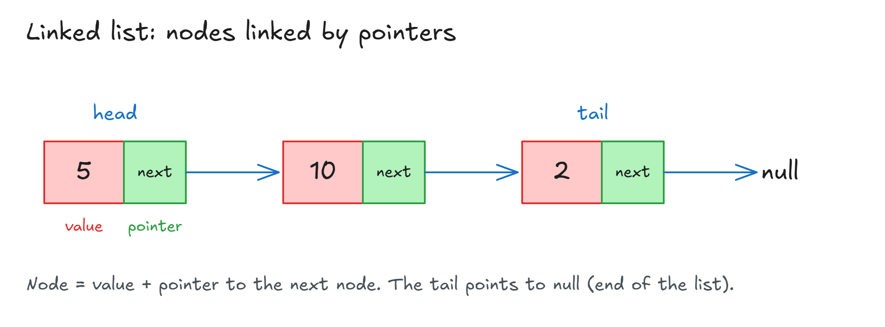

# Linked Lists Introduction

## Linked Lists Introduction

**Problems so far:**

| Data structure | Problem                                                          |
| -------------- | ---------------------------------------------------------------- |
| Arrays         | Growing past the limit means copying to a bigger spot → **O(n)** |
| Arrays         | **Insert / delete** (not at the end) shift indexes → **O(n)**    |
| Hash tables    | Fast, but **unordered**                                          |

- **Linked lists** help solve these.
- But they're not always the best. Every data structure has **trade-offs**.

## What Is A Linked List?

- A **linked list** = a chain of **nodes**. Each node points to the next one.
- **Node** = 2 parts:
  - **value**: the data (e.g. `5`)
  - **pointer**: link to the next node
- **Head** = first node. **Tail** = last node.
- The tail points to **`null`** → end of the list (**null terminated**).
- Can be sorted or unsorted, and hold any data type.



> 💡 **My idea:** think of a node as a JavaScript object with 2 fields, stored somewhere in memory:
>
> ```js
> { value: 5, next: <address of the next node> }
> ```
>
> - `value` → the data.
> - `next` → the memory address of the next node (`null` for the tail).

**Array vs linked list (pseudocode):**

<!-- prettier-ignore -->
```js
const basket = ["apples", "grapes", "pears"];    // array

// linked list (not real code)
apples --> grapes --> pears --> null
```

- In memory, nodes can be **anywhere**. Each pointer holds the next node's address.

| Node   | Address (example) | Points to |
| ------ | ----------------- | --------- |
| apples | 8947    | 8742      |
| grapes | 8742    | 372       |
| pears  | 372     | null      |

- **JavaScript has no built-in linked list** (Java does). We'll build our own.

> **Key idea:** A linked list is nodes in a chain: each node has a value and a pointer to the next node, from head to tail, ending at null.

## Extra: Imposter Syndrome

- **Imposter syndrome** = feeling you're not good enough, or that you'll never get there.
- It's normal when learning. It just means **you're not there yet**.
- With practice and repetition, it fades (like your first day at school or a job).
- It's a good sign: you're stretching your limits.

**Try this:**

- Take a break and **help someone** on the course Discord (e.g. answer a question in a coding channel).
- **Teaching what you learn** makes you learn it better, even if you're not 100% sure.
