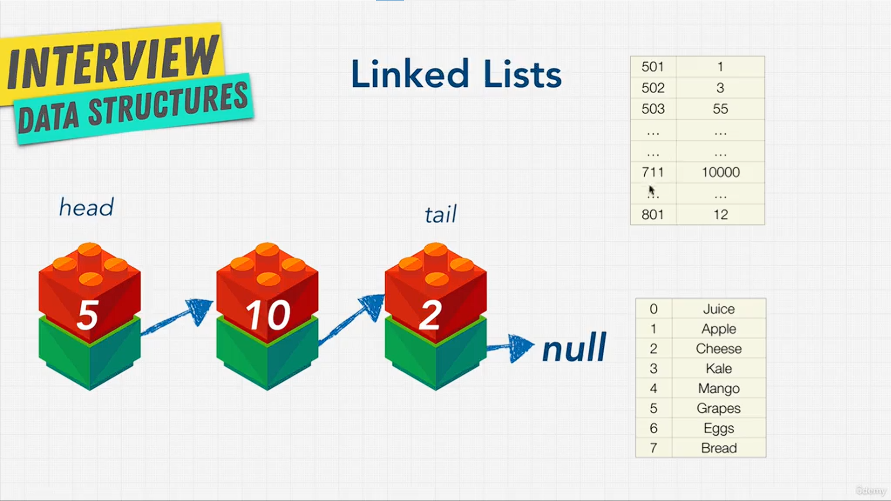
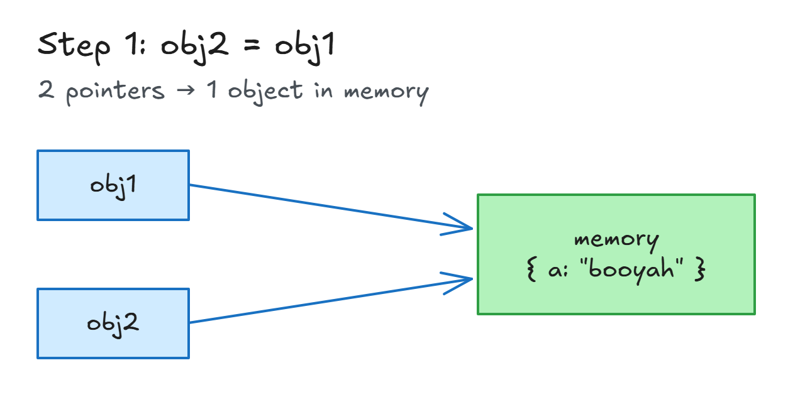
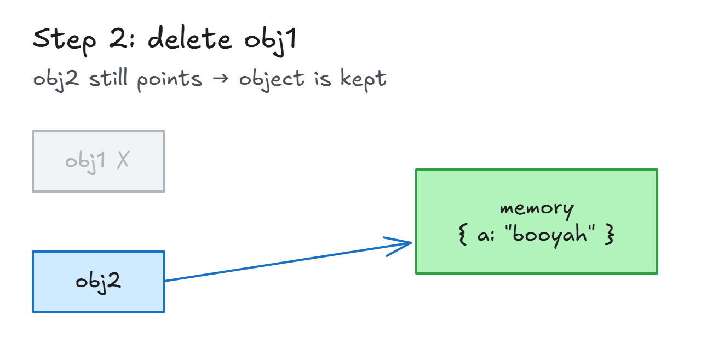
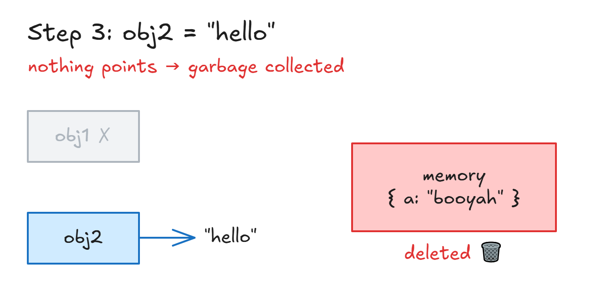

# Why Linked Lists?

## Exercise: Why Linked Lists?

- **Question:** why might a linked list be better than an array or a hash table?
- Try it visually: [VisuAlgo - Linked List](https://visualgo.net/en/list) (create, search, insert, remove).

## Solution: Why Linked Lists?



**Good:**

- **Insert / delete in the middle:** just change a few pointers. No shifting like arrays.
- **Scattered in memory** (like hash tables): just keep adding nodes anywhere.
- **Ordered** (unlike hash tables): each node points to the next, so data can be sorted.

**Bad:**

- **No indexes.** To get item 5, start at the head and go node by node → **O(n)**.
- This is called **traversal**: keep going until you hit `null` (usually a `while` loop, since you don't know the length).
- **Slower to loop than arrays.** Array items sit next to each other in memory, and computers read nearby memory faster (caching). Both are O(n), but arrays win in practice.

**Big O:**

| Action  | Big O | Why                                      |
| ------- | ----- | ---------------------------------------- |
| prepend | O(1)  | Add to the start (new head)              |
| append  | O(1)  | Add to the end (new tail)                |
| lookup  | O(n)  | Traverse from the head until found       |
| insert  | O(n)  | Traverse to the spot, then change pointers |
| delete  | O(n)  | Traverse to the item, then change pointers |

- **Append is O(1)** because the list keeps a `tail` pointer: jump straight to the end.
- **Insert / delete at an index are O(n)**: you must walk from the head to that spot first. Worst case = a spot near the end.

> **Key idea:** Linked lists make inserts and deletes cheap (just change pointers) and keep order, but finding an item means walking from the head, O(n).

## What Is A Pointer?

- **Pointer** = a **reference** to another place in memory (an object, a node...).
- It does **not copy** the data. It just says "the data is over there".

**Step 1: make a pointer**

<!-- prettier-ignore -->
```js
let obj1 = { a: true };
let obj2 = obj1;       // pointer: obj2 points to the SAME object, no copy

obj1.a = "booyah";
console.log(obj1);     // { a: "booyah" }
console.log(obj2);     // { a: "booyah" } → changed too
```

- Only **1 object** in memory. `obj1` and `obj2` both point to it.



**Step 2: delete `obj1`**

<!-- prettier-ignore -->
```js
delete obj1;           // remove the obj1 pointer
console.log(obj2);     // { a: "booyah" } → still there
```

- `obj2` still points to the object, so it **stays** in memory.



> 💡 **Nice to know: when does `delete` work?**
>
> | How `obj1` was made                       | `delete obj1`        | `obj1` after                 |
> | ----------------------------------------- | -------------------- | ---------------------------- |
> | `obj1 = { a: true }` (no `let/const/var`) | `true` → works       | error: "obj1 is not defined" |
> | `let obj1 = { a: true }`                  | `false` → does nothing | still `{ a: true }`        |
>
> - `delete` only removes **object properties**. A variable made without `let/const/var` is secretly a property of the global object, so it can be deleted.
> - That's why it worked in the lecture.
> - With `let` (normal modern code), use `obj1 = null` to drop the pointer instead.

**Step 3: point `obj2` somewhere else**

<!-- prettier-ignore -->
```js
obj2 = "hello";
console.log(obj2);     // "hello"
```

- Now **nothing** points to `{ a: "booyah" }`.
- JavaScript deletes it automatically. This is **garbage collection**.



**Garbage collected vs low-level languages:**

| Garbage collected (JavaScript, Python, Java) | Low-level (C, C++)                              |
| -------------------------------------------- | ----------------------------------------------- |
| Memory is freed **automatically**            | You free memory **yourself**                    |
| Easier, safer                                | Forget it → unused memory stays (a **memory leak**) |
| Less control                                 | More control → can be faster and more efficient |

- **Linked lists use pointers:** each node's `next` is a pointer to the next node. Removing a node = no pointer to it → it gets garbage collected.

> **Key idea:** A pointer is a reference to a place in memory, not a copy. In JavaScript, memory that nothing points to is deleted automatically (garbage collection).
