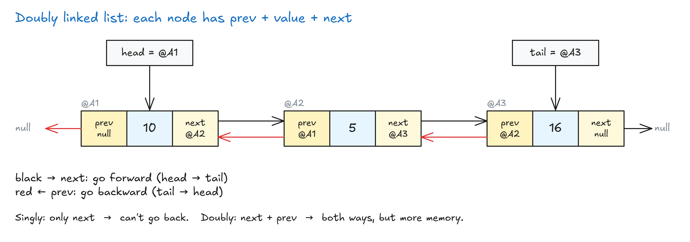

# Doubly Linked Lists

## Doubly Linked Lists

- Same as a singly linked list, plus one extra pointer: **`prev`** → the node **before** it.
- Each node = `prev` + `value` + `next`.
- The head's `prev` is `null`. The tail's `next` is `null`.



**Why it helps:**

- You can walk **backwards** (tail → head). A singly list can't know what comes before a node.
- **Lookup** can start from either end. If the item is in the 2nd half, start from the tail → about **O(n/2)**, but that's still **O(n)** (drop the constants). A bit faster in practice.

**Downside:**

- More **memory**: every node stores an extra pointer.

| Action         | Singly | Doubly                  |
| -------------- | ------ | ----------------------- |
| Walk backwards | ❌     | ✅                       |
| Lookup         | O(n)   | O(n) (≈ n/2, from either end) |
| Memory         | Less   | More (extra `prev`)     |

> **Key idea:** A doubly linked list links both ways (`next` and `prev`), so you can go forwards and backwards, at the cost of more memory.

## Exercise: Doubly Linked Lists


## Solution: Doubly Linked Lists

- Same as the singly list. Only change: also manage the **`previous`** pointer.

<!-- prettier-ignore -->
```js
class NodeClass {
  constructor(value) {
    this.value = value;
    this.next = null;
    this.previous = null;                     // NEW
  }
}

class LinkedListClass {
  constructor(value) {
    this.head = {
      value: value,
      next: null,
      previous: null,                         // NEW: nothing before the head
    };
    this.tail = this.head;
    this.length = 1;
  }

  append(value) {
    const newNode = new NodeClass(value);
    this.tail.next = newNode;
    newNode.previous = this.tail;             // NEW: point back to the old tail
    this.tail = newNode;
    this.length++;
    return this;
  }

  prepend(value) {
    const newNode = new NodeClass(value);
    newNode.next = this.head;
    this.head.previous = newNode;             // NEW: old head points back to the new node
    this.head = newNode;
    this.length++;
    return this;
  }

  insert(index, value) {
    if (index >= this.length) {
      return this.append(value);
    }
    if (index === 0) {
      return this.prepend(value);
    }

    const newNode = new NodeClass(value);

    let previousNode = this.traverseToIndex(index - 1);
    newNode.next = previousNode.next;         // 1. new → follower
    newNode.previous = previousNode;          // 2. new → leader (NEW)
    previousNode.next.previous = newNode;     // 3. follower → new (NEW)
    previousNode.next = newNode;              // 4. leader → new

    this.length++;
  }

  remove(index) {
    let currentNode = this.traverseToIndex(index);
    currentNode.next.previous = currentNode.previous; // follower skips back to leader
    currentNode.previous.next = currentNode.next;     // leader skips to follower
    this.length--;
  }
}
```

- `printList` and `traverseToIndex` stay the same as the singly list.
- **append:** new node's `previous` = old tail (set it **before** moving the tail).
- **prepend:** old head's `previous` = new node.
- **insert:** 4 links now: leader ⇄ new node ⇄ follower. (Leader = node before, follower = node after.)
- **remove:** in a doubly list you can go straight to the node itself (no `index - 1`), because it knows its `previous`.

<!-- prettier-ignore -->
```js
// 2 → 5 → 10 → 13
linkedList.insert(1, 100);    // [2, 100, 5, 10, 13]
linkedList.remove(2);         // [2, 100, 10, 13]
```

**Ways to improve:**

- `remove(0)` → crashes (head has no `previous`). Handle it separately.
- Removing the last node → crashes (tail has no `next`). Move the tail back.

- **Tip:** draw the steps before coding. Interviewers love linked lists because they show how clearly you think step by step.

👉 Code file: [code/doubly-linked-list.js](code/doubly-linked-list.js)


## Singly VS Doubly Linked Lists

|               | Singly                                                  | Doubly                                                        |
| ------------- | ------------------------------------------------------- | ------------------------------------------------------------- |
| **Good**      | Simple to build                                         | Walk both ways (front → back, back → front)                   |
|               | Less memory (no `previous`)                             | Delete a previous node without walking from the head          |
|               | Insert / delete a bit faster (fewer pointers to update) |                                                               |
| **Bad**       | Can't walk backwards                                    | More complex to build                                         |
|               | Lose `this.head` → the whole list is lost in memory     | More memory (extra `previous`)                                |
|               |                                                         | Insert / delete need extra steps (update `previous` too)      |
| **Use when**  | Memory is limited or expensive                          | Memory isn't a big problem                                    |
|               | You mostly insert / delete (especially at the start), not search | You need good searching, including backwards        |

- **Interviews:** you'll mostly see **singly** linked lists. Doubly usually comes up only as a "what's the difference?" question.

> **Key idea:** Singly = simple and less memory. Doubly = both directions, but more memory and more work per insert/delete.
