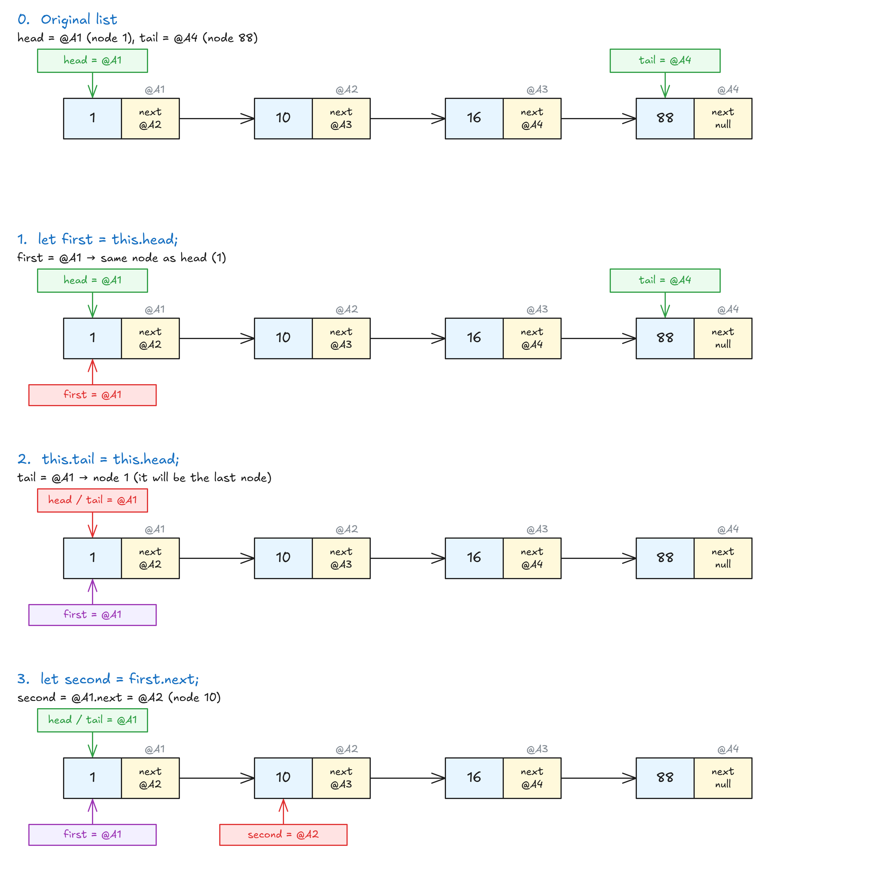
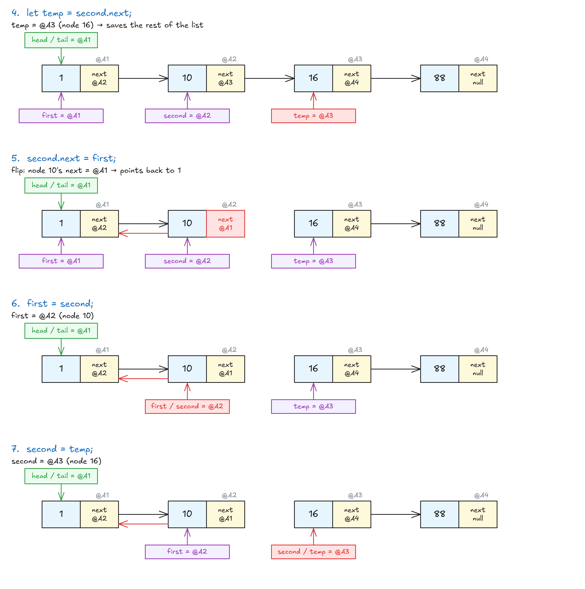
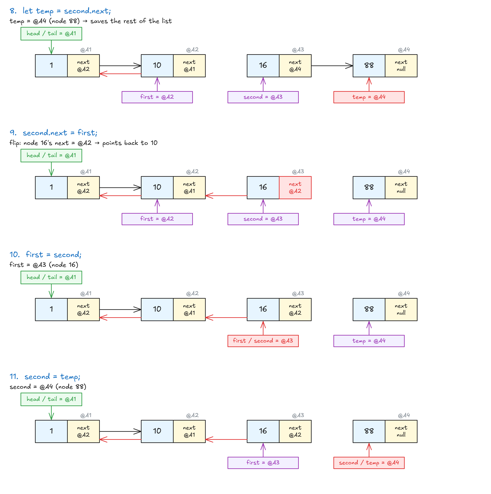
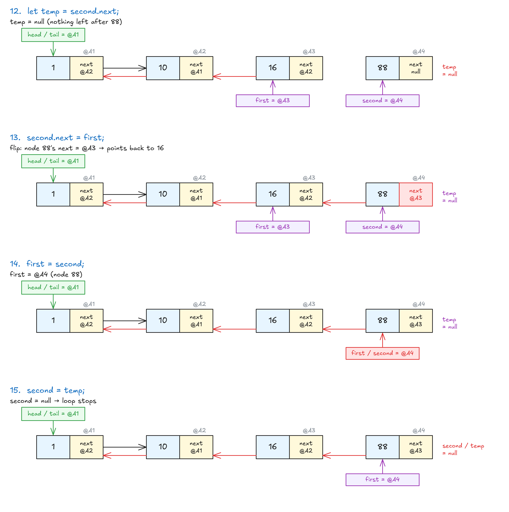
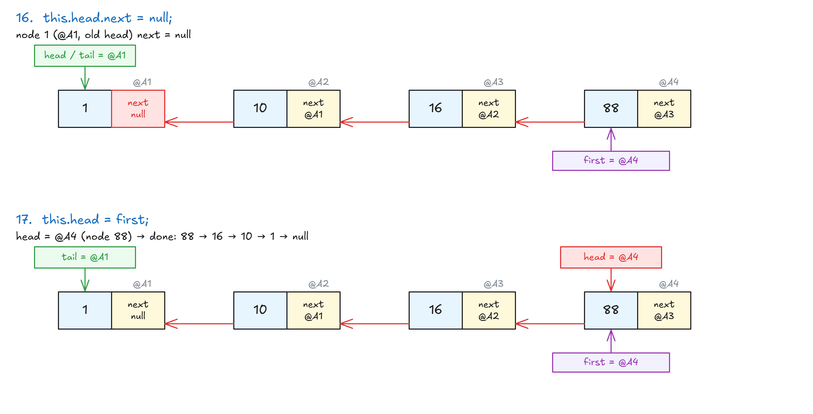

# reverse()

## Exercise: reverse()


## Solution: reverse()

<!-- prettier-ignore -->
```js
reverse() {
  if (!this.head.next) {
    return this.head;                 // only 1 node → nothing to reverse
  }

  let first = this.head;
  this.tail = this.head;              // old head becomes the tail
  let second = first.next;

  while (second) {
    let temp = second.next;           // save the rest of the list
    second.next = first;              // flip the pointer → points back
    first = second;                   // move both one step right
    second = temp;
  }

  this.head.next = null;              // old head (now tail) points to null
  this.head = first;                  // last node becomes the head
  return this;
}
```

- `!this.head.next` → no 2nd node → only 1 item. (Same as `this.length === 1`.)
- Keep 3 variables: `first`, `second`, `temp`. `temp` saves the rest of the list before the pointer flips, or you lose it.
- Each loop: flip **one** pointer, then move `first` and `second` one step right.
- Loop ends when `second` is `null` → `first` is the old last node → new head.

**Step by step** (list `1 → 10 → 16 → 88`, red = what that line changes):

**Setup:**



**Loop 1:**



**Loop 2:**



**Loop 3:**



**End:**



<!-- prettier-ignore -->
```js
// 1 → 10 → 16 → 88
myLinkedList.reverse();
myLinkedList.printList();    // [88, 16, 10, 1]
```

- **Big O:** O(n) (one loop through the list).
- The steps are the same in every language, only the syntax changes.

> **Key idea:** Walk the list once, flipping each `next` to point back, then swap head and tail.
