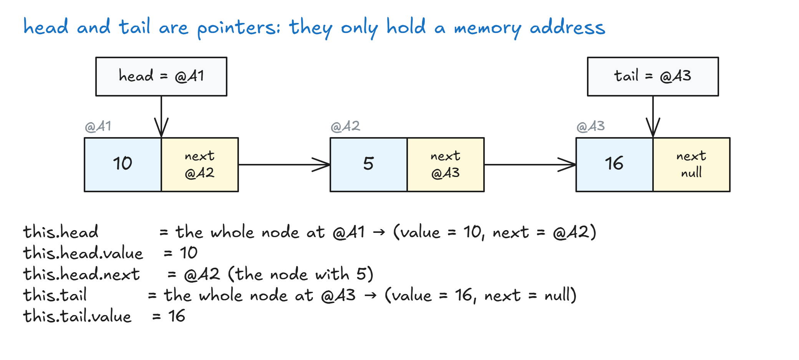
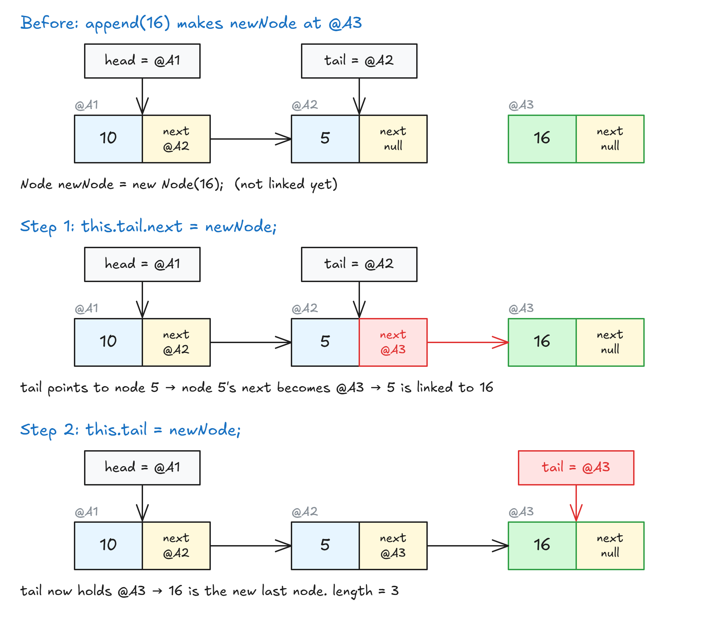
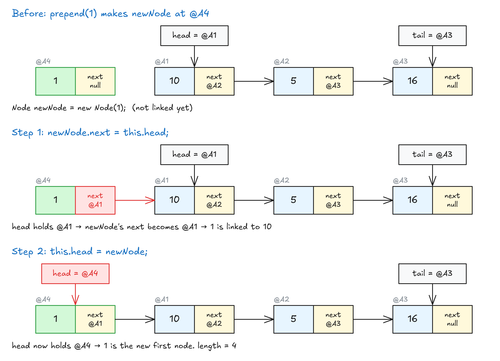

# Visualizing A Linked List

## Head And Tail Are Pointers

- **The 3 nodes are the real data.** Each one is stored at a memory address (`@A1`, `@A2`, `@A3`) and holds `value` + `next`.
- **`head` and `tail` are only pointers.** They have no `value` or `next` of their own. They just hold an address: `head = @A1`, `tail = @A3`.
- Everything (nodes and pointers) is stored in memory, so everything has an address. A pointer is just something whose content **is** an address.

| Thing            | Has an address? | What it holds            |
| ---------------- | --------------- | ------------------------ |
| Node (real data) | ✅              | `value` + `next`         |
| `head` / `tail`  | ✅              | another address (`@A1`)  |

- `this.head` = the **whole node** at that address (value + next).
- `this.head.value` = `10`, `this.head.next` = the next address (`@A2`). Same for `this.tail`.

## Adding At The End (append)

## Adding At The Start (prepend)

