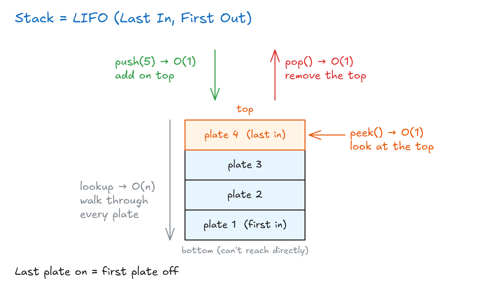
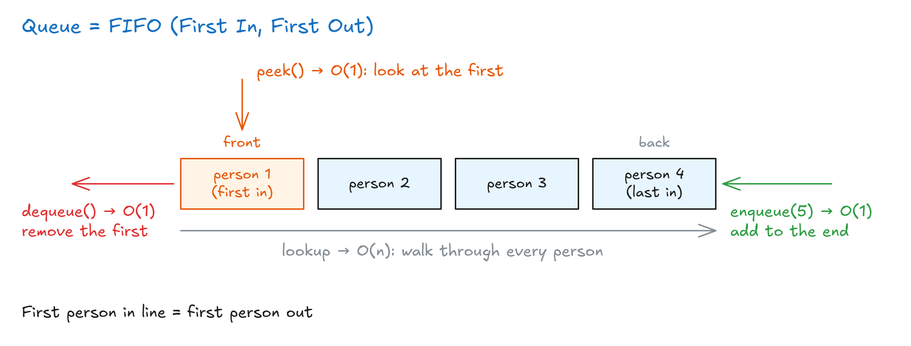
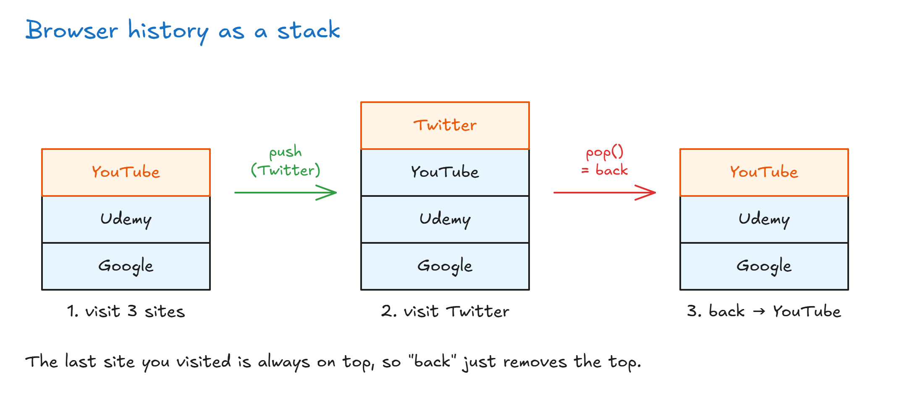
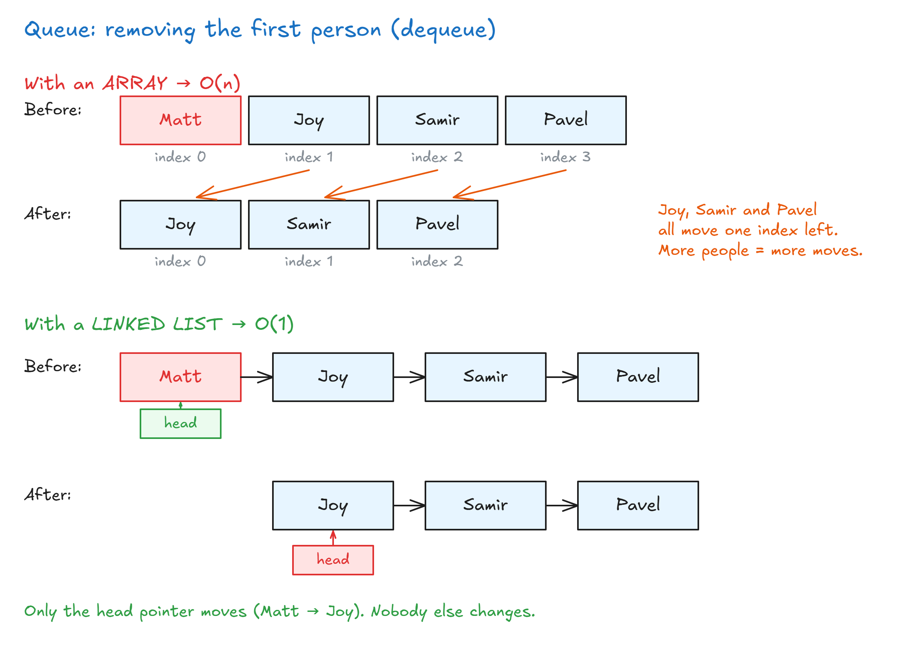

# Stacks And Queues Introduction

## Stacks And Queues Introduction

- Learned together because they're very similar.
- Both are **linear** data structures: you go through items **one by one**, and only **one** item can be reached directly.
- Can be built with **arrays** or **linked lists**.
- Main difference between them: **how items get removed**.
- **No random access** (unlike arrays). You mainly use `push`, `peek`, `pop`, which only touch the **first or last** item.

**Why limit what you can do?**

- Stacks and queues are **higher-level** data structures built on lower-level ones (arrays, linked lists), but with **fewer** actions.
- Fewer actions is a **benefit**: whoever uses it can only do the right, efficient operations.
- Give someone 2–3 tools instead of everything → they know exactly what to do.

> **Key idea:** Stacks and queues are arrays or linked lists with fewer actions. Only the first or last item is reachable, and that limit keeps them simple and fast.

## Stacks

- Think of a **stack of plates**: new items go on **top**, and you can only touch the **top** one.
- **LIFO** = **Last In, First Out**: the last item added is the first one taken out.

**Where stacks are used:**

- When you need the **last** value seen or added.
- **Programming languages:** function calls work as a stack. A function inside a function inside a function → the last called finishes first. (Too many → **stack overflow**.)
- **Browser history:** back and forward buttons.
- **Undo / redo** in text editors: the last change is stored on top, so it's undone first.

**Big O:**

| Action   | What it does                 | Big O    |
| -------- | ---------------------------- | -------- |
| `push`   | Add an item on top           | **O(1)** |
| `pop`    | Remove the top item          | **O(1)** |
| `peek`   | Look at the top item         | **O(1)** |
| `lookup` | Search through the whole stack | **O(n)** |

- `lookup` is shown only to compare. You usually **don't** search through a stack.

> **Key idea:** A stack is LIFO: add, remove and look only at the top, all O(1).

## Queues

- Think of a **line for a roller coaster**: the first person in line goes first.
- **FIFO** = **First In, First Out**: the first item added is the first one taken out. (Opposite of a stack.)

**Where queues are used:**

- Waitlist apps (concert tickets, restaurant tables).
- Uber / Lyft: whoever requested a ride first gets it first.
- **Printer:** the first person to click print gets their printout first.

**Big O:**

| Action    | What it does                                  | Big O    |
| --------- | --------------------------------------------- | -------- |
| `enqueue` | Add an item to the **end** of the line (like `push`) | **O(1)** |
| `dequeue` | Remove the **first** item (not the last, like `pop`) | **O(1)** |
| `peek`    | Look at the **first** item                    | **O(1)** |
| `lookup`  | Search through the whole queue                | **O(n)** |

- `lookup` is shown only to compare. You usually only enqueue and dequeue.

**Why not build a queue with an array?**

- `dequeue` removes the **first** item → every other item must shift its index (like `shift()`) → **O(n)**. Very slow.
- A **linked list** removes the first item in O(1), so it's the better choice.

> **Key idea:** A queue is FIFO: add at the end, remove from the front, both O(1). Build it with a linked list, not an array.

## Stacks VS Queues

JavaScript has no built-in stack or queue. So we have to build them ourselves, using one of the two data structures we already know: an **array** or a **linked list**. The question is: which one is better for each?

### Stack: array or linked list?

A stack works like your **browser history**. You visit Google, then Udemy, then YouTube. Each new site is placed on **top** of the stack. If you then visit Twitter and press **back**, the browser removes the top item (Twitter), and you are on YouTube again.

For a stack, **both work well**. A stack only adds and removes at the **top** (the end), and both arrays and linked lists do that in O(1). So the choice depends on what matters more to you:

| Array                                                                                                   | Linked list                                                                       |
| ------------------------------------------------------------------------------------------------------- | --------------------------------------------------------------------------------- |
| Items sit **next to each other** in memory (cache locality), so the computer reads them a bit faster.  | Items are **scattered** around memory, so reading them is a bit slower.           |
| Uses **less memory**, because it stores only the values.                                                | Uses **more memory**, because every node also stores a pointer.                   |
| Has a **fixed size**. When it gets full, it must copy everything into a new array twice as big.         | **Grows freely**. It just adds one more node, with no copying.                    |

### Queue: array or linked list?

A queue works like a **waitlist**. Matt arrives first, then Joy, then Samir, then Pavel. Matt was first, so Matt must leave first.

For a queue, the answer is clear: **use a linked list, not an array**. The reason is how each one removes the **first** item:

- **Array:** every item has an index. When Matt (index 0) leaves (`array.shift()`), Joy, Samir and Pavel must each **move one index to the left** to fill the gap. The more people in line, the more moves. That is **O(n)**.
- **Linked list:** there are no indexes. The list only has a `head` pointer to the first node. When Matt leaves, we just move `head` from Matt to Joy. Nobody else changes. That is **O(1)**.

This is a common interview question: "Why should you not build a queue with an array?" The answer is that removing from the front of an array shifts every other item.

> **Key idea:** A stack can use an array or a linked list, because it only works at the end. A queue should use a linked list, because removing the first item from an array forces every other item to shift.
