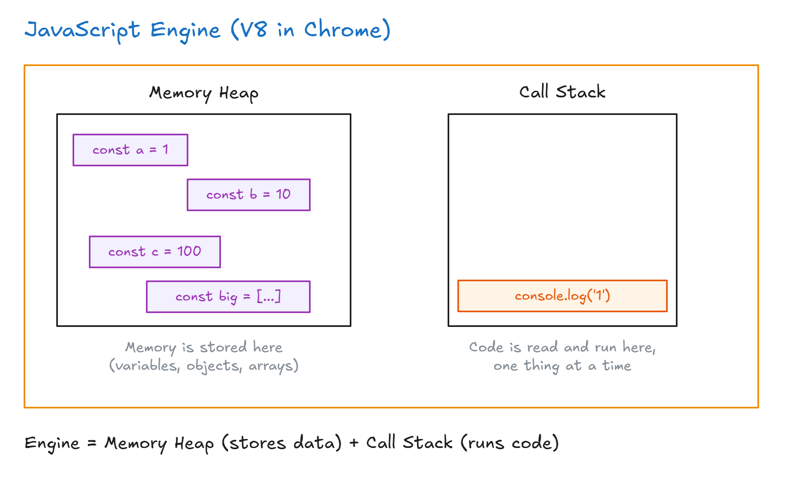
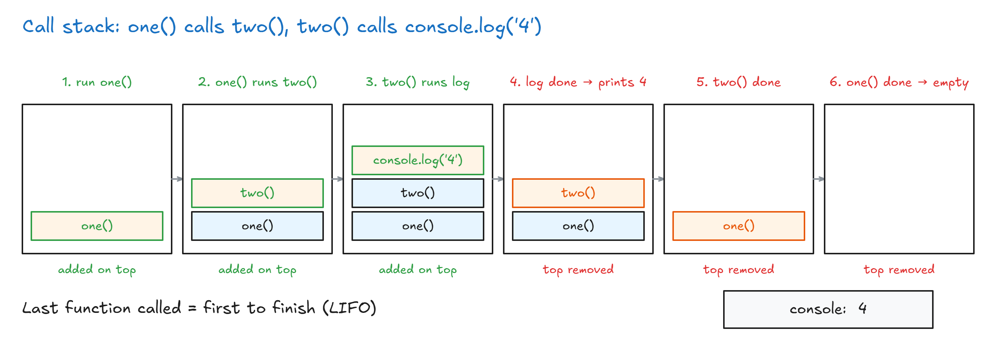
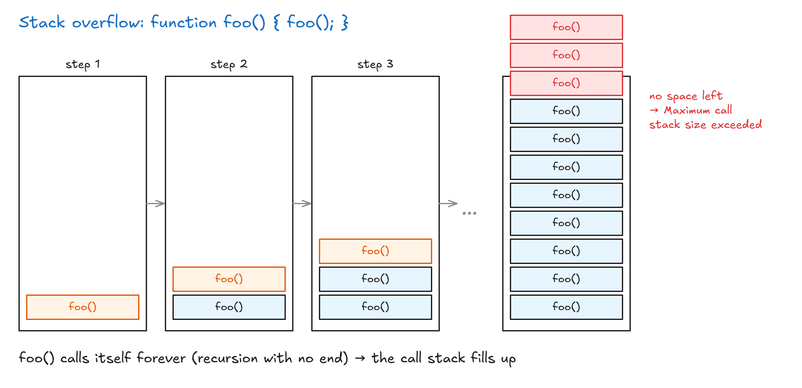
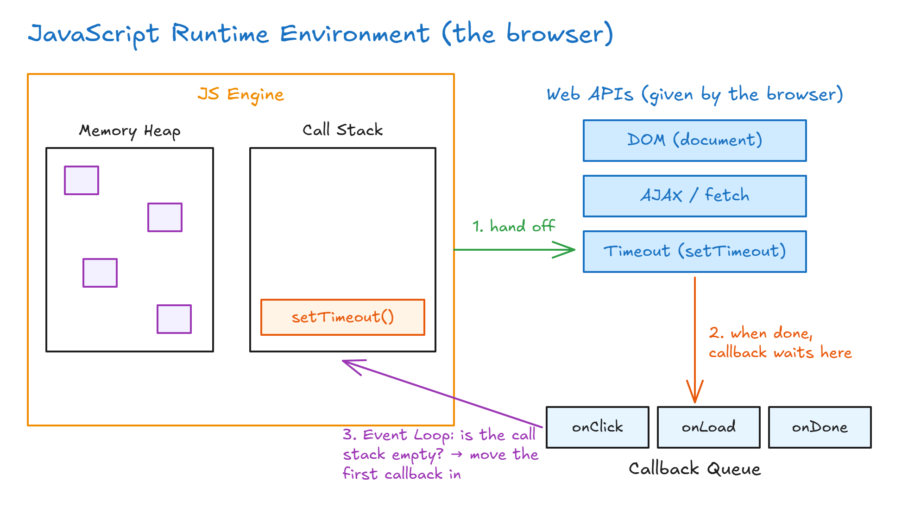
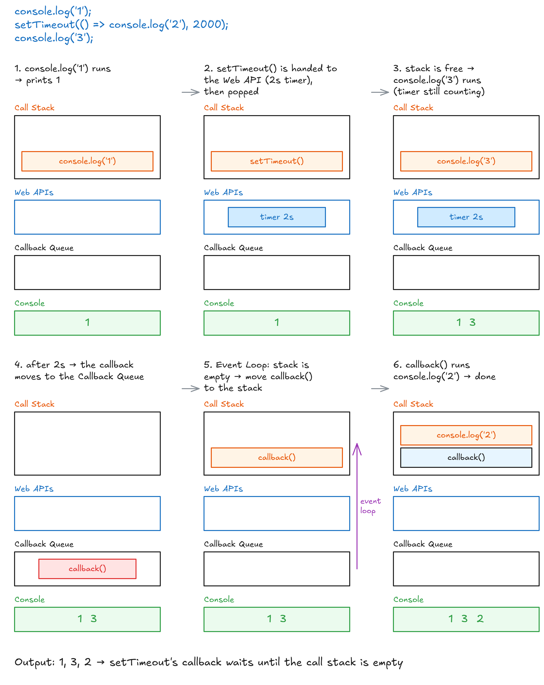

# How JavaScript Works

## Quick Note: Upcoming Video


## Optional: How JavaScript Works

This lecture shows **stacks and queues in real life**: the JavaScript engine uses a **stack** to run your code and a **queue** to handle tasks that take time. It helps you answer common interview questions like:

- "How does JavaScript work?"
- "What is the difference between synchronous and asynchronous?"
- "JavaScript is a single-threaded language that can be non-blocking. What does that mean?"

### What Does A Program Do?

Every program has to do two things:

1. **Allocate memory**: store things like variables and files.
2. **Parse and execute**: read the code and run it.

### The JavaScript Engine

Each browser has a **JavaScript engine** that reads your JavaScript and turns it into instructions the computer can run. Chrome's engine is called **V8**. The engine has two parts:

- **Memory Heap**: where memory is stored (variables, objects, arrays).
- **Call Stack**: where your code is read and run, one step at a time. It also tells you **where you are** in the program.



### Memory Heap And Memory Leaks

Writing `const a = 1` stores `a` in the memory heap. The heap has a **limited size**.

A **memory leak** happens when memory you no longer use stays in the heap. For example, if you create many big **global variables** and never clean them up, they keep filling the heap until the browser can't work anymore. This is why **global variables are bad**.

### The Call Stack

The call stack is a **stack** (LIFO). When a line runs, it is **pushed** on top. When it finishes, it is **popped** off.

```js
console.log("1");
console.log("2");
console.log("3");
// 1, 2, 3
```

Each `console.log` goes on the stack, runs, and is removed, then the next one goes on.

It gets more interesting when functions call other functions:

```js
function one() {
  two();
}
function two() {
  console.log("4");
}
one(); // 4
```

`one()` is pushed first. Inside it, `two()` is pushed on top. Inside that, `console.log('4')` is pushed on top. The top one finishes first and prints `4`, then each function is popped in reverse order until the stack is empty.



### Single Threaded And Synchronous

- **Single threaded** = JavaScript has only **one call stack**, so it can do only **one thing at a time**.
- Some other languages are **multi-threaded**: they have many call stacks and can do several things at once. That is faster, but it can cause hard problems like **deadlocks**.
- JavaScript stays single threaded because it is **simpler**: there is only one thing to worry about.
- **Synchronous** = line 1 runs, then line 2, then line 3. A line can't start until the one before it has finished.

### Stack Overflow

A **stack overflow** happens when the call stack gets bigger and bigger until there is **no space left**. (Like a memory leak, but for the call stack.)

The easiest way to cause it is **recursion** (a function that calls itself) with no end:

```js
function foo() {
  foo(); // calls itself forever
}
foo(); // RangeError: Maximum call stack size exceeded
```

Every call adds another `foo()` on top, and none of them ever finish, so the stack overflows.



### The Problem With Synchronous Code

Imagine a program with **3 lines** to run, where line 2 is a **huge task**:

<!-- prettier-ignore -->
```js
console.log("1");                         // line 1: runs right away
for (let i = 0; i < 10000000000; i++) {}  // line 2: huge loop, takes a long time
console.log("3");                         // line 3: has to WAIT for line 2
```

- Line 1 runs and prints `1`.
- Line 2 starts the huge loop. The call stack is **busy** with it.
- Line 3 can't start until line 2 finishes, because there is only **one** call stack.

On a website, this means the page **freezes**: the user can't click, scroll or type until line 2 is done.

Think of a buffet line: if one person takes forever filling their plate, **everyone behind them waits**. We need something **non-blocking**.

### Asynchronous To The Rescue

**Asynchronous** code lets slow tasks happen in the background, so the rest of the code keeps running. It's used for things that take time, like network requests (API calls), talking to a database, reading files and image processing.

```js
console.log("1");
setTimeout(() => {
  console.log("2");
}, 2000); // wait 2 seconds
console.log("3");
// 1, 3, 2
```

`'2'` comes **last**, even though it's written in the middle. To see why, we need the bigger picture.

### The JavaScript Runtime Environment

The engine alone isn't enough. The browser gives a **runtime environment** with extra parts around the engine:

| Part               | What it does                                                                                   |
| ------------------ | ---------------------------------------------------------------------------------------------- |
| **Web APIs**       | Tools the **browser** gives us, not part of JavaScript itself: DOM, AJAX / fetch, `setTimeout`. |
| **Callback Queue** | A **queue** (FIFO) where finished callbacks wait their turn.                                   |
| **Event Loop**     | Keeps checking: "Is the call stack empty?" If yes, it moves the first callback from the queue to the stack. |



### Step By Step: Why Is It 1, 3, 2?

1. `console.log('1')` goes on the stack and runs → prints **1**.
2. `setTimeout()` goes on the stack. It's a **Web API**, so it's handed to the browser, which starts a 2-second timer. Then `setTimeout()` is popped.
3. The stack is free, so `console.log('3')` runs → prints **3**. The timer is still counting in the background.
4. After 2 seconds, the timer is done. Its **callback** (the function with `console.log('2')`) moves into the **callback queue**.
5. The **event loop** sees the call stack is empty, so it moves the callback onto the stack.
6. The callback runs `console.log('2')` → prints **2**. Everything is empty again.



### What If The Timeout Is 0?

```js
console.log("1");
setTimeout(() => {
  console.log("2");
}, 0); // 0 seconds
console.log("3");
// still 1, 3, 2
```

Even with 0 seconds, the callback still goes through the **Web API → callback queue → event loop**. By then, `console.log('3')` has already run. The callback only runs once the call stack is **empty**. (Common interview question.)

### Synchronous VS Asynchronous: Phone Call VS Text

- **Synchronous** = you **call** your teacher with a question and wait on the phone until they answer. You can't do anything else while you wait.
- **Asynchronous** = you **text** your teacher. You go do other things, and when the teacher has time, they **call you back** with the answer. That's why it's called a **callback** function, and why it waits in the **callback queue**.

Real example: if a website loads your latest tweets **synchronously**, the page freezes until they arrive. **Asynchronously**, the page works while the tweets load.

**Event listeners work the same way:**

```js
element.addEventListener("click", function () {
  console.log("click");
});
```

The callback waits. Every time a click happens, it goes through the callback queue and runs when the stack is free (`onClick`, `onLoad`, `onDone` in the diagram).

### Where Stacks And Queues Appear

| Part           | Data structure | Why                                                          |
| -------------- | -------------- | ------------------------------------------------------------ |
| Call Stack     | **Stack** (LIFO) | The last function called is the first to finish.            |
| Callback Queue | **Queue** (FIFO) | The first callback ready is the first to run.                |

> **Key idea:** JavaScript is single threaded (one call stack, one thing at a time) but non-blocking. Slow tasks are handed to Web APIs, their callbacks wait in the callback queue, and the event loop moves them to the call stack only when it's empty.
