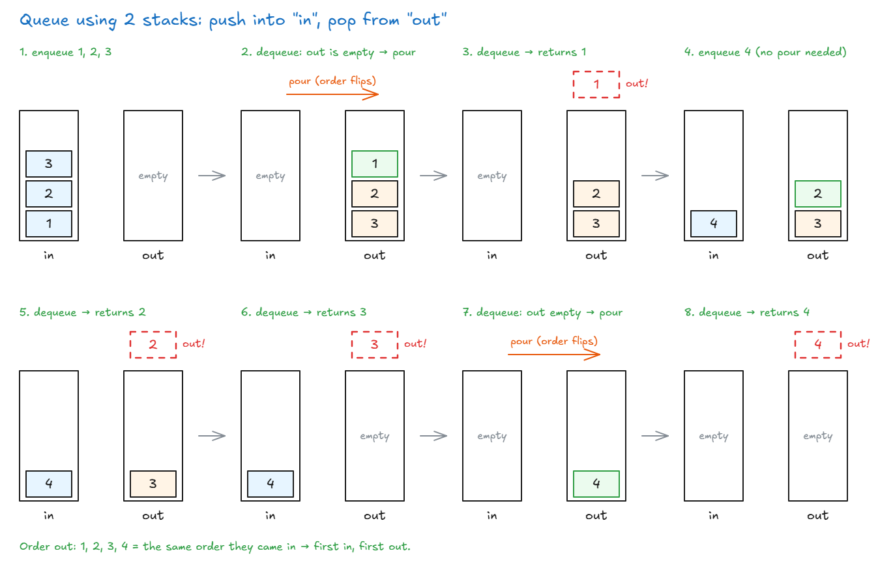

# Queues Using Stacks

## Queues Using Stacks

- **Task:** build a queue (first in, first out) using only stacks. You may only use `push`, `pop`, `peek`, `length` on each stack.
- **Problem:** a stack gives back the **newest** item first. A queue must give back the **oldest** item first.
- **Trick:** use **2 stacks**. Pouring one stack into another **flips the order**, so the oldest item ends up on top.

<!-- prettier-ignore -->
```js
class QueueClass {
  constructor() {
    this.inStack = [];                // new items go here
    this.outStack = [];               // items leave from here
  }

  enqueue(value) {
    this.inStack.push(value);
  }

  dequeue() {
    this.moveIfNeeded();
    if (this.outStack.length === 0) {
      return null;                    // queue is empty
    }
    return this.outStack.pop();
  }

  peek() {
    this.moveIfNeeded();
    if (this.outStack.length === 0) {
      return null;
    }
    return this.outStack[this.outStack.length - 1];
  }

  empty() {
    return this.inStack.length === 0 && this.outStack.length === 0;
  }

  // outStack empty → pour everything from inStack into it (order flips)
  moveIfNeeded() {
    if (this.outStack.length === 0) {
      while (this.inStack.length > 0) {
        this.outStack.push(this.inStack.pop());
      }
    }
  }
}
```



**Reading the picture:**

1. **enqueue 1, 2, 3:** they go into **in**. 1 is at the bottom, 3 is on top.
2. **dequeue:** **out** is empty, so pour **in** into **out**. Each `pop` from in becomes a `push` into out, so the order flips: now **1 is on top**.
3. **dequeue:** pop from **out** → gives back **1**, the oldest. ✅ First in, first out.
4. **enqueue 4:** goes into **in**. **out** still has items (2 is on top), so no pour.
5. **dequeue:** pop from **out** → gives back **2**. 4 waits in **in**.
6. **dequeue:** pop from **out** → gives back **3**. Now **out** is empty.
7. **dequeue:** **out** is empty again, so pour **in** into **out**. 4 moves to **out**.
8. Same dequeue, after the pour: pop from **out** → gives back **4**. Both stacks are empty.

- **Order out: 1, 2, 3, 4** = the same order they came in. First in, first out. ✅

**How it works (like 2 boxes of plates):**

- **enqueue:** put the new plate on the **in** box.
- **dequeue / peek:** take from the **out** box.
- If the **out** box is empty, move every plate from **in** to **out**, one by one. The oldest plate was at the bottom of **in**, so now it's on **top** of **out**.
- Only move when **out** is empty. Moving earlier would mix up the order.

<!-- prettier-ignore -->
```js
const queue = new QueueClass();
queue.enqueue(1);
queue.enqueue(2);
queue.enqueue(3);             // in: [1, 2, 3]   out: []
queue.peek();                 // 1 → moves first: in: []   out: [3, 2, 1]
queue.dequeue();              // 1 → out: [3, 2]
queue.enqueue(4);             // in: [4]   out: [3, 2]
queue.dequeue();              // 2 (out still has items, so no move)
```

| Action    | Big O                                                        |
| --------- | ------------------------------------------------------------ |
| `enqueue` | O(1)                                                         |
| `dequeue` | O(1) usually. O(n) when it has to move everything             |
| `peek`    | Same as `dequeue`                                            |

- Each item is moved **only once** in its life, so on average every action is still **O(1)**.

> **Key idea:** Two stacks make a queue: push into one, pop from the other, and pour across only when the out stack is empty.
