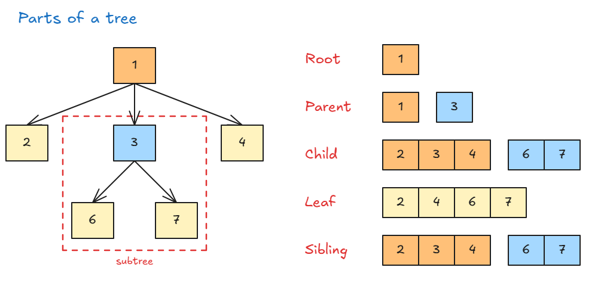

# Trees Introduction

## Trees Introduction

- **Tree:** data is arranged in levels, from top to bottom, like a family tree. Arrays and linked lists are one straight line instead.
- A tree looks like a real tree **upside down**: the root is at the top.
- Each node can have **0 or more children**, and only **1 parent**.
- Arrows go **one way**: from parent down to child. A node doesn't have to point back to its parent.
- There is **one way in**: the root.
- A node can hold any data: numbers, user information, anything.

| Part    | Meaning                              | In the picture     |
| ------- | ------------------------------------ | ------------------ |
| Root    | The top node. Everything starts here | 1                  |
| Parent  | A node that has children             | 1, 3               |
| Child   | A node under a parent                | 2, 3, 4 and 6, 7   |
| Leaf    | A node at the end, with no children  | 2, 4, 6, 7         |
| Sibling | Nodes with the same parent           | 2, 3, 4 and 6, 7   |
| Subtree | A node plus everything under it      | 3, 6, 7            |

**Where trees are used:**

- **Web pages (the DOM):** `html` has children `head` and `body`, and `body` has more children.
- **Chess programs:** try each possible move, then pick the one with the best result.
- **Facebook comments:** a comment can have replies, and replies can have replies.
- **Family trees.**
- **Running code (abstract syntax tree):** your code is broken into a tree so the machine can understand it.

**Linked list vs tree:**

- Both use nodes.
- A linked list is really a type of tree with **only one path**.

**Types of trees:** there are many, but they are small changes of the same idea. This course covers the main ones used in real work and interviews.

> **Key idea:** A tree starts at one root and branches downward. Each node has one parent and can have many children.
