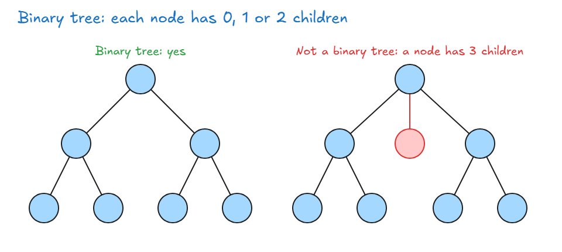
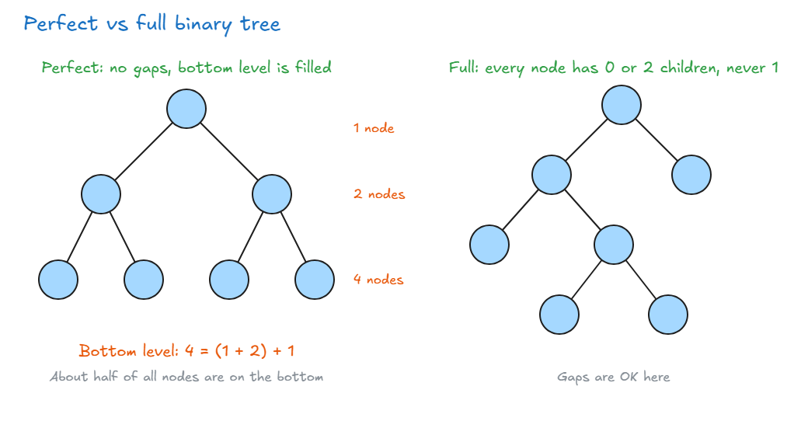
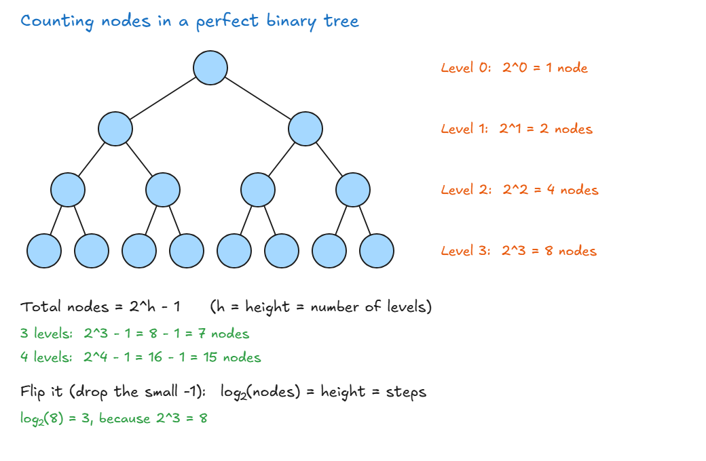
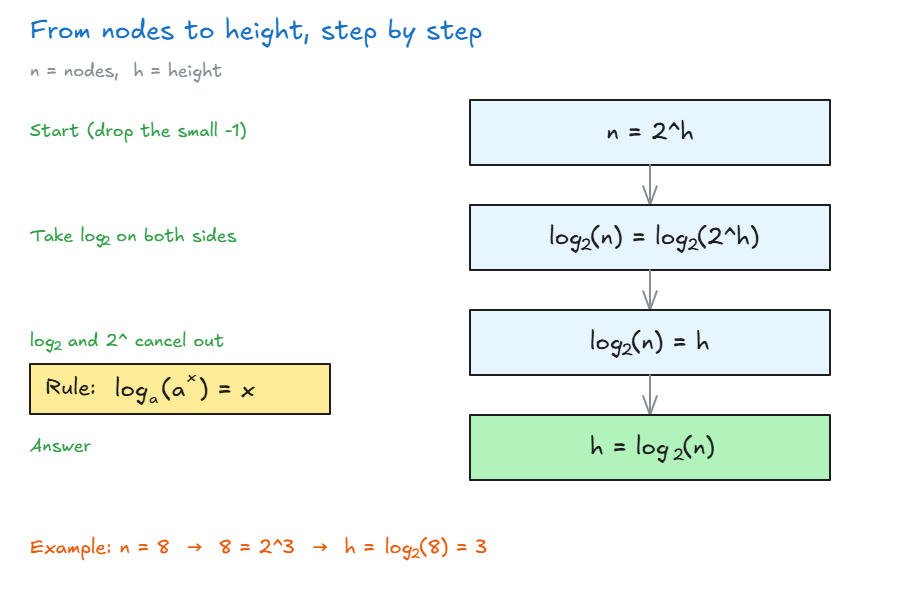
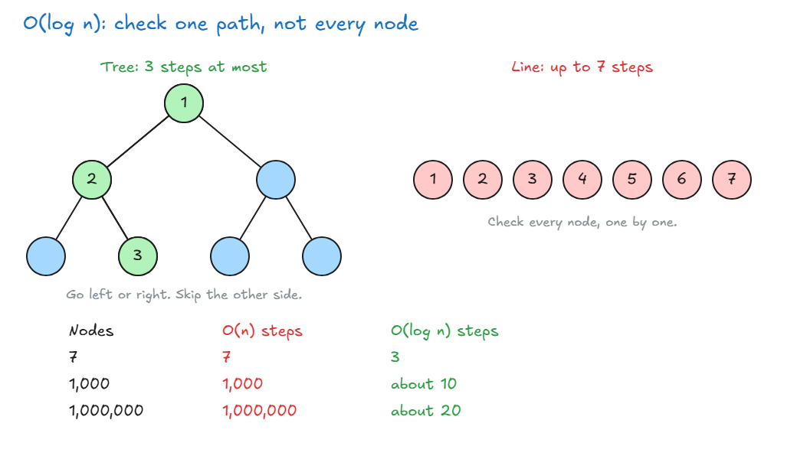

# Binary Trees

## Binary Trees

- **Binary tree:** each node can have **0, 1 or 2 children**, and only **1 parent**.
- If any node has 3 children, it's not a binary tree.



**A node has 3 parts:** a value, a pointer to the left child, and a pointer to the right child. It's the same idea as a linked list node. (Normally we use a class to write this.)

<!-- prettier-ignore -->
```js
function BinaryTreeNode(value) {
  this.value = value;
  this.left = null;     // left child
  this.right = null;    // right child
}
```

**Two types to know:**

| Type    | Rule                                                                  |
| ------- | --------------------------------------------------------------------- |
| Perfect | Every node has 0 or 2 children, and the bottom level is completely filled |
| Full    | Every node has 0 or 2 children, never 1. Gaps are OK                  |



**Why perfect trees are useful:**

- **Each level doubles:** 1 → 2 → 4 → 8 nodes.
- **Nodes on the bottom level = all the nodes above + 1:** 4 = (1 + 2) + 1.
- So **about half of all nodes are on the bottom level**.
- If we can reach the bottom without visiting every node, searching gets much faster. This gives a new Big O: **O(log n)**.

> **Key idea:** A binary tree node has at most 2 children. A perfect binary tree doubles at each level, which leads to O(log n).


## O(log n)

**Counting nodes:** in a perfect binary tree, each level has **2^level** nodes (level 0 is the top).



- **Total nodes = 2^h - 1**, where `h` is the height (number of levels). 3 levels → 8 - 1 = **7 nodes**.
- **Flip it:** `log(nodes) = height`. The `-1` is small, so we drop it.

**What is log?** It asks: "what power gives this number?"

- `log₁₀(100) = 2`, because 10^2 = 100.
- Trees split in 2, so they use base 2: `log₂(8) = 3`, because 2^3 = 8.

**From nodes to height, step by step:** we know the nodes `n` and want the height `h`.



- The rule works because log₂ asks "2 to what power gives this?" For `2^h`, the answer is simply `h`.
- `n = 2^h` and `h = log₂(n)` say the **same thing** in two ways.

| Nodes (`n`) | Same as | Height (`h = log₂(n)`) |
| ----------- | ------- | ---------------------- |
| 8           | 2^3     | 3                      |
| 16          | 2^4     | 4                      |
| 1,024       | 2^10    | 10                     |

- **Double the nodes → only 1 more step.** That's why O(log n) is so fast.

**What O(log n) means:** the most steps you need is the **height** of the tree.



- At each node: "Is this the one?" If not, go **left or right**. You skip the other side.
- 7 nodes → at most **3 steps**, not 7.

**Think of a phone book:**

- You don't read every name. You open near the right letter, then keep narrowing it down.
- This is called **divide and conquer**.

**Why it matters:**

- O(log n) is very fast, and better than O(n).
- Big searches, like Google's, have far too much data to check one by one. Tree structures make them much faster.
- Coming up: **binary search trees**, which make this kind of search possible.

> **Key idea:** O(log n) means you choose one path and skip the rest, so the steps grow very slowly as the data grows.
