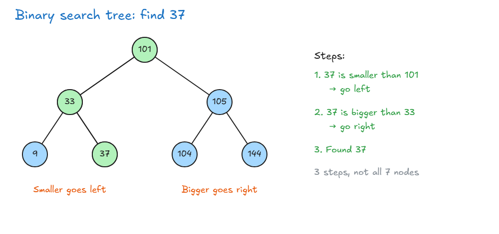
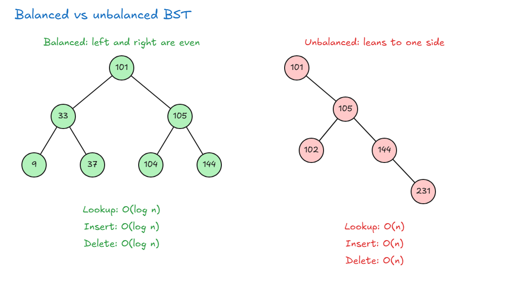

# Binary Search Trees

## Binary Search Trees

- **Binary search tree (BST):** a binary tree that keeps its values in order, so searching is very fast.
- **Why not just use a hash table?** A hash table finds an item fast, but its items are not connected to each other. In a BST, items are connected, like a folder and its subfolders.

**Rules:**

1. For every node:
   - All values on its **left** side are **smaller** than the node.
   - All values on its **right** side are **bigger** than the node.
   - Example: 33 has 9 on its left (9 is smaller than 33) and 37 on its right (37 is bigger than 33).
2. A node can have **at most 2 children**.

| Action | Big O    | Why                                                |
| ------ | -------- | -------------------------------------------------- |
| Lookup | O(log n) | At each node you go left or right, and you skip the other side |
| Insert | O(log n) | You first walk down the tree to find the right place            |
| Delete | O(log n) | You first walk down to find the node, then another node must fill its place |

- **Compared to a hash table:** a hash table can insert and delete in O(1), which is faster than a BST.
- **Deleting a node:** when you remove a node, another node must take its place. For example, if you delete 105, then 144 moves up to its place, and 104 stays on the left of 144.
- In a big tree, more nodes may need to move. We will code this later.

> **Key idea:** In a BST, smaller values are on the left of a node and bigger values are on the right. So at each step, you can skip about half of the tree.

## Balanced VS Unbalanced BST

**The problem:** a BST can become one-sided. If you keep adding bigger numbers, like 86, then 90, then 99, each new node goes to the right of the last one. The tree then looks like a long line, which is really just a linked list.

- **Balanced tree:** the left and right sides are about even. At each node you can skip about half of the tree, so actions are **O(log n)**.
- **Unbalanced tree:** most nodes are on one side, so there is little to skip. You may have to go through every node, so actions become **O(n)**.

| Action | Balanced (average) | Unbalanced (slowest case) |
| ------ | ------------------ | ------------------------- |
| Lookup | O(log n)           | O(n)                      |
| Insert | O(log n)           | O(n)                      |
| Delete | O(log n)           | O(n)                      |

**Interview question: why is an unbalanced BST bad?** It loses its speed. It acts like a linked list, so O(log n) actions become O(n).

**How do we balance a tree?**

- There are special algorithms for this, such as **AVL trees** and **Red Black trees**.
- They are built into most programming languages.
- Interviews usually won't ask you to code this, because it is complicated and takes too long. You only need to know that it exists and be able to talk about the trade-offs.

> **Key idea:** A balanced BST is O(log n). An unbalanced BST acts like a linked list and becomes O(n), so we want to keep trees balanced.

## BST Pros and Cons

| Pros                                                     | Cons                                  |
| -------------------------------------------------------- | ------------------------------------- |
| All actions are faster than O(n), if the tree is balanced | No O(1) actions                       |
| Values are kept in order                                 | Almost every action must walk down the tree |
| Size can grow freely, because nodes can be anywhere in memory |                                  |

**Compared to an array:**

- **Search:** a BST is faster, O(log n). An unsorted array must check every item, O(n).
- **Insert and delete:** a BST is faster, O(log n). An array must shift its items, O(n). The exception is adding to the end of an array, which is O(1) and faster than a BST.

**Compared to a hash table:**

- **Insert and search:** a hash table is faster, O(1). A BST is O(log n).
- **Order and links:** a BST keeps values sorted and has parent and child links. A hash table doesn't give you these.

**A BST isn't the fastest at anything,** but it is good all round. On average, an array or a hash table has faster actions, but a BST can beat them in some cases. To get this good speed, keep the tree balanced.

> **Key idea:** A BST is not the fastest at any one action, but it is fast at all of them, keeps values in order, and can grow freely, as long as it stays balanced.
