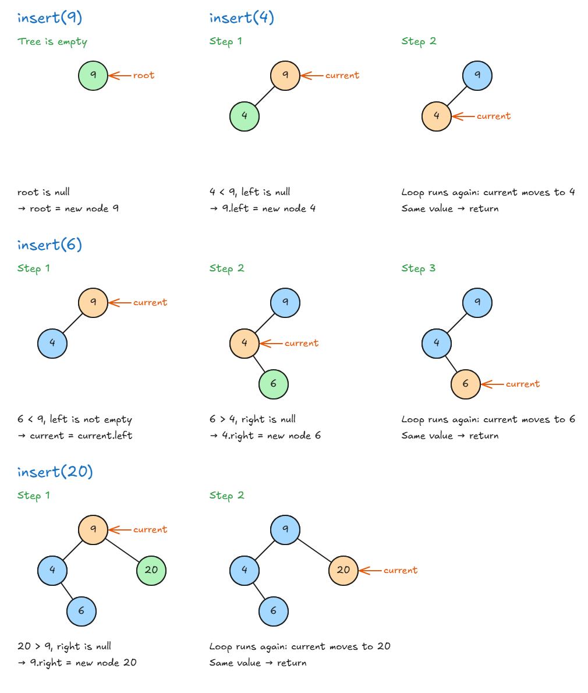
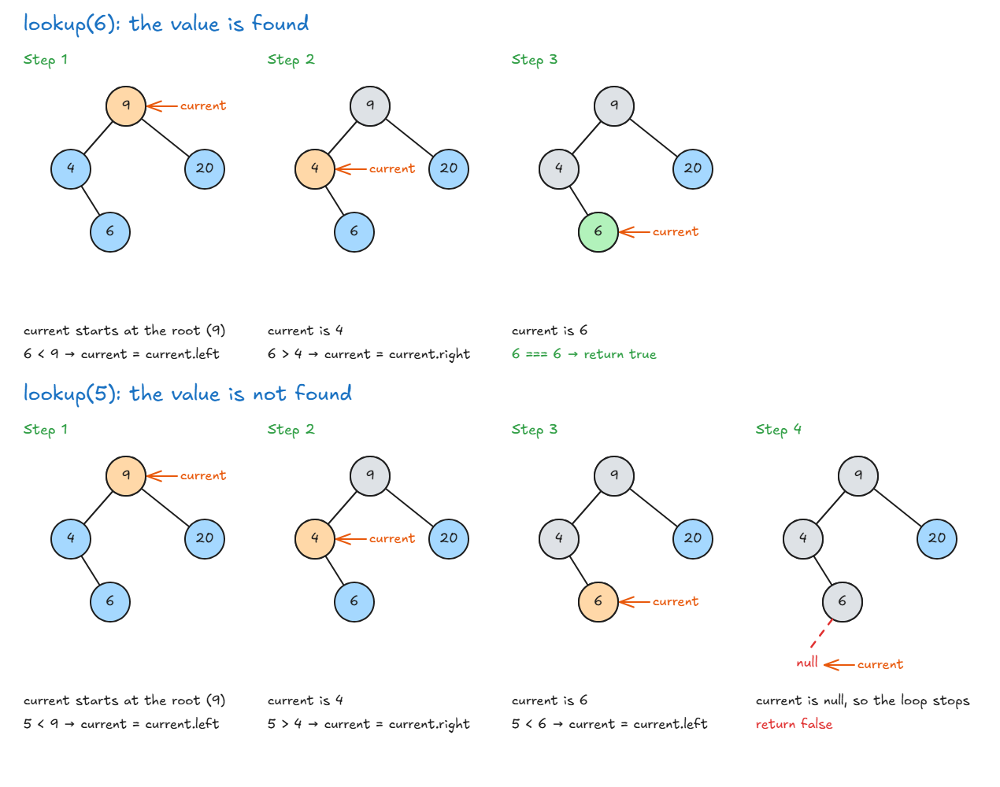

# Implement A Binary Search Tree

## Solution: insert()

- **In real work** you usually use a library for trees. Interviewers mostly want to see that you understand the idea.

<!-- prettier-ignore -->
```js
class NodeClass {
  constructor(value) {
    this.left = null;
    this.right = null;
    this.value = value;
  }
}

class BinarySearchTreeClass {
  constructor() {
    this.root = null;
  }

  insert(value) {
    const newNode = new NodeClass(value);
    let currentNode = this.root;

    if (this.root === null) {
      this.root = newNode;                // empty tree: new node is the root
      return;
    }

    while (true) {                        // walk down until we find a free place
      if (value < currentNode.value) {    // smaller → go left
        if (currentNode.left === null) {
          currentNode.left = newNode;     // free place: add it
        } else {
          currentNode = currentNode.left;
        }
      } else if (value > currentNode.value) { // bigger → go right
        if (currentNode.right === null) {
          currentNode.right = newNode;    // free place: add it
        } else {
          currentNode = currentNode.right;
        }
      } else {
        return;                           // same value: stop the loop
      }
    }
  }
}
```

- **`while (true)`:** we don't know how far down we must go. So we keep looping until `return` stops the loop.
- **How the loop ends:** after adding the new node, the loop runs one more time and moves onto that new node. Its value is the same as `value`, so the last `else` runs `return`.
- **Same value already in the tree:** the last `else` runs `return`, so it isn't added. You can choose what happens here. The lecture's code sends it to the right, so the tree keeps the value **twice**, and it shows up twice when you print the tree.

**Step by step, using the first 4 nodes (9, 4, 6, 20):** orange is where `currentNode` points, and green is the new node.



**Print the tree to check it:**

<!-- prettier-ignore -->
```js
function traverse(node) {
  const tree = { value: node.value };
  tree.left = node.left === null ? null : traverse(node.left);
  tree.right = node.right === null ? null : traverse(node.right);
  return tree;
}

const tree = new BinarySearchTreeClass();
tree.insert(9);
tree.insert(4);
tree.insert(6);
tree.insert(20);
tree.insert(170);
tree.insert(15);
tree.insert(1);
console.log(JSON.stringify(traverse(tree.root)));
//       9
//    4     20
//  1  6  15  170
```

👉 Code file: [code/binary-search-tree.js](code/binary-search-tree.js)

> **Key idea:** To insert, start at the root and go left for smaller or right for bigger, until you find a free place.

## Solution: lookup()

- **Idea:** start at the root. Smaller → go left. Bigger → go right. Stop when you find the value or reach `null`.

<!-- prettier-ignore -->
```js
lookup(value) {
  let currentNode = this.root;

  if (this.root === null) {
    return false;                        // empty tree
  }

  if (currentNode.value === value) {
    return true;                         // found at the root
  }

  while (currentNode) {                  // stops when currentNode is null
    if (value < currentNode.value) {
      currentNode = currentNode.left;    // smaller → move left
    } else if (value > currentNode.value) {
      currentNode = currentNode.right;   // bigger → move right
    } else if (value === currentNode.value) {
      return true;                       // found
    }
  }
  return false;                          // reached null → not in the tree
}
```

**Step by step, using the first 4 nodes (9, 4, 6, 20):** orange is where `currentNode` points now, and grey means already checked.



> **Key idea:** Lookup moves `currentNode` one level down at each step. It returns `true` when the value matches and `false` when it reaches `null`.

## remove()

- **First:** find the node you want to remove, and also remember its parent.
- **Then:** what you do depends on how many children the node has. After removing, smaller values must still be on the left and bigger values on the right.

| Case | The node has | What to do                                                                                      |
| ---- | ------------ | ----------------------------------------------------------------------------------------------- |
| 1    | No children  | Remove it. Set its parent's pointer to `null`                                                   |
| 2    | 1 child      | Connect its parent directly to its child                                                        |
| 3    | 2 children   | Replace its value with one of these, then remove that replacement node: the **inorder successor** (smallest value on its right side) or the **inorder predecessor** (biggest value on its left side) |

**Examples, using this tree:**

```text
       9
    4     20
  1  6  15  170
```

- **Case 1, remove 1:** 1 has no children, so set `4.left = null`.
- **Case 2, remove 20 after 15 is gone:** 20 only has 170, so set `9.right = 170`.
- **Case 3, remove 9, using the inorder successor:** go to the right side of 9. The smallest value there is 15. Put 15 in the place of 9, then remove the old 15.

```text
       15
    4     20
  1  6      170
```

- **Case 3, remove 9, using the inorder predecessor:** go to the left side of 9. The biggest value there is 6. Put 6 in the place of 9, then remove the old 6.

```text
       6
    4     20
  1     15  170
```

- **Why the inorder successor works:** it is bigger than everything on the left, and smaller than everything else on the right.
- **Why the inorder predecessor works:** it is smaller than everything on the right, and bigger than everything else on the left.
- Both keep the tree in the correct order, so you can use either one.

> **Key idea:** To remove a node, find it first. Then remove it directly (no children), connect its parent to its child (1 child), or replace it with its inorder successor or predecessor (2 children).

## Solution: remove()

- **New here:** `parentNode` keeps track of the node above `currentNode`, so we can re-link the nodes after removing one.
- **Interviews:** this is hard, and it is rarely needed. Being able to do `insert` and `lookup` is what matters.

| Option | The node to remove has | Who takes its place |
| ------ | ---------------------- | ------------------- |
| 1      | No right child         | Its left child (or nothing) |
| 2      | A right child with no left child | Its right child |
| 3      | A right child with a left child  | The leftmost node of its right side (the inorder successor) |

<!-- prettier-ignore -->
```js
remove(value) {
  if (this.root === null) {
    return false;                                 // empty tree: nothing to remove
  }
  let currentNode = this.root;
  let parentNode = null;                          // we need the parent to re-link the nodes

  while (currentNode) {
    if (value < currentNode.value) {
      parentNode = currentNode;
      currentNode = currentNode.left;             // smaller → go left
    } else if (value > currentNode.value) {
      parentNode = currentNode;
      currentNode = currentNode.right;            // bigger → go right
    } else if (currentNode.value === value) {
      // We found the node to remove

      // Option 1: no right child → the left child takes its place
      if (currentNode.right === null) {
        if (parentNode === null) {
          this.root = currentNode.left;           // removing the root
        } else if (currentNode.value < parentNode.value) {
          parentNode.left = currentNode.left;     // node was on the parent's left
        } else if (currentNode.value > parentNode.value) {
          parentNode.right = currentNode.left;    // node was on the parent's right
        }

      // Option 2: right child has no left child → the right child takes its place
      } else if (currentNode.right.left === null) {
        currentNode.right.left = currentNode.left; // right child keeps the node's left side
        if (parentNode === null) {
          this.root = currentNode.right;          // removing the root
        } else if (currentNode.value < parentNode.value) {
          parentNode.left = currentNode.right;
        } else if (currentNode.value > parentNode.value) {
          parentNode.right = currentNode.right;
        }

      // Option 3: right child has a left child → the leftmost node takes its place
      } else {
        // Find the leftmost node of the right side (smallest value there)
        let leftmost = currentNode.right.left;
        let leftmostParent = currentNode.right;
        while (leftmost.left !== null) {
          leftmostParent = leftmost;
          leftmost = leftmost.left;
        }

        leftmostParent.left = leftmost.right;     // parent adopts leftmost's right side
        leftmost.left = currentNode.left;         // leftmost takes over the node's children
        leftmost.right = currentNode.right;

        if (parentNode === null) {
          this.root = leftmost;                   // removing the root
        } else if (currentNode.value < parentNode.value) {
          parentNode.left = leftmost;
        } else if (currentNode.value > parentNode.value) {
          parentNode.right = leftmost;
        }
      }
      return true;                                // removed
    }
  }
  return false;                                   // value is not in the tree
}
```

> **Key idea:** Find the node and its parent, choose the node that takes its place, then link the parent to that node.
