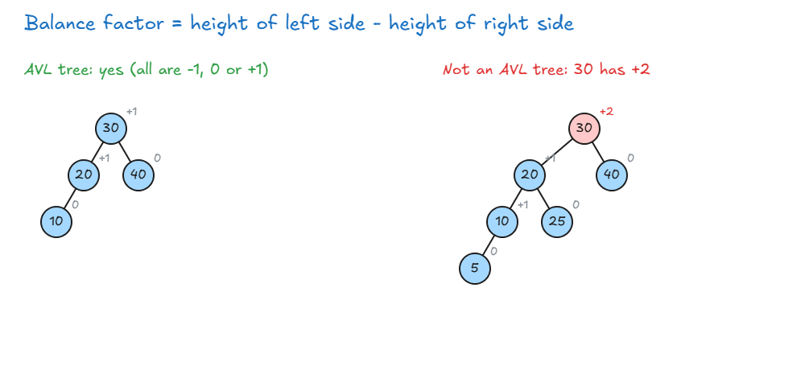
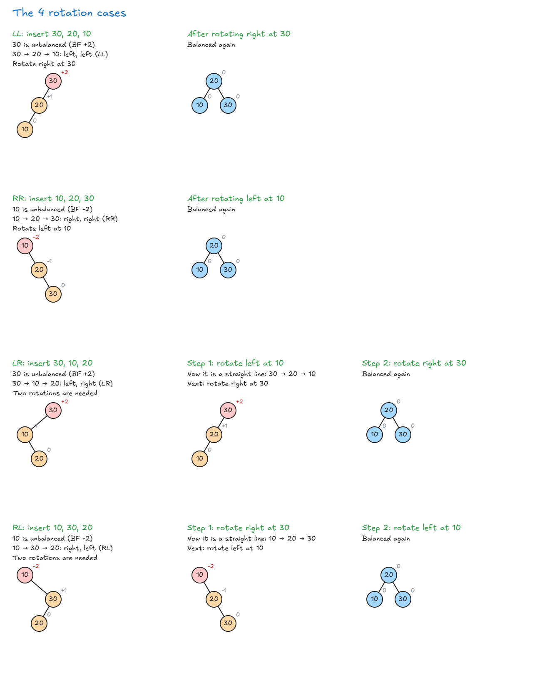
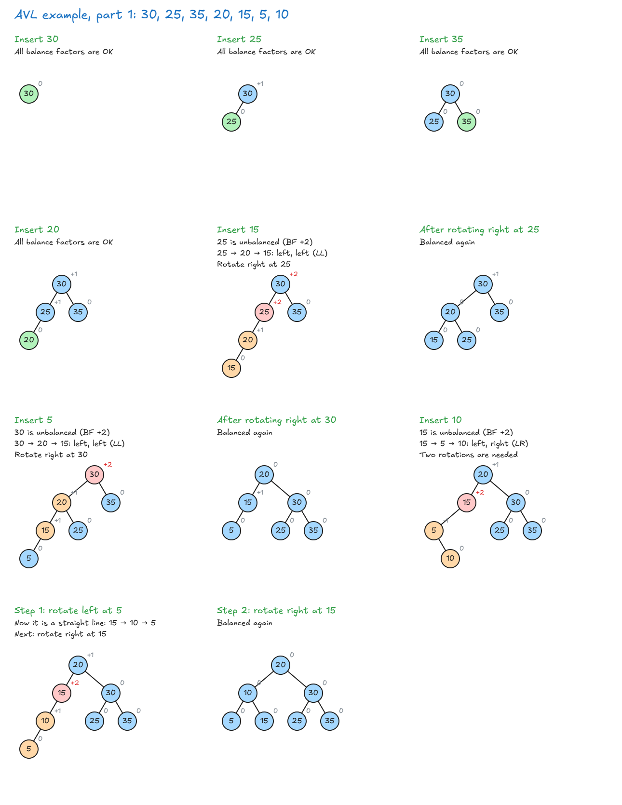
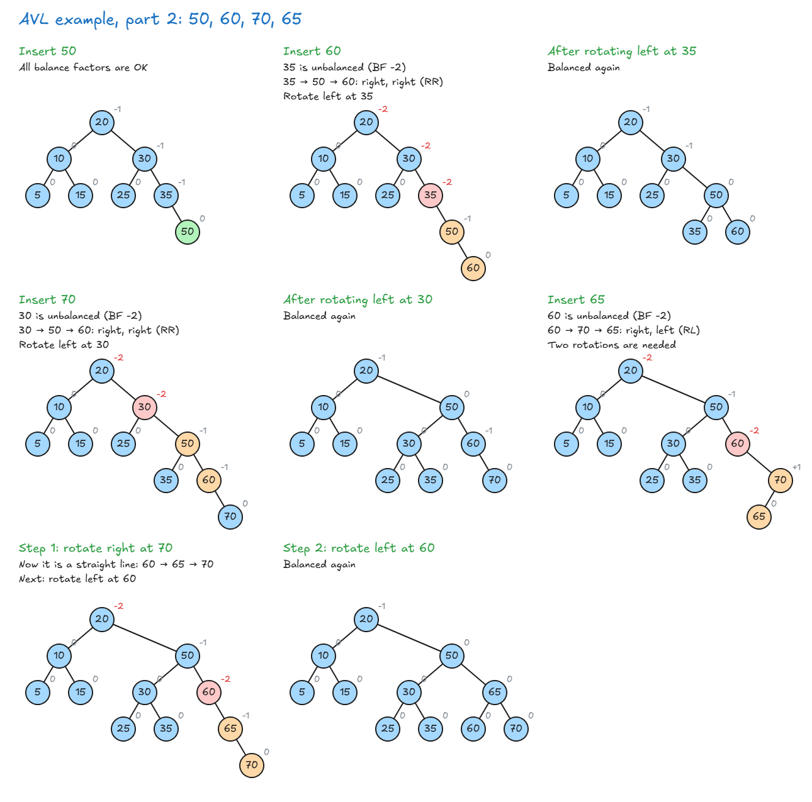
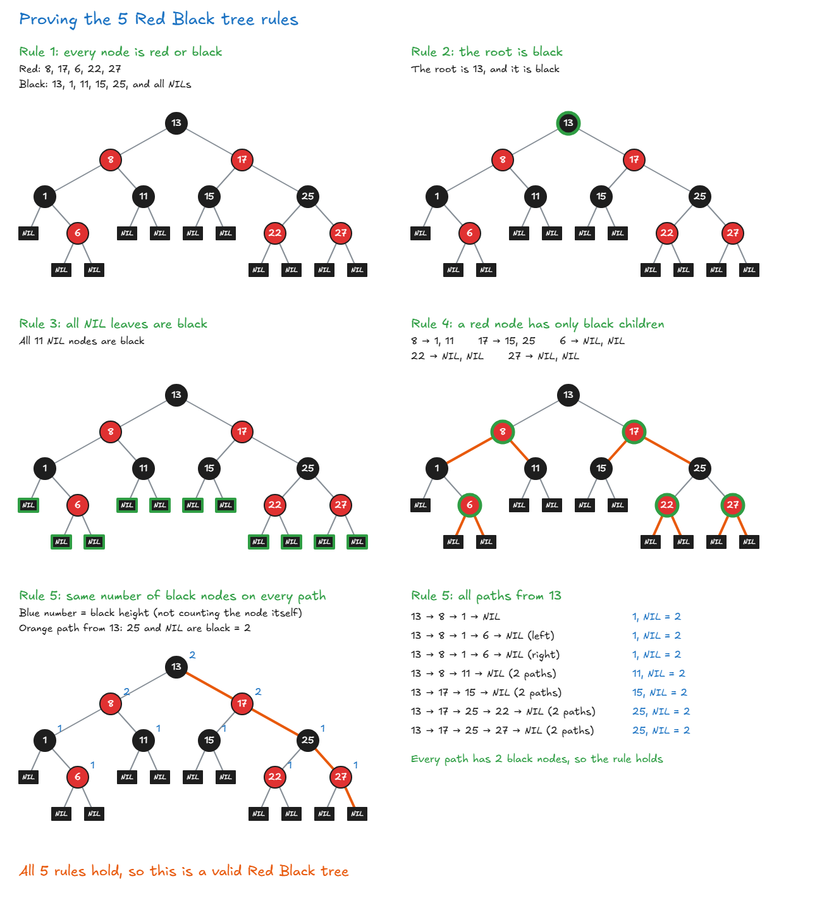
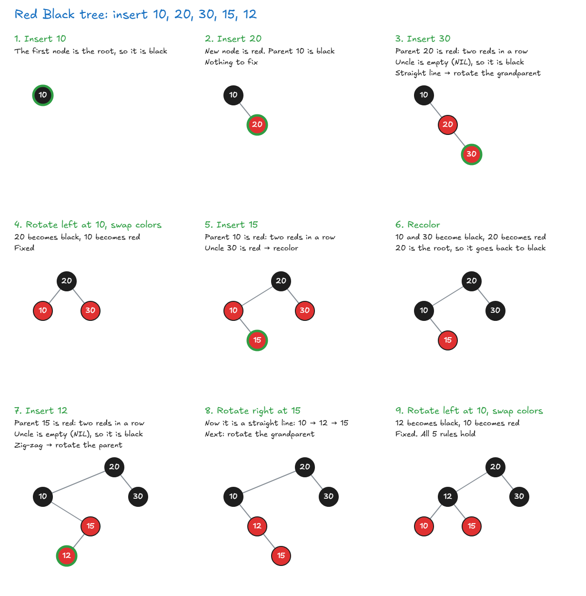

# AVL And Red Black Trees

## AVL Trees + Red Black Trees

- **The problem:** a normal BST can become one-sided and slow, O(n).
- **In real work,** we usually want a tree that stays balanced. The two most popular are **AVL trees** and **Red Black trees**.
- Both **balance themselves automatically** when you add values.

| Tree      | How it balances                                                                                         |
| --------- | ------------------------------------------------------------------------------------------------------- |
| AVL       | After adding a value, it goes back up the tree and does a switch (a **rotation**) if the tree is uneven |
| Red Black | Nodes are colored red or black. The colors help it know when to balance                                 |

**Example:** in an AVL tree, adding 77 may change nothing. Adding 80 next can make the tree uneven, so the tree rotates to fix it.

- **Code:** you usually don't write these yourself, because they are complex. You normally use a library.
- **Interviews:** you won't have to build them. You only need to explain what they are and why they are useful.

> **Key idea:** AVL and Red Black trees are BSTs that balance themselves, so they stay fast and don't become slow, one-sided trees.

## AVL Tree Details

**What is an AVL tree?** It is a binary search tree that fixes itself. After each insert, it checks every node on the way back up. If a node is uneven, the tree rotates to balance it.

**Balance factor (BF):** a number that shows how even a node is.

- `BF = height of left side - height of right side`
- Height here means the number of levels on that side. An empty side has height 0.

**The AVL rule:** every node must follow this:

`|height of left side - height of right side| <= 1`

- The `| |` means "ignore the minus sign". So the balance factor must be **-1, 0 or +1**.
- If any node has +2 or -2, the tree is unbalanced and needs a rotation.



**How to choose the rotation:**

1. Find the **lowest unbalanced node**, starting from the new node and going up. If several nodes are unbalanced, fixing this one fixes the others.
2. Go from that node **toward the new node**. Only look at the **first 2 steps**. They give you the case.
3. Rotate **through the unbalanced node**, using the table below.

| First 2 steps | Case | What to do                                                                |
| ------------- | ---- | ------------------------------------------------------------------------- |
| Left, left    | LL   | Rotate **right** at the unbalanced node                                   |
| Right, right  | RR   | Rotate **left** at the unbalanced node                                    |
| Left, right   | LR   | Rotate **left** at the left child, then **right** at the unbalanced node  |
| Right, left   | RL   | Rotate **right** at the right child, then **left** at the unbalanced node |

**The 4 cases with 10, 20 and 30:** red is the unbalanced node, orange shows the first 2 steps, and the small number beside each node is its balance factor.



### Step By Step Example

Insert: **30, 25, 35, 20, 15, 5, 10, 50, 60, 70, 65**

Green is the new node.





| Insert | Unbalanced node | First 2 steps | Case | Rotation                     |
| ------ | --------------- | ------------- | ---- | ---------------------------- |
| 30     | None            |               |      | None                         |
| 25     | None            |               |      | None                         |
| 35     | None            |               |      | None                         |
| 20     | None            |               |      | None                         |
| 15     | 25              | 25 → 20 → 15  | LL   | Right at 25                  |
| 5      | 30              | 30 → 20 → 15  | LL   | Right at 30                  |
| 10     | 15              | 15 → 5 → 10   | LR   | Left at 5, then right at 15  |
| 50     | None            |               |      | None                         |
| 60     | 35              | 35 → 50 → 60  | RR   | Left at 35                   |
| 70     | 30              | 30 → 50 → 60  | RR   | Left at 30                   |
| 65     | 60              | 60 → 70 → 65  | RL   | Right at 70, then left at 60 |

**Final tree:**

```text
          20
      /        \
    10          50
   /  \       /    \
  5    15   30      65
           /  \    /  \
         25    35 60   70
```

> **Key idea:** Every AVL node must have a balance factor of -1, 0 or +1. If not, take the lowest unbalanced node, look at the first 2 steps toward the new node, and rotate.

## Red Black Tree Details

**Why we need it:** a normal BST can become one-sided, like a linked list. Search then slows from O(log n) to O(n). A tree that balances itself fixes this.

**What is a Red Black tree?** It is a binary search tree where each node also has a color, red or black. The colors and 5 rules keep the tree balanced.

**The 5 rules:**

1. Every node is either **red or black**.
2. The **root** is always **black**.
3. All **leaf nodes (NIL)** are **black**. NIL nodes are empty placeholders at the ends of the tree. They store no data, and diagrams often don't show them.
4. If a node is **red**, both of its children must be **black**. So two red nodes can never be next to each other.
5. From any node, every path down to a NIL node has the **same number of black nodes**.

**Black height:** the number of black nodes on a path from a node down to a NIL node, not counting the node itself. Rule 5 means this number is the same on every path. Example: a black height of 2 means every path down from that node has exactly 2 black nodes.

**Proving the 5 rules with an example tree:**



**Why these rules keep it balanced:** the longest path from the root to a leaf is at most **2 times** the shortest path.

- **Shortest path:** only black nodes.
- **Longest path:** red and black nodes, one after the other.

**AVL vs Red Black:**

|                   | AVL tree             | Red Black tree                   |
| ----------------- | -------------------- | -------------------------------- |
| Balance           | Strict               | Weaker, but good enough          |
| Height            | As small as possible | A little taller                  |
| Insert and delete | More adjustments     | Fewer adjustments                |
| Best when         |                      | Inserts and deletes happen often |

- Because of this, Red Black trees are more common in real-world software.

**Big O:**

| Action | Big O    | How it works                                                            |
| ------ | -------- | ----------------------------------------------------------------------- |
| Search | O(log n) | Same as a normal BST: compare, then go left or right                    |
| Insert | O(log n) | Can break the rules, so it fixes them with **recoloring and rotations** |
| Delete | O(log n) | Can break the rules, so it fixes them with **recoloring and rotations** |

**Where it's used:**

- **Programming languages:** Java's `TreeMap` and `TreeSet`, and C++'s `map` and `set`.
- **Operating systems:** the Linux kernel uses one to manage virtual memory areas, which helps with giving out and freeing memory.
- **Networking:** Linux's IP sets may use one to store and quickly match IP rules.

### How Insert Works

1. Add the new node like in a normal BST, and color it **red**.
2. If its parent is **black**, you are done.
3. If its parent is **red**, that is two reds in a row, which breaks rule 4. Look at the **uncle** (the parent's sibling) to choose the fix:

| Uncle | New node's shape | What to do                                                                                                 |
| ----- | ---------------- | ---------------------------------------------------------------------------------------------------------- |
| Red   | Any              | **Recolor:** parent and uncle become black, grandparent becomes red. Then check again from the grandparent |
| Black | Zig-zag          | **Rotate the parent** to make a straight line. Then do the next row                                        |
| Black | Straight line    | **Rotate the grandparent**, then swap the colors of the old parent and grandparent                         |

4. At the end, make sure the root is **black**.

- **Empty uncle:** an empty place counts as a black NIL node.
- **Short way to remember:** red uncle → recolor. Black uncle → rotate.
- **Rotations:** these are the same left and right rotations as in an AVL tree.

**Example:** the green ring marks the new node.



> **Key idea:** A Red Black tree uses node colors and 5 rules to stay roughly balanced. It keeps O(log n) actions and needs fewer adjustments than an AVL tree when inserting and deleting.
