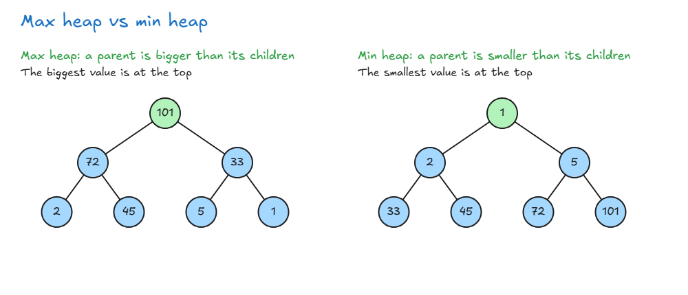
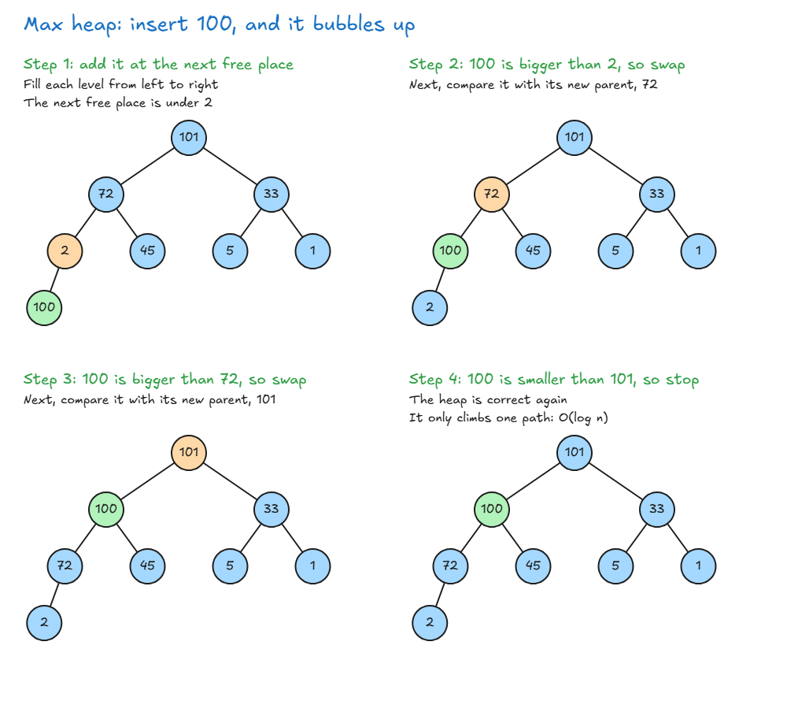
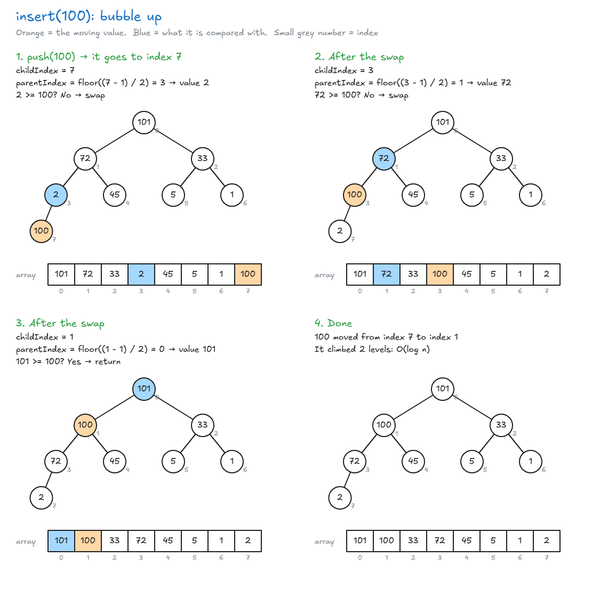
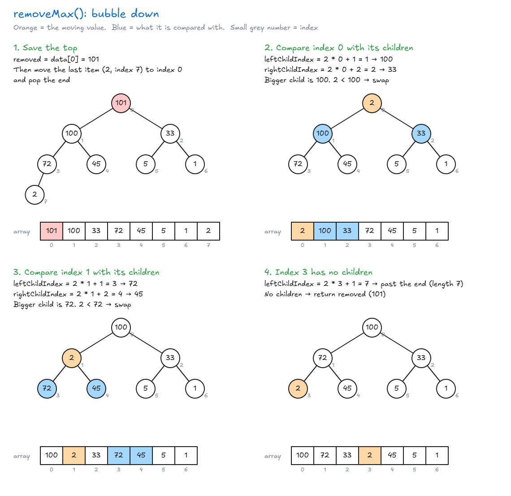

# Binary Heaps

## Binary Heaps

- **Binary heap:** a tree where each node has at most 2 children, and each parent has a higher priority than its children.
- A node can hold anything, such as a number or a person's name.

| Type     | Rule                                  | At the top         |
| -------- | ------------------------------------- | ------------------ |
| Max heap | A parent is **bigger** than its children  | The biggest value  |
| Min heap | A parent is **smaller** than its children | The smallest value |



**Heap vs BST:**

- **BST:** left is smaller and right is bigger, so you know which way to go.
- **Heap:** left and right can be in any order, as long as both follow the parent rule. So you don't know which way to go.
- **Example:** to find 1 in the max heap above, 1 is smaller than everything, so you must check both sides at every level. This is like going through a whole array.

**How insert works:**

1. Add the new value at the **next free place**. Levels fill from left to right. (A new level starts only when the level above is full. Example: in the max heap above, the first 3 levels are full, so a new value starts level 4 and goes on the far left, under 2. The next new value also goes under 2, on its right. Then the next one goes under 45.)
2. Compare it with its parent. If it breaks the rule, **swap** them. This is called **bubbling up**.
3. Repeat until the rule is correct, or it reaches the top.



| Action | Big O    | Why                                       |
| ------ | -------- | ----------------------------------------- |
| Lookup | O(n)     | You may have to check every node          |
| Insert | O(log n) | It climbs at most one path to the top     |
| Delete | O(log n) | Same idea: only one path needs fixing     |

**Where heaps are used:** when order matters and you compare values, such as data storage, priority queues and sorting algorithms.

> **Key idea:** In a heap, a parent always beats its children, so the most important value is at the top. Finding other values is slow, O(n).


## Quick Note on Heaps

**Memory heap and heap data structure are not the same thing.** They only share the same name.

| Name                | What it is                                                    |
| ------------------- | ------------------------------------------------------------- |
| Memory heap         | A free area of memory where a language stores data (JavaScript and C have one) |
| Heap data structure | A tree where a parent beats its children (this lesson)        |

> **Key idea:** A memory heap is a place to store data. A heap data structure is a way to organize data.

## Implement A Binary Heap

- A heap is stored in an **array**, level by level, from left to right.
- Find a node's family with its index `i`:

| To find     | Formula                    |
| ----------- | -------------------------- |
| Left child  | `2 * i + 1`                |
| Right child | `2 * i + 2`                |
| Parent      | `Math.floor((i - 1) / 2)`  |

### My Version

<!-- prettier-ignore -->
```js
// Max Heap

class HeapClass {
  constructor() {
    this.data = [];
  }

  insert(value) {
    this.data.push(value);                    // add at the next free place
    let childIndex = this.data.length - 1;

    while (true) {
      if (childIndex == 0) {
        return;                               // reached the top
      }

      let parentIndex = Math.floor((childIndex - 1) / 2);

      if (this.data[parentIndex] >= this.data[childIndex]) {
        return;                               // parent is bigger: done
      }

      // swap with the parent and move up
      let temp = this.data[parentIndex];
      this.data[parentIndex] = this.data[childIndex];
      this.data[childIndex] = temp;
      childIndex = parentIndex;
    }
  }

  removeMax() {
    const removed = this.data[0];             // the max is always at the top

    this.data[0] = this.data[this.data.length - 1]; // move the last item to the top (the rightmost item on the bottom level goes to the top, like moving the last array item to the first place)
    this.data.pop();

    let parentIndex = 0;

    while (true) {
      let leftChildIndex = parentIndex * 2 + 1;
      let rightChildIndex = parentIndex * 2 + 2;

      if (
        leftChildIndex > this.data.length - 1 &&
        rightChildIndex > this.data.length - 1
      ) {
        return removed;                       // no children: done
      }

      let biggerChildIndex;

      if (this.data[rightChildIndex] === undefined) {
        // A missing array item is undefined, not null
        biggerChildIndex = leftChildIndex;    // only a left child
      } else if (this.data[leftChildIndex] > this.data[rightChildIndex]) {
        biggerChildIndex = leftChildIndex;
      } else {
        biggerChildIndex = rightChildIndex;
      }

      if (this.data[parentIndex] < this.data[biggerChildIndex]) {
        // swap with the bigger child
        let temp = this.data[parentIndex];
        this.data[parentIndex] = this.data[biggerChildIndex];
        this.data[biggerChildIndex] = temp;
      }

      parentIndex = biggerChildIndex;         // move down
    }
  }
}
```

**insert, step by step:** insert 100 into `[101, 72, 33, 2, 45, 5, 1]`.



**removeMax, step by step:** remove from the heap above.



### A Simpler Version

- `peek` returns the top without removing it.
- `while (index > 0)` stops at the top, so no extra `if` is needed.
- **removeMax:** start with `bigger = index`, then check each child **only if it exists**. If neither child is bigger, `bigger` stays the same, so stop.
- `[a, b] = [b, a]` swaps two values in one line.

<!-- prettier-ignore -->
```js
class HeapClass {
  constructor() {
    this.data = [];
  }

  peek() {
    return this.data[0];                      // the max, O(1)
  }

  insert(value) {
    this.data.push(value);
    let index = this.data.length - 1;

    while (index > 0) {                       // stop at the top
      const parentIndex = Math.floor((index - 1) / 2);
      if (this.data[parentIndex] >= this.data[index]) {
        break;                                // parent is bigger: done
      }
      [this.data[parentIndex], this.data[index]] = [this.data[index], this.data[parentIndex]];
      index = parentIndex;                    // move up
    }
  }

  removeMax() {
    if (this.data.length === 0) {
      return undefined;                       // empty heap
    }
    const max = this.data[0];
    const last = this.data.pop();

    if (this.data.length > 0) {
      this.data[0] = last;                    // move the last item to the top (the rightmost item on the bottom level goes to the top, like moving the last array item to the first place)
      let index = 0;

      while (true) {
        const left = 2 * index + 1;
        const right = 2 * index + 2;
        let bigger = index;

        if (left < this.data.length && this.data[left] > this.data[bigger]) {
          bigger = left;
        }
        if (right < this.data.length && this.data[right] > this.data[bigger]) {
          bigger = right;
        }
        if (bigger === index) {
          break;                              // no bigger child: done
        }
        [this.data[index], this.data[bigger]] = [this.data[bigger], this.data[index]];
        index = bigger;                       // move down
      }
    }
    return max;
  }
}
```

| Action    | Big O    |
| --------- | -------- |
| peek      | O(1)     |
| insert    | O(log n) |
| removeMax | O(log n) |

👉 Code file: [code/binary-heap.js](code/binary-heap.js)

> **Key idea:** A heap lives in an array. Insert adds to the end and bubbles up. removeMax moves the last item to the top and bubbles down.
