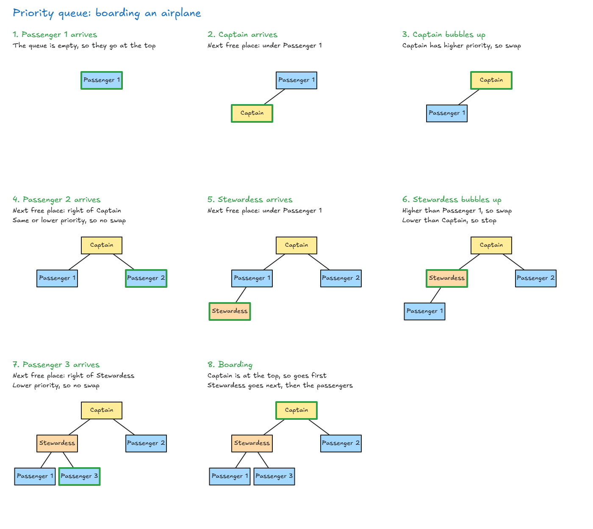
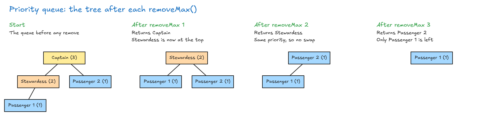

# Priority Queue

## Priority Queue

**More about binary heaps:**

- **Only one promise:** a parent has a higher priority than its children. In a max heap, the parent is bigger. In a min heap, the parent is smaller. Left and right have no order, so 33 and 72 could swap and it would still be a max heap.
- **Always compact:** values fill from left to right, so a heap never becomes unbalanced and never needs rebalancing. It uses the least space possible.
- **Can be built with an array,** instead of nodes like our BST.

**Priority queue:** each item has a priority, and higher priority items are served first, even if they arrive later.

| Type           | Who goes first               | Example                  |
| -------------- | ---------------------------- | ------------------------ |
| Queue          | Whoever came first           | A movie ticket line      |
| Priority queue | Whoever has highest priority | A club letting VIPs in first, or an emergency room treating the most serious patient first |

**Note: two ways to build a priority queue**

- **With a heap:** use **one heap** for all items. The highest priority is always at the top.
- **With queues:** use **many queues**, one for each priority level (for example, one for captains, one for stewardesses and one for passengers). To remove, take from the highest level that isn't empty.
- **The most common way is a heap**, because:
  - It works with any priority values, not just a few levels.
  - Insert and remove are always O(log n).
  - Most languages already have one built in (Java `PriorityQueue`, Python `heapq`, C++ `priority_queue`).
- **Queues only fit a few fixed levels,** like high, medium and low. With priorities from 1 to 1,000,000, you would need a million queues.

**Example: boarding an airplane.** Captain is the highest priority, then stewardess, then passengers. Green marks the person who just moved or arrived.



**Binary heap pros and cons:**

| Good                                                  | Bad         |
| ----------------------------------------------------- | ----------- |
| Better than O(n) for insert and delete                | Slow lookup |
| Knows the priority order                              |             |
| Flexible size                                         |             |
| Fast insert (bubbling up is only sometimes needed)    |             |

- **Find max / find min:** O(1), because the answer is always at the top.
- **BST vs heap:** a BST is much faster for searching. Use a heap when you only care about the biggest or smallest value.

## Priority Queue Using Our Binary Heap

- **The binary heap we already built also works as a priority queue.** Only a small change is needed.
- **The change:** store objects (`{ name, priority }`) instead of plain numbers, and compare their `.priority` instead of the whole value.

| Before                                          | After                                                             |
| ----------------------------------------------- | ----------------------------------------------------------------- |
| `this.data[parentIndex] >= this.data[childIndex]` | `this.data[parentIndex].priority >= this.data[childIndex].priority` |
| `this.data[leftChildIndex] > this.data[rightChildIndex]` | `this.data[leftChildIndex].priority > this.data[rightChildIndex].priority` |
| `this.data[parentIndex] < this.data[biggerChildIndex]` | `this.data[parentIndex].priority < this.data[biggerChildIndex].priority` |

- Bubbling up and bubbling down stay exactly the same.

**Full code:**

<!-- prettier-ignore -->
```js
class PriorityQueueClass {
  constructor() {
    this.data = [];
  }

  insert(name, priority) {
    this.data.push({ name, priority });       // add at the next free place
    let childIndex = this.data.length - 1;

    while (true) {
      if (childIndex == 0) {
        return;                               // reached the top
      }

      let parentIndex = Math.floor((childIndex - 1) / 2);

      if (this.data[parentIndex].priority >= this.data[childIndex].priority) {
        return;                               // parent has higher priority: done
      }

      // swap with the parent and move up
      let temp = this.data[parentIndex];
      this.data[parentIndex] = this.data[childIndex];
      this.data[childIndex] = temp;
      childIndex = parentIndex;
    }
  }

  removeMax() {
    if (this.data.length === 0) {
      return undefined;                       // empty queue
    }

    const removed = this.data[0];             // highest priority is always at the top

    this.data[0] = this.data[this.data.length - 1]; // move the last item to the top (the rightmost item on the bottom level goes to the top, like moving the last array item to the first place)
    this.data.pop();

    let parentIndex = 0;

    while (true) {
      let leftChildIndex = parentIndex * 2 + 1;
      let rightChildIndex = parentIndex * 2 + 2;

      if (leftChildIndex > this.data.length - 1) {
        return removed;                       // no children: done
      }

      let biggerChildIndex;

      if (this.data[rightChildIndex] === undefined) {
        biggerChildIndex = leftChildIndex;    // only a left child
      } else if (this.data[leftChildIndex].priority > this.data[rightChildIndex].priority) {
        biggerChildIndex = leftChildIndex;
      } else {
        biggerChildIndex = rightChildIndex;
      }

      if (this.data[parentIndex].priority >= this.data[biggerChildIndex].priority) {
        return removed;                       // parent already wins: done
      }

      // swap with the higher-priority child and move down
      let temp = this.data[parentIndex];
      this.data[parentIndex] = this.data[biggerChildIndex];
      this.data[biggerChildIndex] = temp;
      parentIndex = biggerChildIndex;
    }
  }
}

const airplane = new PriorityQueueClass();
airplane.insert("Passenger 1", 1);
airplane.insert("Captain", 3);
airplane.insert("Passenger 2", 1);
airplane.insert("Stewardess", 2);

console.log(airplane.removeMax().name); // Captain
console.log(airplane.removeMax().name); // Stewardess
console.log(airplane.removeMax().name); // Passenger 1 or Passenger 2
```

**The tree after each `removeMax()`:** the number in brackets is the priority.



- **removeMax 2:** Passenger 2 moves to the top. Its child, Passenger 1, has the same priority (1), so no swap is needed.

- **Same priority:** a heap doesn't keep arrival order, so Passenger 1 and Passenger 2 can come out in either order.

> **Key idea:** A priority queue serves the highest priority first. A binary heap is great for this, because the top item is always the most important.
