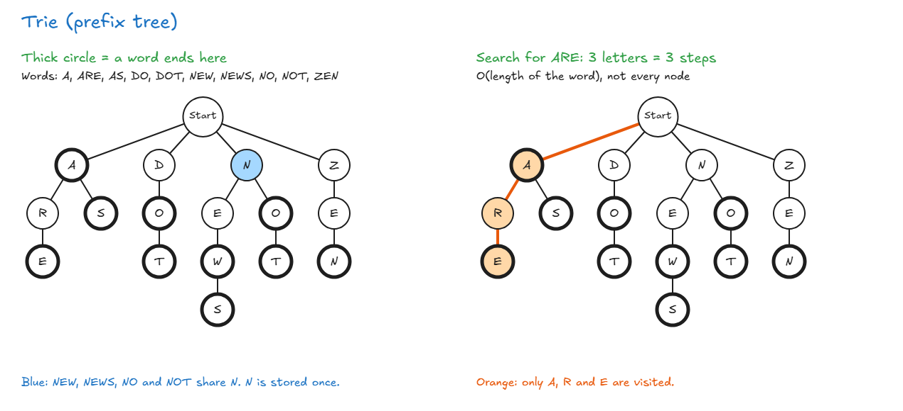
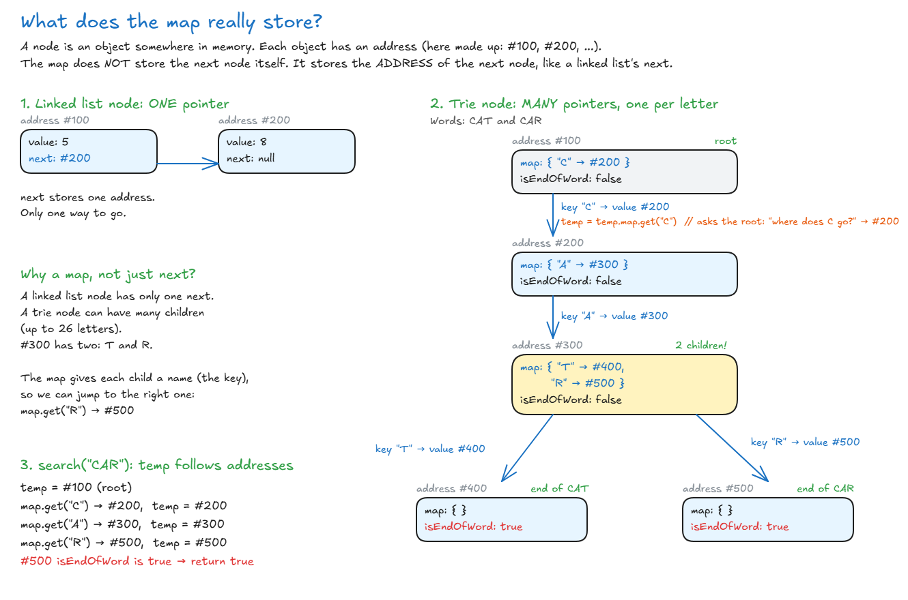

# Trie

## Trie

- **Trie (also called a prefix tree or a digital tree):** a special tree for searching, most often text. It tells you if a word, or the start of a word, exists.
- It starts with an **empty root**, and each node below holds a letter.
- It isn't a binary tree. A node can have many children, up to 26 for the English alphabet.
- **End of a word:** each word's last letter is marked, shown with a thick circle below. That's how the trie can hold both `DO` and `DOT`.



**Why it's useful:**

- **Speed:** finding a word takes **O(length of the word)**. Searching for `ARE` only visits A, R and E, not every node.
- **Space:** words that start the same share nodes. `NEW` and `NOT` share one `N`, so it isn't stored twice.
  - **But only the start is shared.** The same letter can still appear in many nodes. Example: in `DOT` and `NOT`, the `O` and `T` are stored twice, because the words start differently.
- **Prefix search:** type `N`, and everything below it is a possible word: `NEW`, `NEWS`, `NO`, `NOT`.

**Where tries are used:**

- Autocomplete, like when a search engine finishes your word
- Searching for words in a dictionary
- IP routing

For this type of search, a trie can be faster than a BST or a hash table.

> **Key idea:** A trie stores words letter by letter and shares the common starts, so finding a word only depends on how long the word is.

## Implement A Trie

- Each node stores 2 things:
  - `map`: a hash map (`Map`) from a letter to the next node. The letter is the **key**, and the child node is the **value**.
  - `isEndOfWord`: `true` if a word ends at this node.
- The root is an empty node. It has no letter.
- `temp` walks down the trie, one letter at a time.

| Method               | What it does                          | Big O            |
| -------------------- | ------------------------------------- | ---------------- |
| `insert(word)`       | Adds a word                           | O(word length)   |
| `search(word)`       | Is this **whole word** in the trie?   | O(word length)   |
| `startsWith(prefix)` | Does **any word** start with this?    | O(prefix length) |

<!-- prettier-ignore -->
```js
class NodeClass {
  constructor() {
    this.isEndOfWord = false;
    this.map = new Map();                    // letter → next node
  }
}

class TrieClass {
  constructor() {
    this.root = new NodeClass();             // empty root
  }

  insert(word) {
    let temp = this.root;

    for (let i = 0; i < word.length; i++) {
      const letter = word[i];

      if (!temp.map.has(letter)) {
        temp.map.set(letter, new NodeClass()); // no path yet: make one
      }
      temp = temp.map.get(letter);           // move down
    }
    temp.isEndOfWord = true;                 // mark the end of the word
  }

  search(word) {
    let temp = this.root;
    for (let i = 0; i < word.length; i++) {
      const letter = word[i];
      temp = temp.map.get(letter);
      if (!temp) {
        return false;                        // path breaks: not here
      }
    }
    return temp.isEndOfWord;                 // must be a whole word
  }

  startsWith(prefix) {
    let temp = this.root;
    for (let i = 0; i < prefix.length; i++) {
      const letter = prefix[i];
      temp = temp.map.get(letter);
      if (!temp) {
        return false;                        // path breaks: no word starts like this
      }
    }
    return true;                             // whole path exists: some word starts like this
  }
}

const trie = new TrieClass();
trie.insert("CAT");
trie.insert("CATTLE");
trie.search("CAT");       // true
trie.search("CATT");      // false (only a path, not a whole word)
trie.startsWith("CATT");  // true
```

**What `temp.map.set(letter, new NodeClass())` does:**

1. `new NodeClass()` makes a new empty node. It lives at some address in memory, like `#200`.
2. `set("C", #200)` saves `"C" → #200` in the current node's map.

- So the map **does** store the letter, as the **key**. The **value** is the address of the child node.
- The child node itself doesn't store a letter.
- **Why a map:** a node can have many children, so each child needs a name (the letter).

**Example with CAT and CAR:** the addresses (#100, #200, ...) are made up, to show the idea.



**`search` vs `startsWith`:** they walk the trie the same way. Only the last line is different:

- `search` returns `temp.isEndOfWord`, because it needs a whole word.
- `startsWith` returns `true`, because the path is enough.

👉 Code file: [code/trie-using-hashmap.js](code/trie-using-hashmap.js)

### Array Version

- Same idea, but each node has an **array of 26 slots** instead of a map. Each slot holds the address of a child node.
- **Letter → slot number:** `charCodeAt(i) - 97` turns `"a"` into 0, `"b"` into 1, and so on up to `"z"`, which is 25.
- Only works for lowercase **a to z**.

```text
Map:    { "c" → #200 }
Array:  [ empty, empty, #200, empty, ... ]   (26 slots, slot 2 = "c")
```

<!-- prettier-ignore -->
```js
class NodeClass {
  constructor() {
    this.isEndOfWord = false;
    this.children = new Array(26);           // one slot per letter: "a" → 0 ... "z" → 25
  }
}

class TrieClass {
  constructor() {
    this.root = new NodeClass();
  }

  insert(word) {
    let temp = this.root;

    for (let i = 0; i < word.length; i++) {
      const index = word.charCodeAt(i) - 97; // letter → number

      if (temp.children[index] === undefined) {
        temp.children[index] = new NodeClass();
      }
      temp = temp.children[index];
    }
    temp.isEndOfWord = true;
  }

  search(word) {
    let temp = this.root;
    for (let i = 0; i < word.length; i++) {
      const index = word.charCodeAt(i) - 97;
      temp = temp.children[index];
      if (temp === undefined) {
        return false;
      }
    }
    return temp.isEndOfWord;
  }

  startsWith(prefix) {
    let temp = this.root;
    for (let i = 0; i < prefix.length; i++) {
      const index = prefix.charCodeAt(i) - 97;
      temp = temp.children[index];
      if (temp === undefined) {
        return false;
      }
    }
    return true;
  }
}
```

| Map version                 | Array version                             |
| --------------------------- | ----------------------------------------- |
| `map.has(letter)`           | `children[index] === undefined`           |
| `map.set(letter, node)`     | `children[index] = node`                  |
| `map.get(letter)`           | `children[index]`                         |
| Any character               | Lowercase a to z only                     |
| Uses space only for letters that exist | Every node has 26 slots, even if empty |

> **Key idea:** Every trie method walks down one letter at a time with `temp`. `insert` makes missing nodes, `search` checks `isEndOfWord` at the end, and `startsWith` only checks that the path exists.
