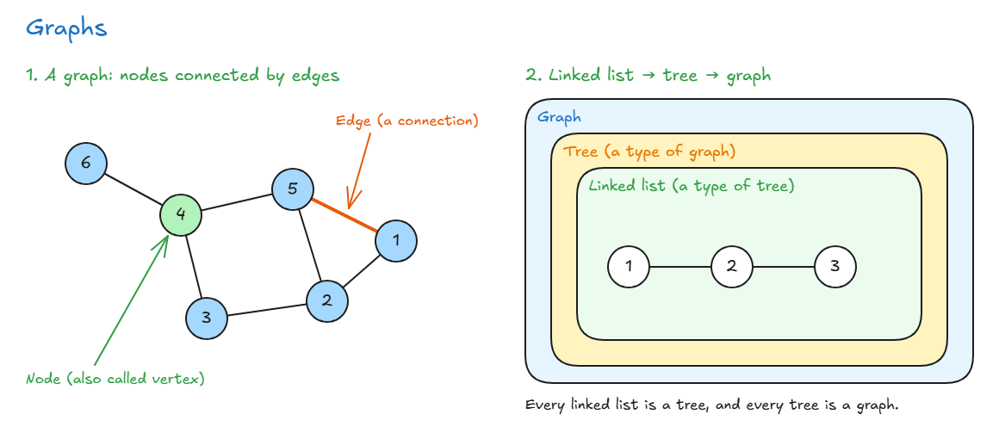
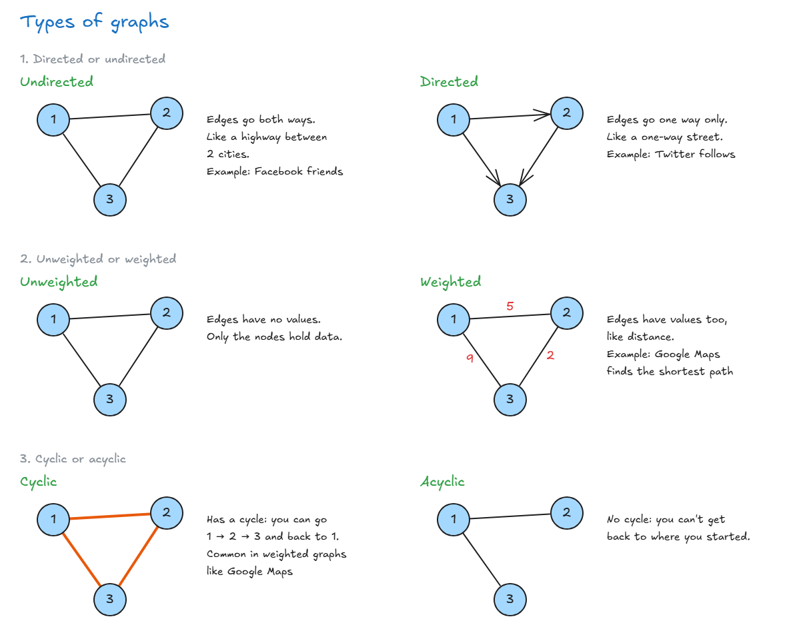
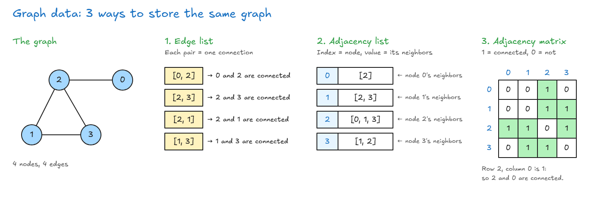

# Graphs Introduction

## Graphs Introduction

- **Graph:** a set of values where items are connected to each other in pairs. It looks like a network.
- **Node (or vertex):** each item in the graph.
- **Edge:** a connection between 2 nodes.
- One of the most used data structures for showing **real-life connections**.



**Where graphs are used:** anything where things connect to other things.

- **Friendships:** Facebook uses a graph for its social network.
- **Roads between cities:** Google Maps uses a graph to find the **shortest path** to where you want to go.
- **Recommendations:** Amazon uses a graph for its recommendation engine.
- Family trees, computer networks and the World Wide Web.

**Graphs include things we already learned:**

- A **linked list** is a type of tree.
- A **tree** is a type of graph.
- So a linked list is also a graph.

> **Key idea:** A graph is nodes connected by edges. It's great for showing real-world connections, and trees and linked lists are special kinds of graphs.

## Types Of Graphs

Graphs are described in 3 ways:

| Type           | Meaning                                           | Example                                                     |
| -------------- | ------------------------------------------------- | ----------------------------------------------------------- |
| **Undirected** | Edges go **both ways**, like a highway            | Facebook: if I'm your friend, you're my friend              |
| **Directed**   | Edges go **one way**, like a one-way street       | Twitter: if you follow me, I don't follow you automatically |
| **Unweighted** | Edges have no values                              |                                                             |
| **Weighted**   | Edges have values too, like distance              | Google Maps finds the shortest path                         |
| **Cyclic**     | You can go around and come back to the start node | Google Maps: there's usually a way back                     |
| **Acyclic**    | You can't get back to the start node              |                                                             |

- **Weighted:** in a graph, data can be stored in the **edges**, not only in the nodes.
- **Cycle:** nodes connected in a circle.



**Best example of a graph:** the internet. A map of the internet (by the Opte Project) shows IP addresses (nodes) connected to other IP addresses (edges).

> **Key idea:** A graph can be directed or undirected, weighted or unweighted, and cyclic or acyclic.

## Graph Data

- Graphs are **built on top of other data structures** we already know, like arrays, objects and linked lists.
- There are **3 ways** to store a graph.



| Way              | How it stores the graph                                   |
| ---------------- | --------------------------------------------------------- |
| Edge list        | A list of pairs. Each pair is one connection              |
| Adjacency list   | Index = the node, value = a list of that node's neighbors |
| Adjacency matrix | A grid of 0s and 1s. 1 means "connected", 0 means "not"   |

<!-- prettier-ignore -->
```js
// Edge list
const graph = [[0, 2], [2, 3], [2, 1], [1, 3]];

// Adjacency list
const graph = [[2], [2, 3], [0, 1, 3], [1, 2]];

// Adjacency matrix
const graph = [
  [0, 0, 1, 0],   // node 0
  [0, 0, 1, 1],   // node 1
  [1, 1, 0, 1],   // node 2
  [0, 1, 1, 0],   // node 3
];
```

- **Objects instead of arrays:** useful when the nodes aren't numbers 0, 1, 2... The key is the node, and the value is its neighbors.

<!-- prettier-ignore -->
```js
// Adjacency list as an object
const graph = {
  0: [2],
  1: [2, 3],
  2: [0, 1, 3],
  3: [1, 2],
};
```

- **Weighted graph:** in a matrix, put the weight (a number) instead of 1. In an edge list or adjacency list, store the weight with each connection.
- **Our own graph** (next lesson) will use an **adjacency list with an object**.
- **See it live:** [VisuAlgo graph](https://visualgo.net/en/graphds) shows all 3 ways side by side.

> **Key idea:** A graph can be stored as an edge list (pairs), an adjacency list (each node's neighbors) or an adjacency matrix (a grid of 0s and 1s).
