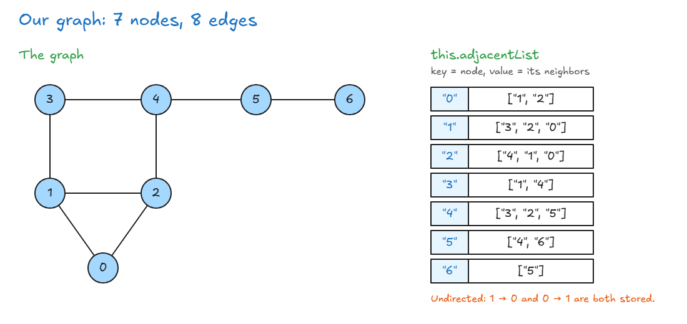

# Implement A Graph

## Solution: Graph Implementation

- Graphs look hard, but they're simple. They're built from things we already know, like **hash tables** (objects) and **arrays**.
- Our graph is **undirected**, and it uses an **adjacency list with an object**.

<!-- prettier-ignore -->
```js
class GraphClass {
  constructor() {
    this.numberOfNodes = 0;
    this.adjacentList = {};                   // node → list of its neighbors
  }

  addVertex(node) {
    if (node in this.adjacentList) {
      return;                                 // node already exists
    }
    this.adjacentList[node] = [];             // new node: no connections yet
    this.numberOfNodes++;
  }

  addEdge(node1, node2) {
    if (!(node1 in this.adjacentList) || !(node2 in this.adjacentList)) {
      return "Invalid Nodes";                 // a node is missing
    }

    // undirected: connect both ways
    this.adjacentList[node1].push(node2);
    this.adjacentList[node2].push(node1);
  }

  showConnections() {
    const allNodes = Object.keys(this.adjacentList);
    for (let node of allNodes) {
      let nodeConnections = this.adjacentList[node];
      let connections = "";
      let vertex;
      for (vertex of nodeConnections) {
        connections += vertex + " ";
      }
      console.log(node + "-->" + connections);
    }
  }
}
```

| Method            | What it does                                                    |
| ----------------- | --------------------------------------------------------------- |
| `addVertex`       | Adds the node as a key, with an empty array, and counts it      |
| `addEdge`         | Adds each node to the other's array (both ways, undirected)     |
| `showConnections` | Prints each node and its neighbors                              |

**Test it:**

<!-- prettier-ignore -->
```js
const myGraph = new GraphClass();
["0", "1", "2", "3", "4", "5", "6"].forEach((node) => myGraph.addVertex(node));
myGraph.addEdge("3", "1");
myGraph.addEdge("3", "4");
myGraph.addEdge("4", "2");
myGraph.addEdge("4", "5");
myGraph.addEdge("1", "2");
myGraph.addEdge("1", "0");
myGraph.addEdge("0", "2");
myGraph.addEdge("6", "5");
myGraph.showConnections();
// 0-->1 2
// 1-->3 2 0
// 2-->4 1 0
// 3-->1 4
// 4-->3 2 5
// 5-->4 6
// 6-->5
```



**Graphs in interviews:**

- **Rare.** Graph questions take time and can get very complex.
- **What you need to know:** the types of graphs, and the 3 ways to store them (edge list, adjacency list, adjacency matrix).
- **Coming later:** the algorithms section covers **breadth first search** and **depth first search**, which work on both graphs and trees.

👉 Code file: [code/graph.js](code/graph.js)

> **Key idea:** A graph is just an object where each node is a key and its value is an array of neighbors. `addEdge` pushes both ways because the graph is undirected.
