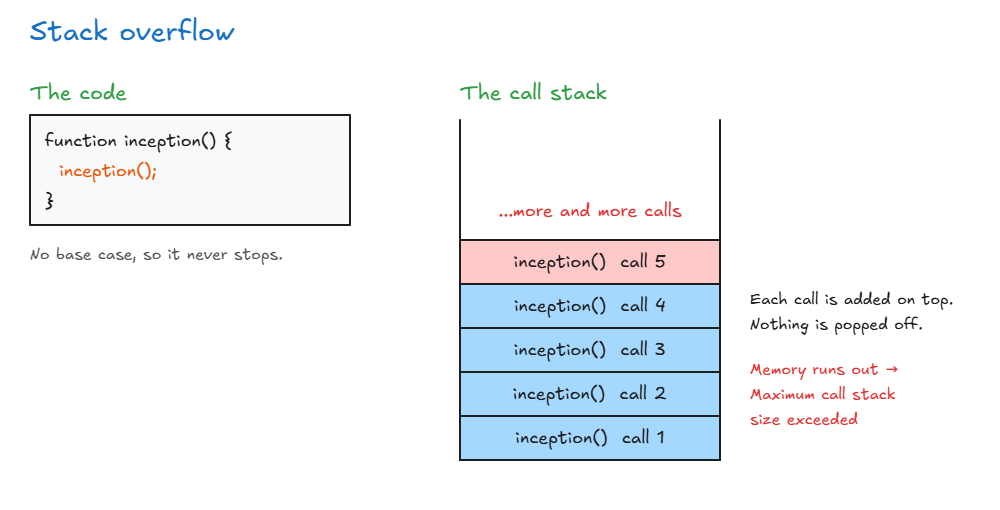

# Recursion Introduction

## Introduction to Algorithms

- **Algorithm:** steps in a process that a computer takes to do a task.
- Underneath, algorithms are just **functions** that programmers write. A 2-line function is an algorithm, and so is a 1000-line one.
- There are too many algorithms to know them all. You can use well-known ones or create your own.
- **Data structures + algorithms = programs.** Algorithms use data structures (arrays, objects, numbers, booleans, or our own classes like stacks and binary search trees) to do actions on data.
- This course covers only the **most common interview algorithms**, the ones that matter most for interviews and your career.

**Why big companies care:**

- Big companies handle **lots of data**, so **scalability** (code that stays fast as data grows) matters.
- The right algorithm can make code faster, for example O(n²) down to **O(n log n)**, or O(n) down to **O(log n)**.

> **Key idea:** An algorithm is just a function: steps to do a task. The right one makes code scale, which is why big companies ask about them.

## Recursion Introduction

- **Recursion:** a function that **calls itself** inside the function.
- It's not really an algorithm. It's a **concept** used in many algorithms, like sorting and searching a tree.
- One of the **most popular interview topics**.
- **Good for:** tasks that have the **same subtask repeated** over and over.

<!-- prettier-ignore -->
```js
function inception() {
  inception();   // calls itself
}
```

**Where recursion is used:**

- **Searching folders:** `ls -R` lists files inside every folder, and inside folders within those (R = recursively).
- **Traversing a tree:** the `traverse` function from our binary search tree calls itself.
- **The DOM:** walking through a web page's HTML.
- **Nested objects:** an object inside an object.

> **Key idea:** Recursion is a function that calls itself. Use it for problems made of the same small task repeated.

## Stack Overflow

- **Stack overflow:** a recursive function keeps calling itself and **never stops**, so the computer runs out of memory.
- Like a tap pouring water into a glass that never stops: the glass overflows.
- In Chrome, you get the error: **`Maximum call stack size exceeded`**. In the past, the browser would just crash.

**Why it's called "stack" overflow:**

- Every function call is added to the **call stack** (you can see it with the `debugger` keyword in Chrome).
- Each new `inception()` call is added **on top** of the old one, but **nothing gets popped off**.
- The stack uses memory, and memory is limited, so it overflows and throws an error.



**Problems with recursion (good interview answer):**

- **Memory:** the computer has to remember every call on the stack, which can get expensive.
- **Stack overflow:** happens when there's no way to stop the recursive calls.
- The fix is a **base case** (next lesson): a check that stops the function from calling itself.

> **Key idea:** Each recursive call is added to the call stack. If the calls never stop, the stack runs out of memory, and that's a stack overflow.
