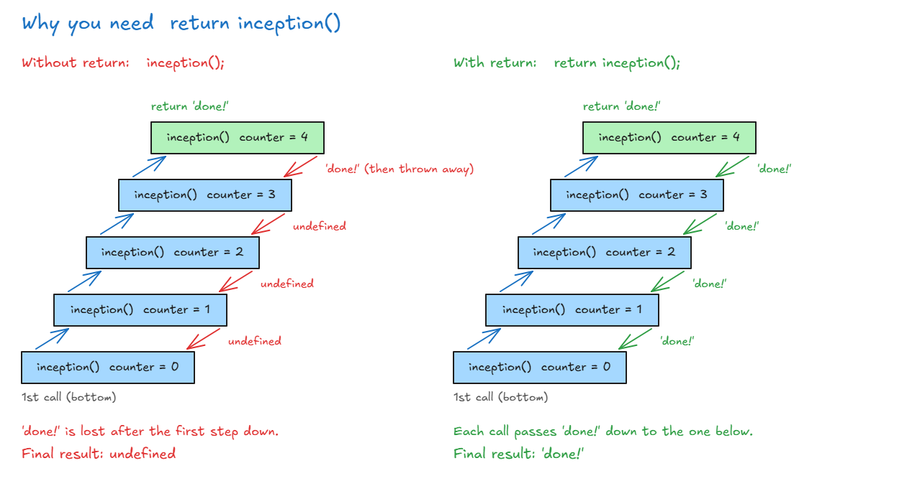
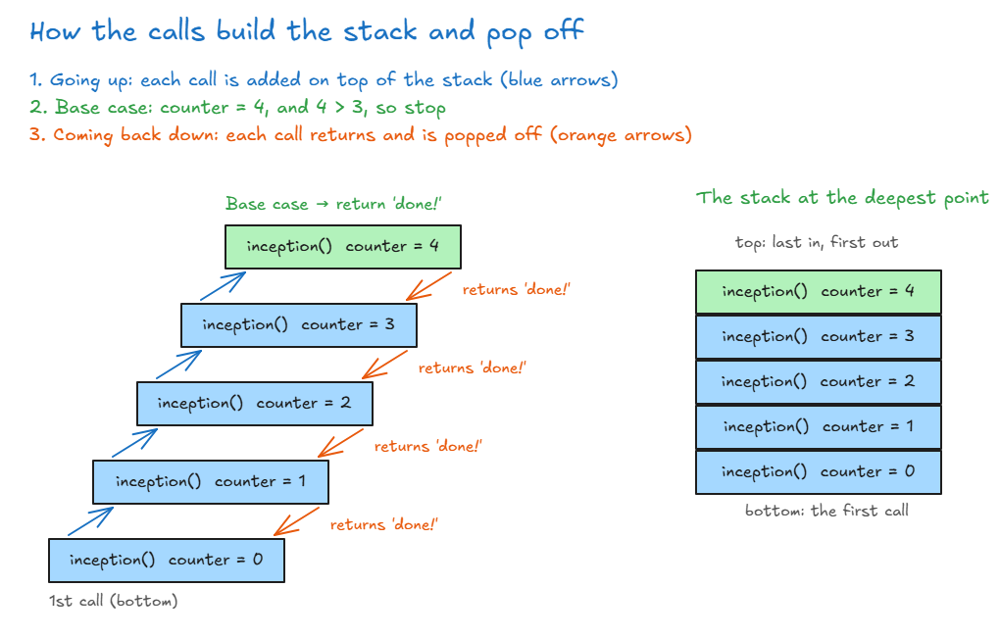

# Anatomy Of Recursion

## Anatomy Of Recursion

Every recursive function has **2 paths**:

| Path               | What it does                  | In the folder example                  |
| ------------------ | ----------------------------- | -------------------------------------- |
| **Base case**      | **Stop** calling the function | No more folders inside, so stop        |
| **Recursive case** | Call the function **again**   | There's another folder, so look inside |

- Without a base case, the function never stops, and you get a **stack overflow**.

### Step 1: No base case → stack overflow

<!-- prettier-ignore -->
```js
function inception() {
  inception();
  console.log("hello");   // never runs
}

inception();
// Maximum call stack size exceeded
```

- The function calls itself on the first line, so it never reaches `console.log`. It just keeps calling itself.

### Step 2: Add a base case (without `return`)

- Add a `counter`. When `counter > 3`, stop and return `"done!"`. Otherwise, add 1 to `counter` and call again.

<!-- prettier-ignore -->
```js
let counter = 0;

function inception() {
  console.log(counter);
  if (counter > 3) {        // base case: stop
    return "done!";
  }
  counter++;                // get closer to the base case
  inception();              // recursive case (no return!)
}

inception();
// 0 1 2 3 4
// undefined   ← why not "done!"?
```

- **No stack overflow:** the function stops, because `counter` grows until it reaches the base case.
- **But the result is `undefined`, not `"done!"`.**

**What happens, step by step (seen with `debugger` in Chrome):**

| Call | `counter` | `counter > 3`? | What happens                    |
| ---- | --------- | -------------- | ------------------------------- |
| 1st  | 0         | No             | `counter` becomes 1, call again |
| 2nd  | 1         | No             | `counter` becomes 2, call again |
| 3rd  | 2         | No             | `counter` becomes 3, call again |
| 4th  | 3         | No             | `counter` becomes 4, call again |
| 5th  | 4         | **Yes**        | **Base case:** `return "done!"` |

- **Going up:** each call is added on top of the **call stack**. The 1st call is at the bottom.
- **Coming back down:** the calls are **popped off** the top of the stack, one by one.
- The 5th call returns `"done!"` to the 4th call. But the 4th call has no `return`, so it returns **`undefined`**. Every call above it returns `undefined` too.

**Think of it as calls inside calls:**

<!-- prettier-ignore -->
```js
inception(inception(inception(inception(inception()))))
// the innermost call (5th) hits the base case and becomes "done!":
inception(inception(inception(inception("done!"))))
// without return, the 4th call ignores "done!" and gives undefined,
// and so does every call above it → undefined
```



### Step 3: Add `return` → `"done!"`

<!-- prettier-ignore -->
```js
let counter = 0;

function inception() {
  console.log(counter);
  if (counter > 3) {        // 1. base case
    return "done!";
  }
  counter++;                // 3. get closer to the base case
  return inception();       // 2. recursive case, with return
}

inception();
// 0 1 2 3 4
// "done!"
```

- `return inception()` makes each call pass the answer up to the one above it. `"done!"` **bubbles up** all the way to the top.

<!-- prettier-ignore -->
```js
inception(inception(inception(inception("done!"))))
inception(inception(inception("done!")))   // 4th returns "done!"
inception(inception("done!"))              // 3rd returns "done!"
inception("done!")                         // 2nd returns "done!"
"done!"                                    // 1st returns "done!"
```



### The 3 rules of recursion

1. **Identify the base case:** when to stop. Here, `counter > 3`.
2. **Identify the recursive case:** when to call itself again. Here, when `counter` is 3 or less.
3. **Get closer and closer to the base case, and return when needed.** Usually you have **2 returns**: one for the base case and one for the recursive case.

> **Key idea:** A recursive function needs a base case (stop) and a recursive case (call again). Each call moves closer to the base case. Then the answer goes back up through every call, so don't forget the `return`.
