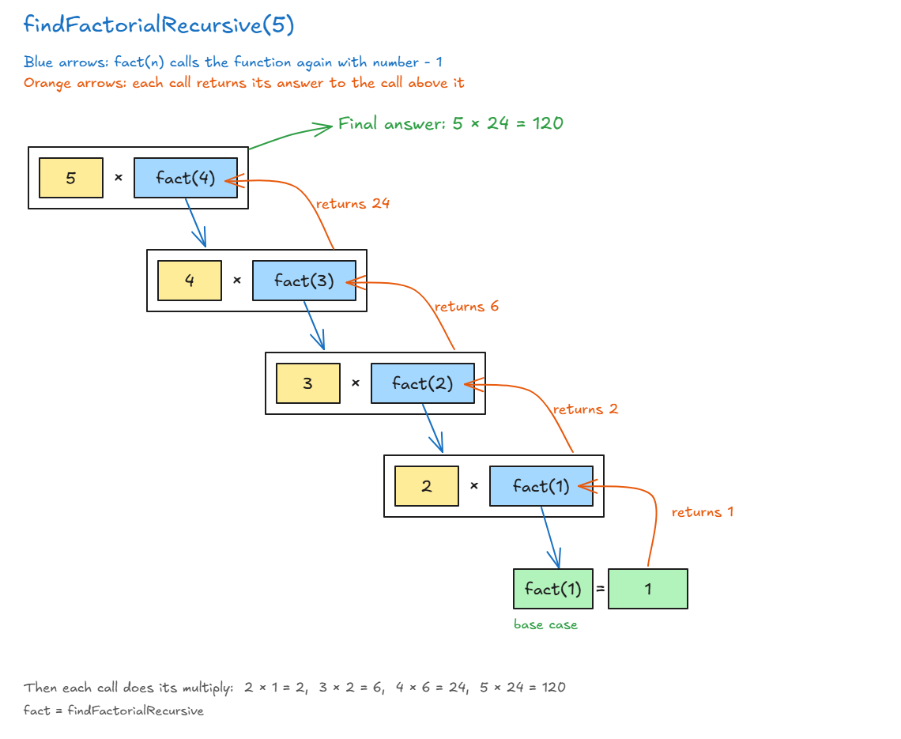

# Factorial

## Exercise: Factorial

- **Factorial (`n!`):** multiply all the whole numbers from `n` down to 1.
- `5! = 5 * 4 * 3 * 2 * 1 = 120`
- **Task:** write 2 functions: `findFactorialRecursive(number)` (with recursion) and `findFactorialIterative(number)` (with a loop).

## Solution: Factorial

### Iterative (loop)

<!-- prettier-ignore -->
```js
function findFactorialIterative(number) {
  // O(n)
  let sum = 1;
  for (let i = 1; i <= number; i++) {   // <= so the number itself is included
    sum = sum * i;
  }
  return sum;
}

findFactorialIterative(5); // 120
```

- Use `i <= number`, not `i < number`. With `<`, 5 is left out and you get **24** instead of 120.
- **Lecture shortcut:** start the loop at `i = 2`, because multiplying by 1 changes nothing (1! = 1 and 2! = 2).

### Recursive

<!-- prettier-ignore -->
```js
function findFactorialRecursive(number) {
  // O(n)
  if (number === 1) {                              // base case: stop
    return 1;
  }
  return number * findFactorialRecursive(number - 1); // recursive case
}

findFactorialRecursive(5); // 120
```

- **Base case:** `number === 1`, so return 1. (The lecture uses `number === 2` and returns 2. Both work.)
- **Recursive case:** `number * findFactorialRecursive(number - 1)`. The number gets **smaller each time** until it reaches the base case.
- **Don't forget the `return`**, so each answer is passed back to the call that made it.



### Big O

| Version   | Time     | Why                                               |
| --------- | -------- | ------------------------------------------------- |
| Iterative | **O(n)** | The loop runs about `n` times                     |
| Recursive | **O(n)** | The function calls itself about `n` times         |

👉 Code file: [code/factorial.js](code/factorial.js)

> **Key idea:** Both versions are O(n). The recursive one makes the number smaller each call until the base case (1), and then multiplies the answers on the way back up.
