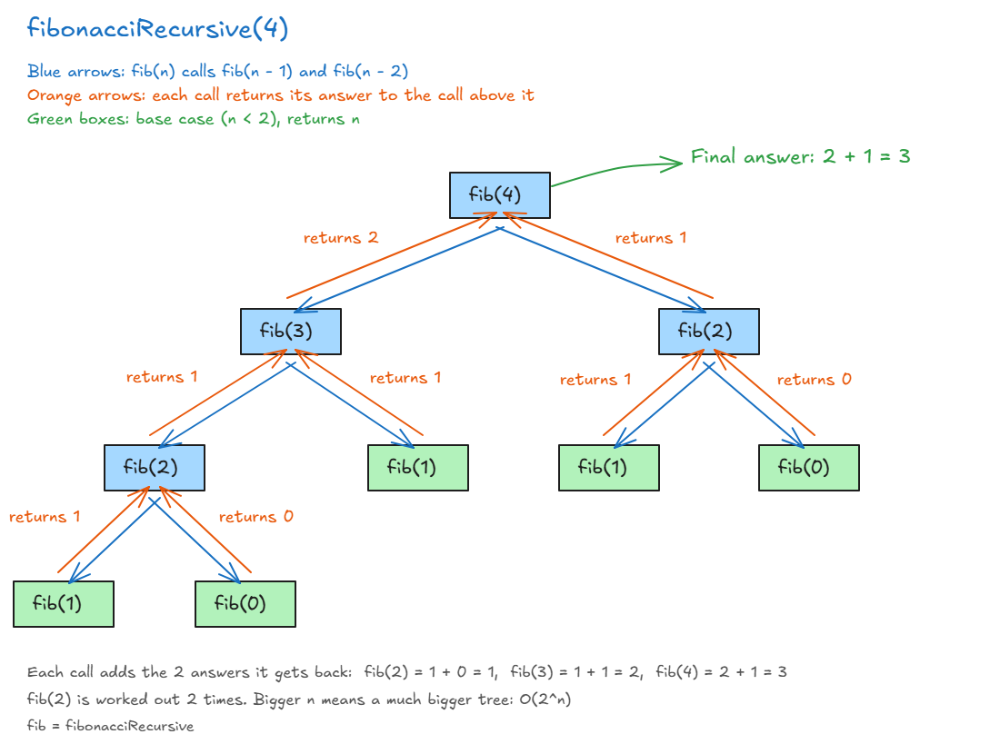

# Fibonacci

## Exercise: Fibonacci

- **Fibonacci sequence:** each number is the sum of the **2 numbers before it**.
- `0, 1, 1, 2, 3, 5, 8, 13, 21, 34, 55, ...`
- **Task:** given an index `n`, return the number at that position. For example, index 8 gives **21**.
- Write 2 functions: `fibonacciRecursive(n)` (with recursion) and `fibonacciIterative(n)` (with a loop).

| Index  | 0 | 1 | 2 | 3 | 4 | 5 | 6 | 7  | 8  |
| ------ | - | - | - | - | - | - | - | -- | -- |
| Number | 0 | 1 | 1 | 2 | 3 | 5 | 8 | 13 | 21 |

## Solution: Fibonacci

### Recursive

<!-- prettier-ignore -->
```js
function fibonacciRecursive(n) {
  // O(2^n)
  if (n == 0) {          // base case
    return 0;
  }
  if (n == 1) {          // base case
    return 1;
  }

  return fibonacciRecursive(n - 1) + fibonacciRecursive(n - 2); // recursive case
}

fibonacciRecursive(8); // 21
```

- **Base case:** index 0 returns 0, and index 1 returns 1.
- **Lecture shortcut:** both base cases in one line: `if (n < 2) return n;`
- **Recursive case:** add the answers for the **2 indexes before** (`n - 1` and `n - 2`).
- Each call makes **2 more calls**, so the calls grow into a **tree**.



### Iterative: my version

<!-- prettier-ignore -->
```js
function fibonacciIterative(n) {
  // O(n)
  let sum;
  let prevSum;
  for (let i = 0; i <= n; i++) {
    if (i === 0) {
      sum = 0;
      prevSum = 0;
    } else if (i === 1) {
      sum = 1;
      prevSum = 0;
    } else {
      let temp = sum;        // save the current number
      sum = sum + prevSum;   // next number = last 2 added
      prevSum = temp;        // move one step forward
    }
  }

  return sum;
}

fibonacciIterative(8); // 21
```

- Keeps only **2 numbers**: the current one (`sum`) and the one before it (`prevSum`).
- Use `i === 0`, not `i = 0`. A single `=` sets `i` back to 0, so the loop never ends.

### Iterative: lecture version (array)

<!-- prettier-ignore -->
```js
function fibonacciIterative(n) {
  // O(n)
  let arr = [0, 1];                  // first 2 numbers already filled in
  for (let i = 2; i < n + 1; i++) {  // start at index 2
    arr.push(arr[i - 2] + arr[i - 1]); // add the 2 numbers before
  }
  return arr[n];
}

fibonacciIterative(8); // 21
```

- Start the array with `[0, 1]`, so indexes 0 and 1 are already done.
- The loop fills in the rest, then returns `arr[n]`.

### Big O

| Version   | Time         | Why                                                         |
| --------- | ------------ | ----------------------------------------------------------- |
| Iterative | **O(n)**     | The loop runs about `n` times                               |
| Recursive | **O(2^n)**   | Each call makes 2 more calls, so the tree doubles at each level |

- **O(2^n), exponential time:** every extra step in `n` roughly **doubles** the number of function calls.
- It's even worse than **O(n²)** (2 nested loops).
- The recursive version **repeats work**. In the diagram, `fib(2)` is worked out 2 times.
- **Test:** `fibonacciRecursive(40)` already takes a long time, and `fibonacciRecursive(43)` takes even longer. The iterative version is instant.
- The recursive version is **easier to read**, but it's **slow**.
- **Later in the course:** dynamic programming and memoization can make the recursive version **O(n)**.

👉 Code file: [code/fibonacci.js](code/fibonacci.js)

> **Key idea:** Recursive Fibonacci is short and easy to read, but it's O(2^n) because each call makes 2 more calls and repeats work. Iterative Fibonacci is O(n).

## Actual Recursion Execution Step by Step


