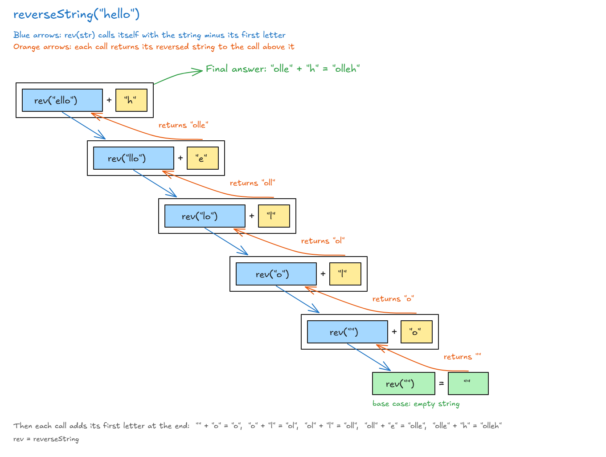

# Reverse String With Recursion

## Solution: Reverse String With Recursion

- **Reverse a string:** `"hello"` becomes `"olleh"`.

### Recursive (code by Claude)

<!-- prettier-ignore -->
```js
function reverseString(str) {
  if (str === "") {                              // base case: nothing left to reverse
    return "";
  }
  return reverseString(str.substring(1)) + str[0]; // reverse the rest, then add the first letter at the end
}

reverseString("hello"); // "olleh"
```

- `str.substring(1)` is the string **without its first letter**, so the string gets **shorter each call** until it's empty.
- `str[0]` is the first letter. It goes **at the end** of the reversed rest.



### Iterative (code by Claude)

<!-- prettier-ignore -->
```js
function reverseStringIterative(str) {
  let reversed = "";
  for (let i = str.length - 1; i >= 0; i--) { // start from the last letter
    reversed = reversed + str[i];
  }
  return reversed;
}

reverseStringIterative("hello"); // "olleh"
```

- Both are **O(n)**: the recursive one calls itself about `n` times, and the loop runs `n` times.
- The recursive version also uses **more memory**, because each call waits on the call stack.

> **Key idea:** Take off the first letter, reverse the rest with recursion, then add that letter at the end. The base case is the empty string.
