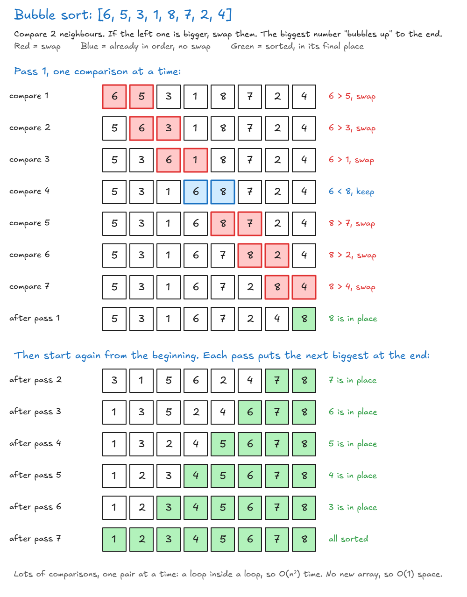

# Bubble Sort

## Bubble Sort

### 2 groups of sorting algorithms

| Group                  | Algorithms                                  | What they are                                      |
| ---------------------- | ------------------------------------------- | -------------------------------------------------- |
| **Elementary sorts**   | Bubble sort, Insertion sort, Selection sort | Simple sorts you'd think of first. Usually slower. |
| **More complex sorts** | Merge sort, Quick sort                      | Harder to write, but usually **more efficient**.   |

### How bubble sort works

- Compare **2 neighbours**. If the left one is **bigger**, **swap** them.
- Move one step right and repeat, to the end of the list.
- After one **pass** (one trip through the list), the **biggest number has "bubbled up"** to the end.
- Start again from the beginning. Each pass puts the **next biggest** number in place.
- Keep going until the whole list is sorted.



### Big O

| Time (average and worst) | Space    |
| ------------------------ | -------- |
| **O(n²)**                | **O(1)** |

- **O(n²):** lots of comparisons, one pair at a time, a loop inside a loop.
- **O(1) space:** it only swaps items inside the same array. No new data structure.
- One of the **simplest** sorts, but also one of the **least efficient**. Mostly used as a **learning tool**.

> **Key idea:** Bubble sort swaps neighbours until the biggest number bubbles to the end, then repeats. It's simple but slow: O(n²) time, O(1) space.

## Exercise: Bubble Sort

- **Task:** write a `bubbleSort(array)` function that sorts an array of numbers from smallest to biggest.

```js
const numbers = [99, 44, 6, 2, 1, 5, 63, 87, 283, 4, 0];
```

## Solution: Bubble Sort

### My version

<!-- prettier-ignore -->
```js
function bubbleSort(arr) {
  const length = arr.length;
  for (let i = 0; i <= length - 2; i++) {     // length - 1 rounds is enough (4 rounds for 5 items - i in 0,1,2,3)
    for (let j = 0; j <= length - 2; j++) {   // stop before arr[j + 1] goes past the end
      if (arr[j] > arr[j + 1]) {
        let temp = arr[j];                    // swap the 2 neighbours
        arr[j] = arr[j + 1];
        arr[j + 1] = temp;
      }
    }
  }
  return arr;
}

const array = [1, 35, 2, 7, 8, 23, 11, 89, 0];
console.log(bubbleSort(array)); // [0, 1, 2, 7, 8, 11, 23, 35, 89]
```

### Lecture version

<!-- prettier-ignore -->
```js
function bubbleSort(array) {
  const length = array.length;
  for (let i = 0; i < length; i++) {
    for (let j = 0; j < length; j++) {
      if (array[j] > array[j + 1]) {
        // Swap numbers
        let temp = array[j];
        array[j] = array[j + 1];
        array[j + 1] = temp;
      }
    }
  }
}

const numbers = [99, 44, 6, 2, 1, 5, 63, 87, 283, 4, 0];
bubbleSort(numbers);
console.log(numbers); // [0, 1, 2, 4, 5, 6, 44, 63, 87, 99, 283]
```

### Differences

|                       | My version                          | Lecture version                                                         |
| --------------------- | ----------------------------------- | ----------------------------------------------------------------------- |
| Rounds (outer loop)   | `length - 1` (8 rounds for 9 items) | `length` (9 rounds: 1 extra that does nothing)                          |
| Inner loop stops at   | `length - 2` (7 for 9 items)        | `length - 1` (8 for 9 items)                                            |
| Last comparison       | stays inside the array              | `array[length - 1] > array[length]`, and `array[length]` is `undefined` |
| Comparisons (9 items) | 64                                  | 81                                                                      |
| Returns the array?    | Yes                                 | No, it sorts the array in place                                         |

- Both work in JavaScript: `5 > undefined` is `false`, so the lecture's extra comparison never swaps.
- ⚠️ In Java, C# or Python, the lecture's `array[j + 1]` at the end would **crash** (index out of range).
- **Swap:** keep the left number in `temp` first, otherwise it gets overwritten and lost.
- Both are **O(n²) time** (2 nested loops) and **O(1) space** (no new array).

👉 Code file: [code/bubble-sort.js](code/bubble-sort.js)

> **Key idea:** Two nested loops: the inner one swaps neighbours, and the outer one repeats until everything is sorted. O(n²) time, O(1) space.
