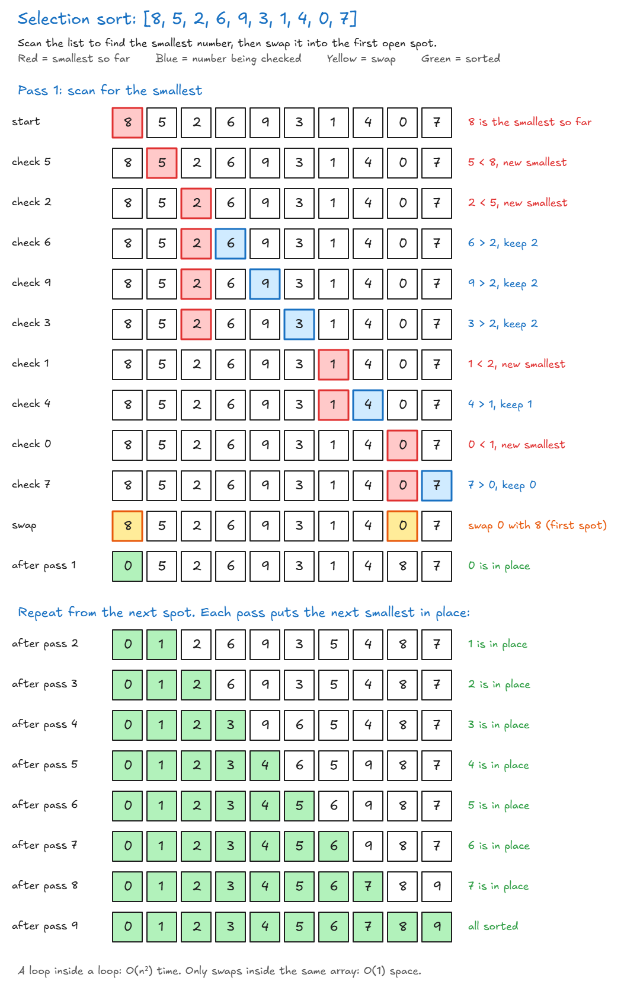

# Selection Sort

## Selection Sort

- Another **simple** (elementary) sort.

### How selection sort works

- **Scan** the whole list to find the **smallest** number.
- **Swap** it into the **first** spot.
- Scan the rest again, find the next smallest, and swap it into the **second** spot.
- Keep going until the list is sorted.



### Big O

| Time      | Space    |
| --------- | -------- |
| **O(n²)** | **O(1)** |

- **O(n²):** a loop inside a loop, like bubble sort. Not fast.
- **O(1) space:** no extra data, only swaps inside the input array.

> **Key idea:** Selection sort finds the smallest number and swaps it into the next spot, again and again. O(n²) time, O(1) space.

## Exercise: Selection Sort

- **Task:** write a `selectionSort(array)` function, using the animation and what you learned from bubble sort.

```js
const numbers = [99, 44, 6, 2, 1, 5, 63, 87, 283, 4, 0];
```

## Solution: Selection Sort

### My version

<!-- prettier-ignore -->
```js
function selectionSort(arr) {
  const length = arr.length;
  for (let i = 0; i <= length - 2; i++) {      // length - 1 rounds (4 rounds for 5 items - i in 0,1,2,3)
    let minIndex = i;                          // start: current spot is the smallest
    for (let j = i + 1; j <= length - 1; j++) {
      if (arr[j] < arr[minIndex]) {
        minIndex = j;                          // found a smaller one, remember where
      }
    }
    let temp = arr[i];                         // swap the smallest into spot i
    arr[i] = arr[minIndex];
    arr[minIndex] = temp;
  }
  return arr;
}

const array = [99, 44, 6, 2, 1, 5, 63, 87, 283, 4, 0];
console.log(selectionSort(array)); // [0, 1, 2, 4, 5, 6, 44, 63, 87, 99, 283]
```

### Lecture version

<!-- prettier-ignore -->
```js
function selectionSort(array) {
  const length = array.length;
  for (let i = 0; i < length; i++) {
    // set current index as minimum
    let min = i;
    let temp = array[i];
    for (let j = i + 1; j < length; j++) {
      if (array[j] < array[min]) {
        // update minimum if current is lower than what we had previously
        min = j;
      }
    }
    array[i] = array[min];
    array[min] = temp;
  }
  return array;
}
```

- **Same idea:** keep the **index** of the smallest (`min` / `minIndex`), not the value, then swap.
- **Example:** `min` starts at 99 (index 0). At 44, `44 < 99`, so `min` becomes index 1. And so on, until the smallest is found.
- The lecture runs `length` rounds. The last round just swaps the last item with itself, so it does nothing. Yours runs `length - 1` rounds.
- The lecture saves `temp` **before** the inner loop. That works, because `array[i]` doesn't change during the scan.
- Both are **O(n²)** time (2 nested loops) and **O(1)** space.

👉 Code file: [code/selection-sort.js](code/selection-sort.js)
