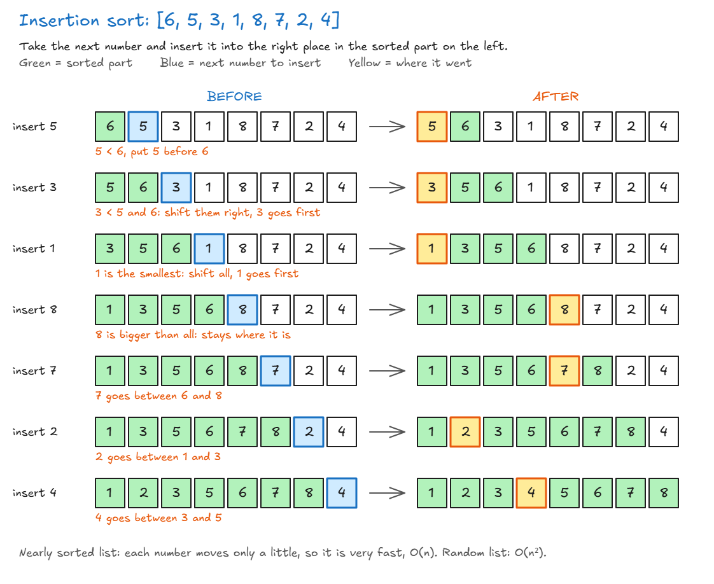
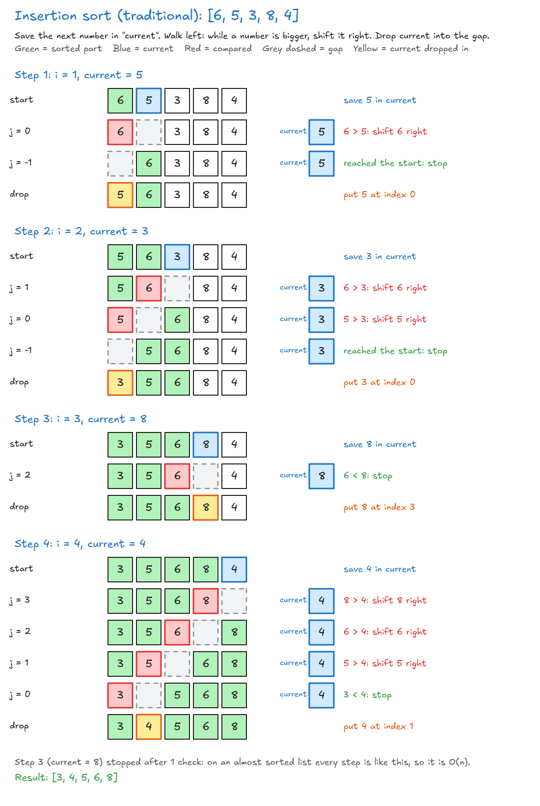

# Insertion Sort

## Insertion Sort

- Not the most efficient sort, but **very fast in some cases**, so this one matters.
- **Best for:** lists that are **almost sorted** (or already sorted), and **small** lists.

### How insertion sort works

- The first number on its own is already "sorted".
- Take the **next number** and **insert** it into the right place in the sorted part on the left. Bigger numbers **shift right** to make room.
- Repeat until every number is inserted.
- This is how you'd sort Lego blocks with numbers by hand.



### Big O

| Best (almost sorted) | Average and worst | Space    |
| -------------------- | ----------------- | -------- |
| **O(n)**             | **O(n²)**         | **O(1)** |

- **O(n) best case:** if the list is almost sorted, each number moves only a little.
- **O(n²):** on a random list, numbers may shift a long way each time.

> **Key idea:** Insertion sort inserts each number into the sorted part on the left. It's O(n) on almost sorted lists and great for small lists, but O(n²) on random ones.

## Exercise: Insertion Sort

- **Task:** write an `insertionSort(array)` function, using the animation.

```js
const numbers = [99, 44, 6, 2, 1, 5, 63, 87, 283, 4, 0];
```

## Solution: Insertion Sort

### Lecture version

<!-- prettier-ignore -->
```js
function insertionSort(array) {
  const length = array.length;
  for (let i = 0; i < length; i++) {
    if (array[i] < array[0]) {
      // smaller than the first number: move it to the front
      array.unshift(array.splice(i, 1)[0]);
    } else {
      // find where it goes, and move it there
      for (let j = 1; j < i; j++) {
        if (array[i] > array[j - 1] && array[i] < array[j]) {
          array.splice(j, 0, array.splice(i, 1)[0]);
        }
      }
    }
  }
}

insertionSort(numbers); // [0, 1, 2, 4, 5, 6, 44, 63, 87, 99, 283]
```

**What `splice` and `unshift` do:**

| Code | What it does | Example |
| --- | --- | --- |
| `array.splice(i, 1)` | **Removes** 1 item at index `i`, and returns it **inside an array** | `[1, 2, 3, 4].splice(2, 1)` → returns `[3]`, list is now `[1, 2, 4]` |
| `array.splice(i, 1)[0]` | Same, but `[0]` takes the number **out of** that array | returns `3` |
| `array.splice(j, 0, x)` | **Inserts** `x` at index `j`, removing nothing (the `0`) | `[1, 2, 4].splice(2, 0, 3)` → list is now `[1, 2, 3, 4]` |
| `array.unshift(x)` | **Adds** `x` to the **front** | `[2, 3].unshift(1)` → list is now `[1, 2, 3]` |

- **If the number is smaller than the first number:** cut it out (`splice(i, 1)[0]`) and put it at the front (`unshift`).
- **Otherwise:** look for 2 neighbours where `left < number < right`. Cut the number out and insert it between them (`splice(j, 0, ...)`).
- ⚠️ **Bug with repeated numbers:** `[3, 1, 1]` becomes `[1, 3, 1]`. The 2nd `1` needs `1 > 1` to find its spot, which is false. **Fix:** use `>=` instead of `>`.
- ⚠️ **Slower than it looks:** `splice` and `unshift` move many items behind the scenes, and the `j` loop always starts from the beginning. So even an almost sorted list takes O(n²).
- `splice` and `unshift` are **JavaScript-only**. Other languages can't do this with a basic array.

### Traditional version (code by Claude)

- The one in most books and interviews. Works in **every language**.

<!-- prettier-ignore -->
```js
function insertionSort(arr) {
  for (let i = 1; i < arr.length; i++) {
    const current = arr[i];              // save the number to insert
    let j = i - 1;                       // start at the number on its left
    while (j >= 0 && arr[j] > current) { // bigger number? shift it right
      arr[j + 1] = arr[j];
      j--;
    }
    arr[j + 1] = current;                // drop current into the gap
  }
  return arr;
}

insertionSort(numbers); // [0, 1, 2, 4, 5, 6, 44, 63, 87, 99, 283]
```

- Save the number in `current`, so it isn't lost when numbers shift over it.
- Walk **left**. While the number there is **bigger**, shift it one spot **right**. This leaves a **gap**.
- When you hit a smaller number (or the start), **drop `current` into the gap**.
- **Almost sorted list:** the `while` stops after 1 check, so it's **O(n)**.
- Repeated numbers work without any fix, because it only shifts numbers that are strictly bigger.



### Lecture vs traditional

| | Lecture (`splice`) | Traditional (shifting) |
| --- | --- | --- |
| Almost sorted list | O(n²) | **O(n)** |
| Random list | O(n²) | O(n²) |
| Repeated numbers | ❌ needs `>=` fix | ✅ works |
| Other languages | ❌ JavaScript only | ✅ any language |
| Space | O(1) | O(1) |

- **When to use insertion sort:** small lists, or lists that are almost sorted. In the animation on almost sorted data, it finishes **first**.

👉 Code file: [code/insertion-sort.js](code/insertion-sort.js)
