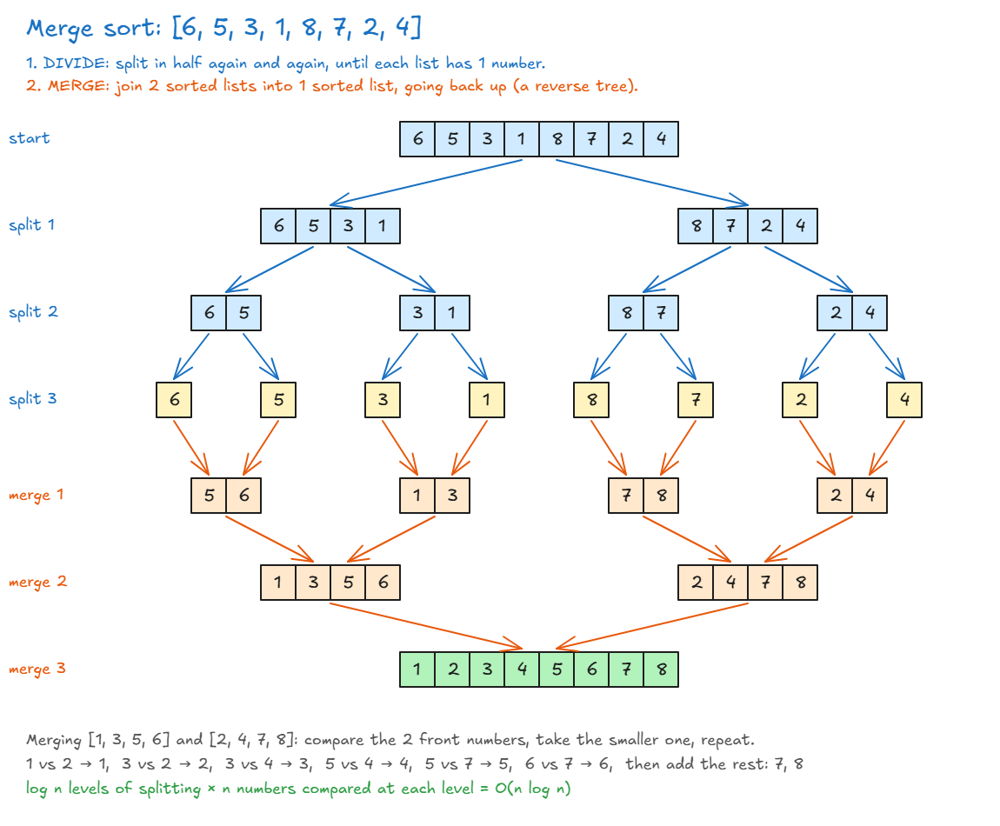
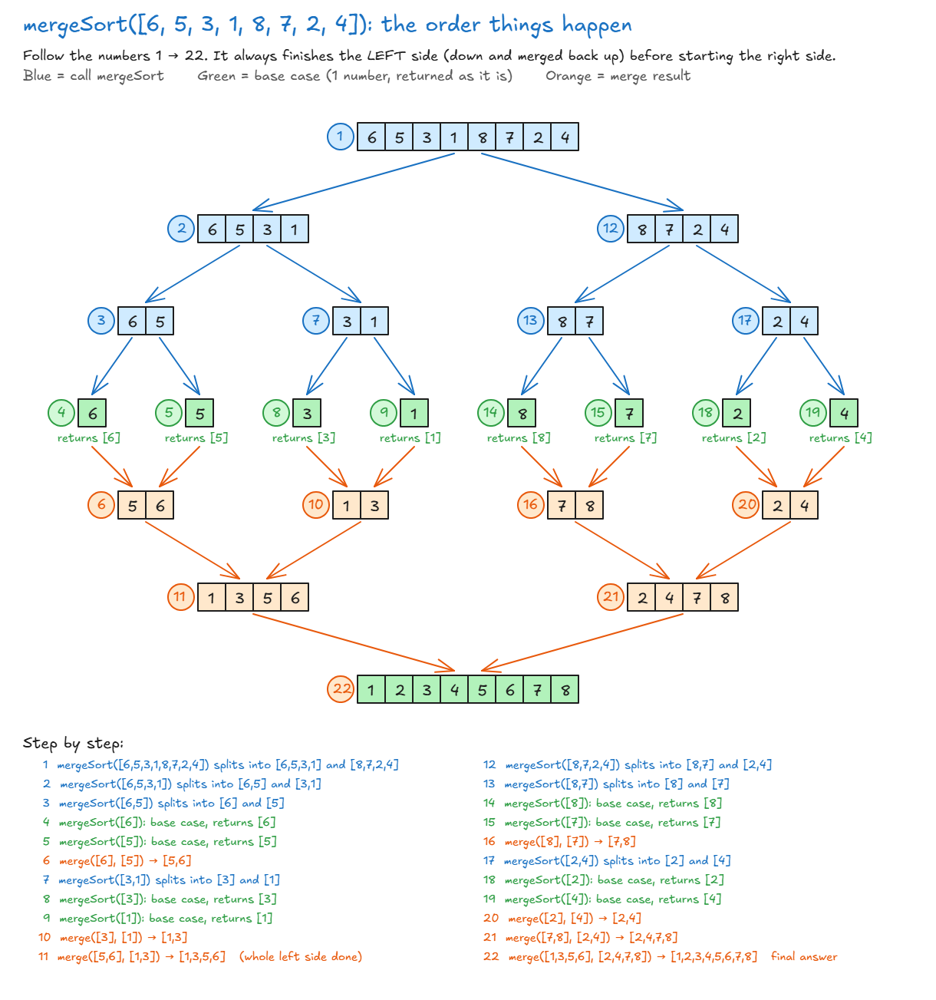
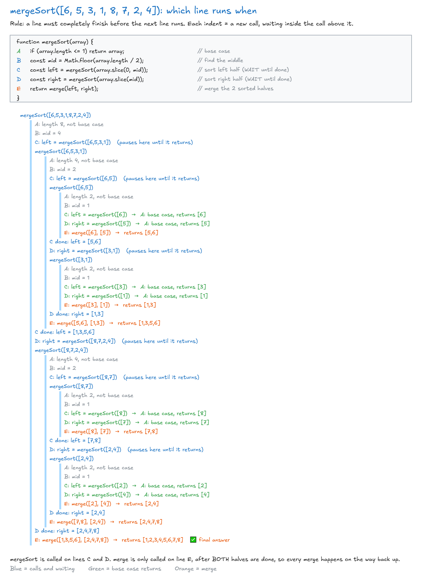
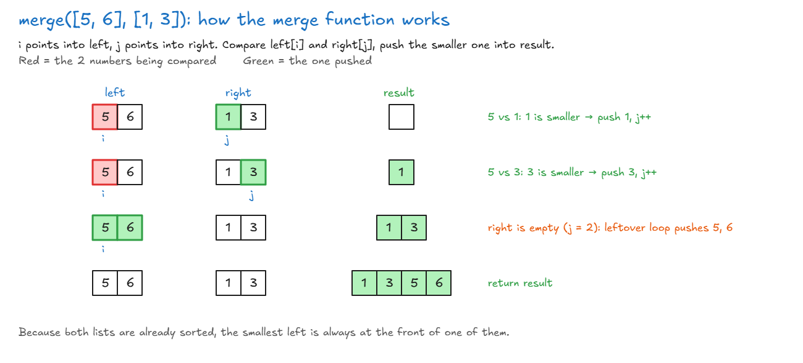

# Merge Sort

## Merge Sort and O(n log n)

- Bubble, selection and insertion sort use **nested loops**, so they're mostly **O(n²)**. That's slow.
- **Merge sort** and **quick sort** are faster: **O(n log n)**, the last Big O on our list.
- They use **divide and conquer** + **recursion**: split the problem into smaller pieces, solve each piece, then combine the answers. (Like opening a phone book in the middle instead of at page 1.)
- **Divide and conquer usually gives a `log n` advantage.**

### How merge sort works

1. **Divide:** split the list in half, then split each half in half again, until every list has **1 number**.
2. **Merge:** join 2 lists into 1 **sorted** list. Repeat going back up, like a **reverse tree**, until there's 1 sorted list.
- **How to merge 2 sorted lists:** compare the 2 front numbers, take the smaller one, and repeat.



### Why O(n log n)

- **n:** every number still has to be **compared** at least once, at each level.
- **log n:** splitting in half again and again gives only **log n levels**. (Finding the middle is **O(1)**: just length ÷ 2.)
- Unlike bubble sort, it **doesn't compare everything to everything**. It only compares the 2 small lists being merged.

### Big O

| Time (best, average, worst) | Space    |
| --------------------------- | -------- |
| **O(n log n)**              | **O(n)** |

- **O(n) space:** it has to keep the split-up lists in memory. That's the **downside** compared to bubble, selection and insertion sort (O(1)).
- One of the **most efficient** sorts. It usually does better than most others.
- **Stable:** equal items (like two 6s, or 2 people with the same name) **keep their original order**. Sometimes this matters.

> **Key idea:** Merge sort splits the list down to single numbers, then merges sorted pieces back up. O(n log n) time, but O(n) extra space.

## Exercise: Merge Sort

- ⚠️ **Hard**, especially if recursion still feels new. In interviews you're usually only asked **how** it works, not to write it.
- **Task:** split the array into `left` and `right`, then write `merge` to join 2 sorted lists.

<!-- prettier-ignore -->
```js
const numbers = [99, 44, 6, 2, 1, 5, 63, 87, 283, 4, 0];

function mergeSort(array) {
  if (array.length === 1) {  // base case: 1 number is already sorted
    return array;
  }
  // Split array into right and left

  return merge(
    mergeSort(left),
    mergeSort(right)
  );
}

function merge(left, right) {
  // compare and join the 2 sorted lists
}

const answer = mergeSort(numbers);
console.log(answer);
```

## Solution: Merge Sort

### My version

<!-- prettier-ignore -->
```js
const numbers = [99, 44, 6, 2, 1, 5, 63, 87, 283, 4, 0];

function mergeSort(array) {
  if (array.length <= 1) {                      // base case: 0 or 1 number is already sorted
    return array;
  }

  const mid = Math.floor(array.length / 2);     // find the middle
  const left = mergeSort(array.slice(0, mid));  // sort the left half
  const right = mergeSort(array.slice(mid));    // sort the right half

  return merge(left, right);                    // join the 2 sorted halves
}

function merge(left, right) {
  const result = [];
  let i = 0;                                    // position in left
  let j = 0;                                    // position in right

  while (i < left.length && j < right.length) { // both still have numbers
    if (left[i] <= right[j]) {                  // <= keeps it stable
      result.push(left[i]);
      i++;
    } else {
      result.push(right[j]);
      j++;
    }
  }

  while (i < left.length) {                     // add what's left in left
    result.push(left[i]);
    i++;
  }
  while (j < right.length) {                    // add what's left in right
    result.push(right[j]);
    j++;
  }

  return result;
}

const answer = mergeSort(numbers);
console.log(answer); // [0, 1, 2, 4, 5, 6, 44, 63, 87, 99, 283]
```

- `array.slice(0, mid)` copies the left half, and `array.slice(mid)` copies the right half. These copies are why merge sort uses **O(n) space**.
- **Lecture version:** it puts the halves in `left` and `right` first, then calls `mergeSort` inside the `return`. It's the same result, just a different order of lines.
- **Base case:** `<= 1` also handles an empty list. The lecture's `=== 1` would crash with a stack overflow on `[]`.

### How mergeSort runs, step by step



### Which code line runs when



### How merge works, step by step



👉 Code file: [code/merge-sort.js](code/merge-sort.js)

## Stable VS Unstable Algorithms

- **Stable sort:** if 2 items are **equal**, they stay in the **same order** they were in before sorting.
- **Unstable sort:** equal items **might swap** places.

### Example: sort people by age

| Before          | Stable (by age)  | Unstable (by age) |
| --------------- | ---------------- | ----------------- |
| Anna, 25        | Ben, 20          | Ben, 20           |
| Ben, 20         | **Anna, 25**     | **Cara, 25**      |
| Cara, 25        | **Cara, 25**     | **Anna, 25**      |

- Anna and Cara are both 25. Anna came first, so a **stable** sort keeps Anna before Cara.
- An **unstable** sort still sorts by age correctly, but Anna and Cara may swap.

### Why it matters

- When you sort **twice**, a stable sort keeps the first sort's order.
- **Example:** sort people by **name**, then by **age** with a stable sort. People with the same age stay in **name order**.

### Which sorts are stable?

| Stable ✅      | Unstable ❌     |
| -------------- | -------------- |
| Merge sort     | Quick sort     |
| Insertion sort | Heap sort      |
| Bubble sort    | Selection sort |

- **Merge sort** is stable because of `<=` in `merge`: when 2 numbers are equal, the one from the **left** list goes first.

> **Key idea:** A stable sort keeps equal items in their original order. Merge, insertion and bubble sort are stable. Quick, heap and selection sort are not.
