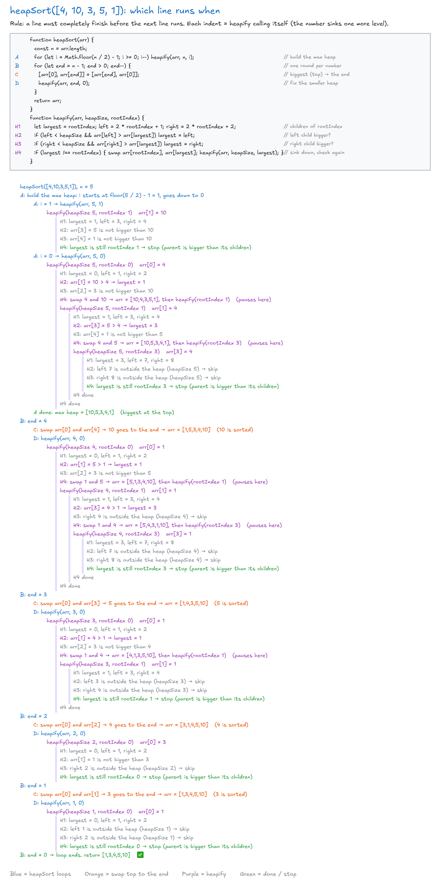

# Heap Sort

## Resources: Heap Sort

- **Heap sort** uses a **max heap**: a tree where every parent is **bigger** than its children, so the **biggest number is always at the top**. (Heaps are covered in [Binary Heaps](../008-Trees/06-Binary-Heaps.md).)
- The heap lives **inside the same array**: the children of index `i` are at `2i + 1` and `2i + 2`.

### How heap sort works

1. **Build a max heap** from the array. Now the biggest number is at the top (index 0).
2. **Swap the top with the last spot.** The biggest number is now in its **final place**, and the heap gets 1 smaller.
3. **Heapify:** the new top is probably too small, so it **sinks down**. Swap it with its **bigger child** until it's bigger than both children.
4. **Repeat steps 2 and 3** until the heap has 1 number left.


### Code (code by Claude)

<!-- prettier-ignore -->
```js
function heapSort(arr) {
  const n = arr.length;

  // 1. Build a max heap from the input array
  // Start from the last non-leaf node and heapify upwards
  for (let i = Math.floor(n / 2) - 1; i >= 0; i--) {
    heapify(arr, n, i);
  }

  // 2. Extract elements one by one from the heap
  for (let end = n - 1; end > 0; end--) {
    // Move the current root (largest element) to the end
    [arr[0], arr[end]] = [arr[end], arr[0]];

    // Restore the max heap property on the reduced heap
    heapify(arr, end, 0);
  }
  return arr;
}

function heapify(arr, heapSize, rootIndex) {
  let largest = rootIndex;
  const left = 2 * rootIndex + 1;
  const right = 2 * rootIndex + 2;

  // Check if left child exists and is greater than root
  if (left < heapSize && arr[left] > arr[largest]) {
    largest = left;
  }

  // Check if right child exists and is greater than the largest so far
  if (right < heapSize && arr[right] > arr[largest]) {
    largest = right;
  }

  // If the largest element is not the root, swap and continue heapifying
  if (largest !== rootIndex) {
    [arr[rootIndex], arr[largest]] = [arr[largest], arr[rootIndex]];
    heapify(arr, heapSize, largest);
  }
}

heapSort([4, 10, 3, 5, 1]); // [1, 3, 4, 5, 10]
```

- **`Math.floor(n / 2) - 1`:** the **last parent** in the heap. Numbers after it are leaves (no children), so there's nothing to fix there.
- **`end`:** the last spot of the heap. The biggest number is swapped there, then the heap shrinks by 1.
- **`heapSize`:** how much of the array is still the heap. The sorted numbers at the end are **outside** it, so `heapify` ignores them.
- **`rootIndex`:** the parent being checked. Its children are at `2 * rootIndex + 1` and `2 * rootIndex + 2`.
- **`left < heapSize`:** makes sure the child exists and is still inside the heap.
- `heapify` calls **itself** until the number is bigger than both its children, or has no children.

**Which code line runs when:**



### Big O

| Time (best, average, worst) | Space    |
| --------------------------- | -------- |
| **O(n log n)**              | **O(1)** |

- **O(n log n):** there are `n` numbers to take off the top, and each heapify sinks down at most `log n` levels (the height of the tree).
- **O(1) space:** everything happens **inside the same array**. No extra lists.
- **Not stable:** the big swaps can change the order of equal numbers.

### Heap sort vs merge sort vs quick sort

|            | Merge sort | Quick sort | Heap sort  |
| ---------- | ---------- | ---------- | ---------- |
| Worst case | O(n log n) | **O(n²)**  | O(n log n) |
| Space      | O(n)       | O(log n)   | **O(1)**   |
| Stable?    | ✅         | ❌         | ❌         |

- Heap sort has **no bad worst case** (unlike quick sort) and needs **no extra memory** (unlike merge sort).
- But in practice it's usually **slower than quick sort**, because it jumps around the array a lot.

> **Key idea:** Heap sort builds a max heap, then keeps swapping the biggest number (the top) to the end and fixing the heap. Always O(n log n), with O(1) space, but not stable.
