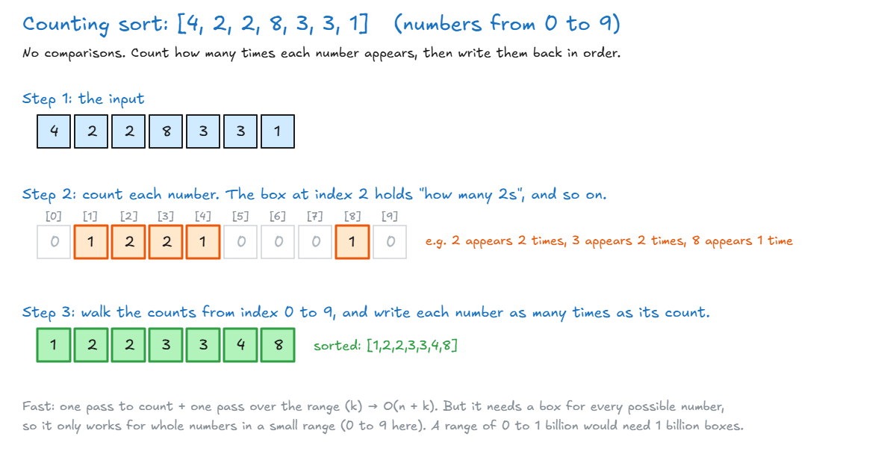
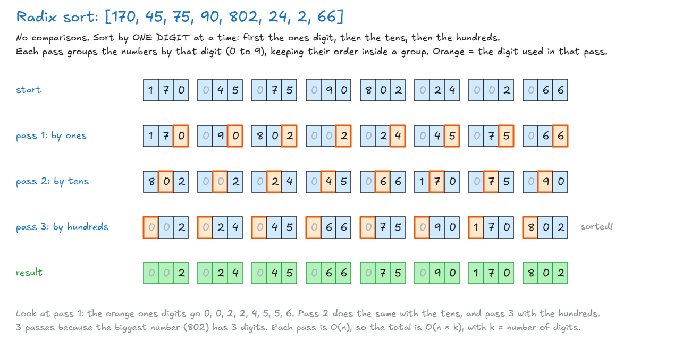

# Radix Sort And Counting Sort

## Radix Sort + Counting Sort

- Merge sort and quick sort are the most used in real life, because divide and conquer gives **O(n log n)**.
- **Can we beat O(n log n)?** Not with **comparison sorts**. It's mathematically **impossible**, because they must compare numbers to each other.

### Comparison vs non-comparison sorts

| | Comparison sorts | Non-comparison sorts |
| --- | --- | --- |
| Examples | Bubble, insertion, selection, merge, quick, heap | **Counting sort**, **radix sort**, bucket sort |
| How they decide order | Ask "is this number bigger than that one?" again and again | Use how numbers are **stored in the computer** (0s and 1s), not comparisons |
| Works on | **Any type of data** (universal) | **Only integers** (whole numbers) in a **small, fixed range** |
| Best speed | O(n log n) | Can be **faster** than O(n log n) |

- **Example of a small range:** numbers only from **0 to 100**. Then counting or radix sort can be faster than quick sort or merge sort.
- They **don't work on every type of data**, only on whole numbers, because of how numbers are stored in memory.

### Big O (from the cheat sheet)

| Sort          | Average   |
| ------------- | --------- |
| Bucket sort   | O(n + k)  |
| Radix sort    | O(nk)     |
| Counting sort | O(n + k)  |

- What `k` means is beyond this course. Some people argue these sorts are still fairly slow in the end.

### How counting sort works

1. **Count** how many times each number appears. Use a box for every possible number (here 0 to 9).
2. Walk the boxes from **0 to 9**, and write each number **as many times as its count**.

- It needs a box for **every possible number**, so the range must be **small**. A range of 0 to 1 billion would need 1 billion boxes.

### How radix sort works

1. Sort by the **ones** digit, grouping numbers by that digit from 0 to 9.
2. Then sort by the **tens** digit, keeping the order from the last pass inside each group.
3. Then the **hundreds** digit, and so on, up to the last digit of the biggest number.

- The number of passes = the number of **digits** in the biggest number (802 has 3).
- Keeping the order inside each group is what makes the earlier passes still count.

> **Key idea:** Comparison sorts can't beat O(n log n). Counting and radix sort can, because they don't compare, but they only work on whole numbers in a small range.
