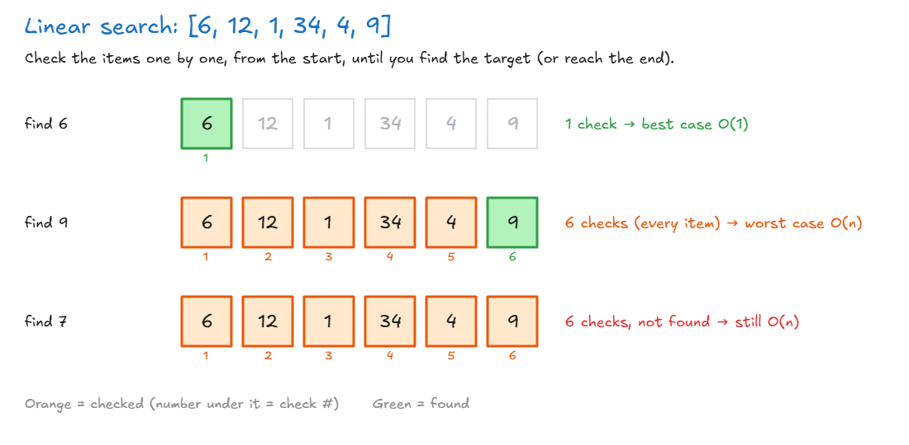
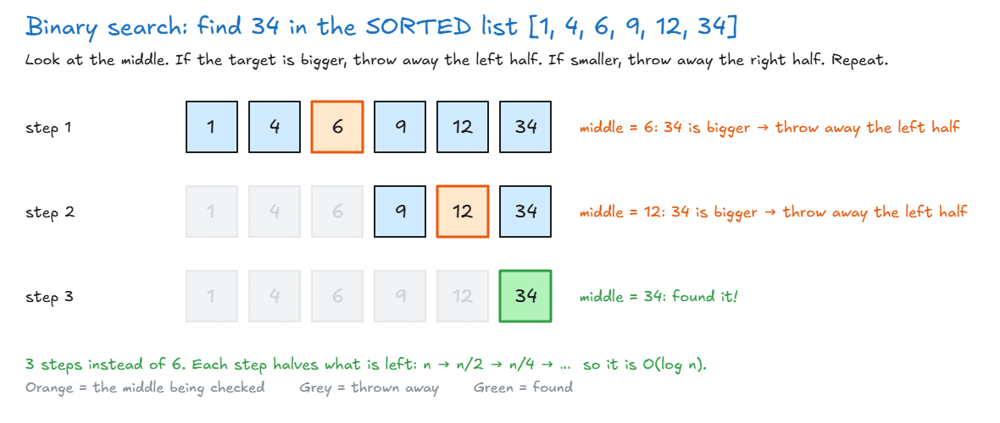

# Searching Introduction

## Searching + Traversal Introduction

- **We search all the time:**
  - files on our computer
  - **Ctrl/Cmd + F** for words in a document
  - Google and YouTube
  - hashtags on Twitter and Instagram
- There's more and more data, so **searching fast** matters a lot.
- **Goal of this section:** understand, at a basic level, how places like **Google**, **Google Maps** and **Facebook** search so fast.

> **Key idea:** Searching is something we do every day, and with more and more data, searching fast is a big computer science problem. This section covers the main ways to search and traverse.

## Linear Search

- **Linear search** (also called **sequential search**): check each item in the list **one by one** until you find the target, or you've checked everything.
- We've done this all through the course whenever we looped through an array.
- The items can be anything: numbers, nodes, strings.



### Big O

| Best case                 | Worst case                                   |
| ------------------------- | -------------------------------------------- |
| **O(1)**: target is first | **O(n)**: target is last, or not in the list |

### Linear search in JavaScript

<!-- prettier-ignore -->
```js
const beasts = ["Centaur", "Godzilla", "Mosura", "Minotaur", "Hydra", "Nessie"];

beasts.indexOf("Godzilla");                         // 1 (the index)
beasts.findIndex(item => item === "Godzilla");      // 1 (index of the first match)
beasts.find(item => item === "Godzilla");           // "Godzilla" (the item itself)
beasts.includes("Godzilla");                        // true (is it there?)
```

- All 4 are **linear searches** under the hood, so worst case **O(n)**.
- `findIndex` and `find` take a **function** with a condition. They stop at the first item where it's `true`.

### The problem

- O(n) is OK, but **not fast** for huge lists.
- Google can't index websites, and Facebook can't search for friends, with linear search. It would take too long.
- **Question for the next lesson:** what if the list was **sorted**? Could we search faster?

> **Key idea:** Linear search checks every item one by one: O(1) at best, O(n) at worst. Simple, but too slow for huge data.

## Binary Search

- If the list is **sorted**, we can do better than linear search.
- **Binary search:** look at the **middle** item.
  - If the target is **bigger**, throw away the **left half**.
  - If it's **smaller**, throw away the **right half**.
  - Repeat on the half that's left until you find it.
- It throws away **half the items each step**, not just 1.



### Why O(log n)

- Each step leaves **half** of what's left: `n → n/2 → n/4 → …`
- That's **divide and conquer**, which gives **O(log n)**. We skip most items instead of visiting them all.
- **Real life:** a teacher looking for Timmy's essay. In an unsorted pile, you check one by one. In a pile sorted **alphabetically**, you keep splitting it in half. It's like a phone book.

| Search        | Needs sorted data? | Time         |
| ------------- | ------------------ | ------------ |
| Linear search | No                 | O(n)         |
| Binary search | **Yes**            | **O(log n)** |

### Binary search and binary search trees

- A sorted list searched this way works like a **binary search tree** (BST): at each step, decide **left or right**.
- **"But we had to sort the list first, and that takes time!"**. That's why we store data in a **tree** instead of an **array** (a linear data structure).
- A tree puts each item in its **sorted place as we insert it**. That's faster overall than adding items to an **unsorted list** and then having to search through it later.
- We already wrote this: the BST **`lookup`** method uses a `while` loop to go left or right, cutting the data in half each time. (Linear search used a `for` loop.)
- Merge sort and quick sort use the same divide and conquer idea.

### What's next: traversal

- So far, we searched for **one item** we knew how to find (left or right).
- **Traversal:** visiting **every** node. For example, to add a color to every node, or multiply every number by 2.

> **Key idea:** Binary search works on sorted data: check the middle and throw away half each step, so it's O(log n) instead of linear search's O(n).
