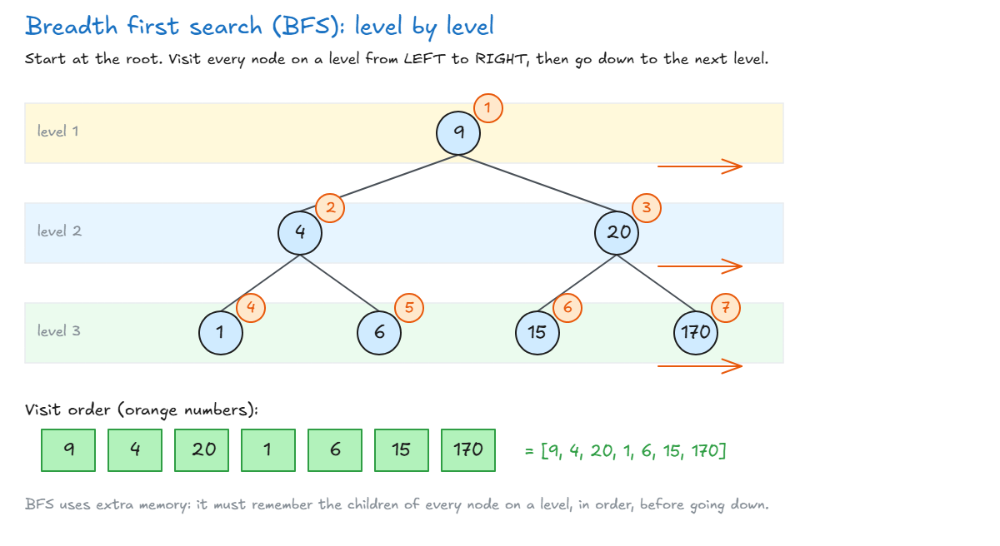
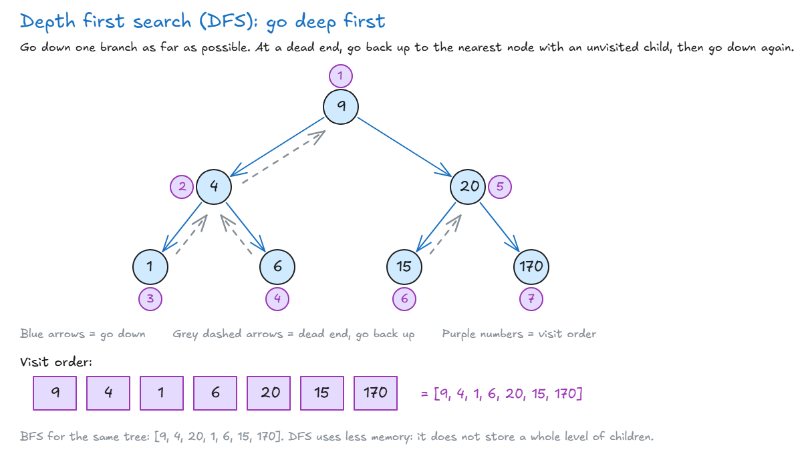

# BFS And DFS

## BFS Introduction

- **Breadth first search (BFS):** start at the **root**, then visit every node on the next level from **left to right**, then the next level, and so on.
- Keep going **level by level** until you find the node you're looking for, or the tree ends.

### Example: the BST from the Trees section

- BFS order: **[9, 4, 20, 1, 6, 15, 170]**
  - Level 1: 9
  - Level 2: 4, 20
  - Level 3: 1, 6, 15, 170

### Extra memory

- BFS uses **extra memory**: while it visits one level, it has to **remember the children** of every node on that level, in order, to visit them next.
- Pros and cons vs depth first search (DFS) come later.

> **Key idea:** BFS visits a tree level by level, left to right, starting at the root. It needs extra memory to remember the next level's nodes.

## DFS Introduction

- **Depth first search (DFS):** follow **one branch down** as far as possible, until you find the target or reach the end (a leaf).
- When you can't go any further, go **back up** to the nearest node that still has an **unvisited child**, then go down again.
- Usually you start on the **left** side and move **right**.
- **Like walking through a maze:** go as far as you can. At a dead end, turn back to the last spot where you could go another way.

### Example: the same BST

- DFS order: **[9, 4, 1, 6, 20, 15, 170]**
- BFS order for the same tree: [9, 4, 20, 1, 6, 15, 170]. Same nodes, **different order**.
- There are **different versions** of DFS, which come later.

### Less memory

- DFS needs **less memory** than BFS, because it doesn't have to store all the children of a whole level.

> **Key idea:** DFS goes as deep as it can down one branch, then backs up and tries the next branch. It uses less memory than BFS.

## BFS vs DFS

- Both do the same job, **traversal**. Interviews often ask which one to use.
- **Same time:** both visit every node once, so both are **O(n)**. What's different is the **order**.

|                 | BFS (breadth first)                                                                              | DFS (depth first)                                                                 |
| --------------- | ------------------------------------------------------------------------------------------------ | --------------------------------------------------------------------------------- |
| **Good at**     | Finding the **shortest path** from the start to another node (it checks the closest nodes first) | Checking **if a path exists** from one node to another                            |
| **Use it when** | The target is likely in the **upper levels** (near the root)                                     | The target is likely in the **lower levels** (deep down)                          |
| **Memory**      | ❌ **More** memory                                                                               | ✅ **Less** memory                                                                |
| **Downside**    | Uses a lot of memory                                                                             | Can be **slow** if the tree or graph is very deep. Not good at the shortest path. |

- More on shortest path and "does a path exist?" comes with **graph traversal**.

> **Key idea:** BFS and DFS are both O(n). Use BFS for the shortest path or targets near the top. Use DFS to check if a path exists, for targets deep down, or to save memory.

## Exercise: BFS vs DFS

- **Task:** for each situation, would you use BFS or DFS?

1. If you know a solution is not far from the root of the tree
2. If the tree is very deep and solutions are rare
3. If the tree is very wide
4. If solutions are frequent but located deep in the tree
5. Determining whether a path exists between two nodes
6. Finding the shortest path

## Solution: BFS vs DFS

| # | Situation | Use | Why |
| --- | --- | --- | --- |
| 1 | Solution is **near the root** | **BFS** | It checks the nodes closest to the root first. |
| 2 | Tree is **very deep**, solutions are **rare** | **BFS** | DFS would go very far down each branch, again and again, and take a long time. (BFS still uses a lot of memory, so answers can vary.) |
| 3 | Tree is **very wide** (each parent has many children) | **DFS** | BFS keeps every node of the current level in a **queue**, so a wide tree takes **too much memory**. |
| 4 | Solutions are **frequent** but **deep** | **DFS** | It goes deep straight away, so it finds one sooner. |
| 5 | Does a **path exist** between two nodes? | **DFS** | This is what DFS is built for. |
| 6 | **Shortest path** | **BFS** | This is what BFS is built for. |

- Some answers can vary. In an interview, what matters is that you **explain why**.
- Keep this table for interviews, and come back to it as you learn more about BFS and DFS.

> **Key idea:** BFS for near the root, very deep trees with rare solutions, and the shortest path. DFS for wide trees, deep but frequent solutions, and checking if a path exists.
