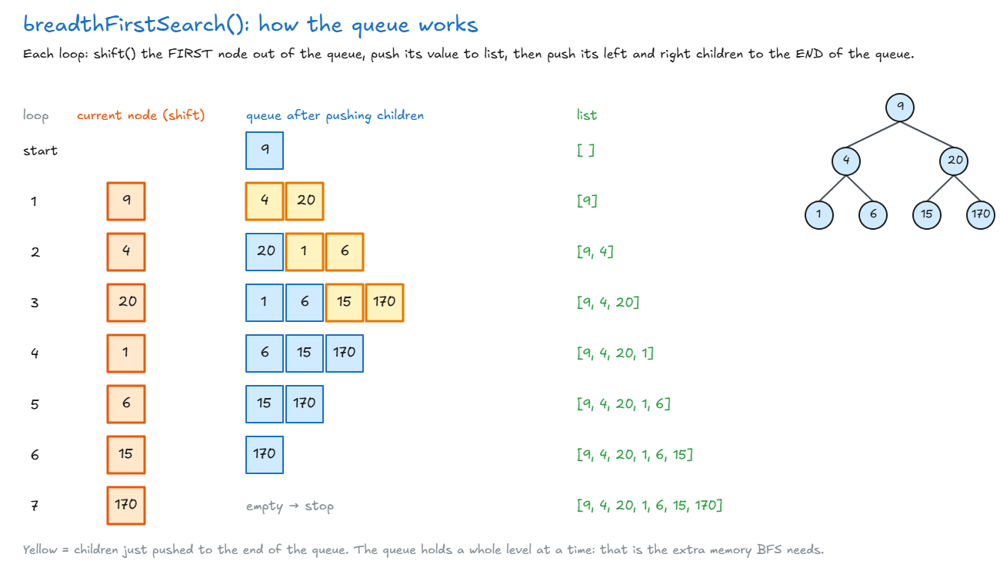
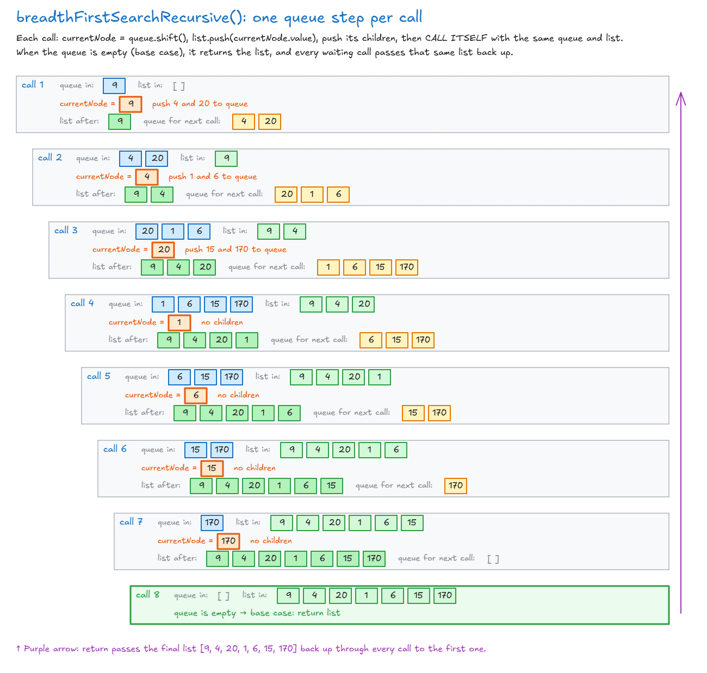

# Breadth First Search

## breadthFirstSearch()

- **Goal:** turn the BST into a list in BFS order: **[9, 4, 20, 1, 6, 15, 170]**.
- BFS uses a **queue** (first in, first out, like a line for a roller coaster). The queue remembers the nodes we still have to come back to, so we can visit their children later. This is where the **extra memory** comes from.

### What we need

- `currentNode`: the node we're on. It starts at the **root**.
- `list`: the **answer**, values in BFS order.
- `queue`: the nodes waiting to be visited (an array here).

### Code (iterative)

<!-- prettier-ignore -->
```js
breadthFirstSearch() {
  let currentNode = this.root;
  let list = [];
  let queue = [];
  queue.push(currentNode);              // start with the root

  while (queue.length > 0) {            // until nothing is left to visit
    currentNode = queue.shift();        // take the FIRST node out of the queue
    list.push(currentNode.value);       // add it to the answer
    if (currentNode.left) {
      queue.push(currentNode.left);     // left child waits at the end
    }
    if (currentNode.right) {
      queue.push(currentNode.right);    // then the right child
    }
  }
  return list;
}

tree.breadthFirstSearch(); // [9, 4, 20, 1, 6, 15, 170]
```

- `queue.shift()` **removes and returns the first item** in the queue.
- Children always go to the **end**, so a whole level finishes before the next level starts.



### The downside: memory

- The **queue can get big**. In a **wide** tree (for example 10 children per node, not just left and right), it holds a lot of nodes at once.
- That memory use is the main downside of BFS.

> **Key idea:** BFS uses a queue: take the first node out, add its value to the list, push its children to the end, and repeat until the queue is empty.

## breadthFirstSearchRecursive()

- BFS is usually written with a **loop** (above). This recursive version is just for fun.
- **Gotcha:** `queue` and `list` **can't** be created inside the function. Every recursive call would reset them to empty arrays. So they're passed in as **parameters**.

### Code (recursive)

<!-- prettier-ignore -->
```js
breadthFirstSearchRecursive(queue, list) {
  if (!queue.length) {                  // base case: queue is empty
    return list;
  }

  let currentNode = queue.shift();
  list.push(currentNode.value);
  if (currentNode.left) {
    queue.push(currentNode.left);
  }
  if (currentNode.right) {
    queue.push(currentNode.right);
  }

  return this.breadthFirstSearchRecursive(queue, list); // repeat with the same queue and list
}

tree.breadthFirstSearchRecursive([tree.root], []); // [9, 4, 20, 1, 6, 15, 170]
```

- **First call:** the queue starts as `[tree.root]` (an array holding the root), and the list starts as `[]`.
- Inside the class, call it with `this.breadthFirstSearchRecursive(...)`. **Outside** the class, use `tree.root`, because `this` only works inside the class.
- Each call does **one loop** of the iterative version. The result is the same.



### Why `return` is needed

- `list` is **one shared array**. Every call pushes into the **same** array, so nothing is added on the way back up.
- But `return` is still needed, so the **first call gives the list back** to you:
  - Call 8 (the base case) returns `list`.
  - Call 7 returns what call 8 returned, call 6 returns what call 7 returned, and so on up to call 1.
- **Without `return`:** call 7 ignores what call 8 returned, so call 1 returns **`undefined`**.

👉 Code file: [code/breadth-first-search.js](code/breadth-first-search.js)

> **Key idea:** Recursive BFS does one queue step per call and passes the queue and list along. Same result as the loop, but the loop is the usual way.
