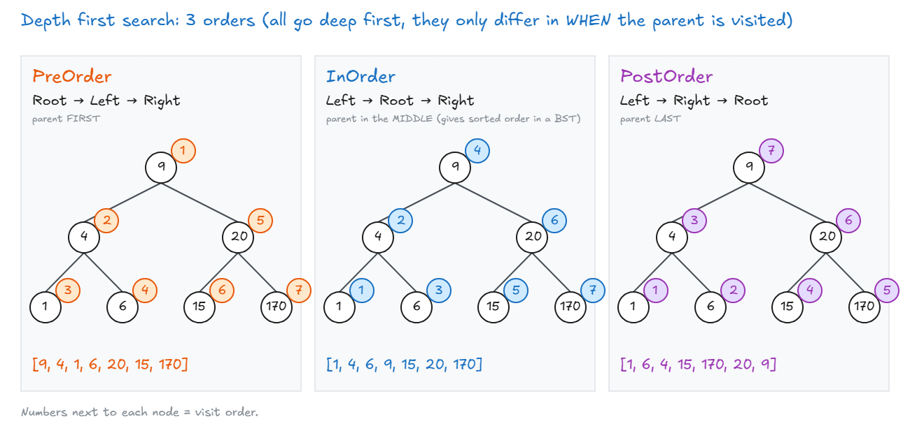
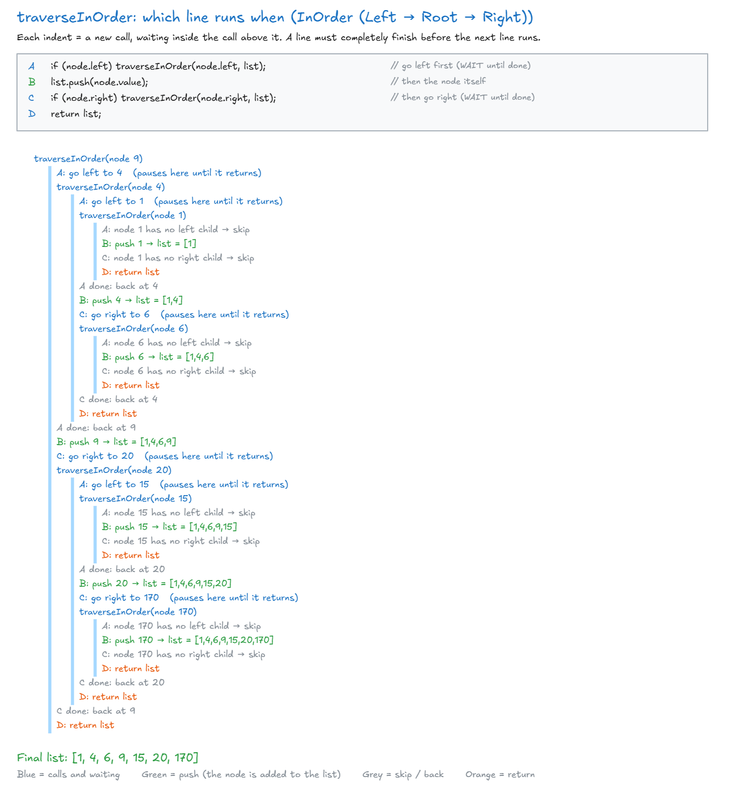
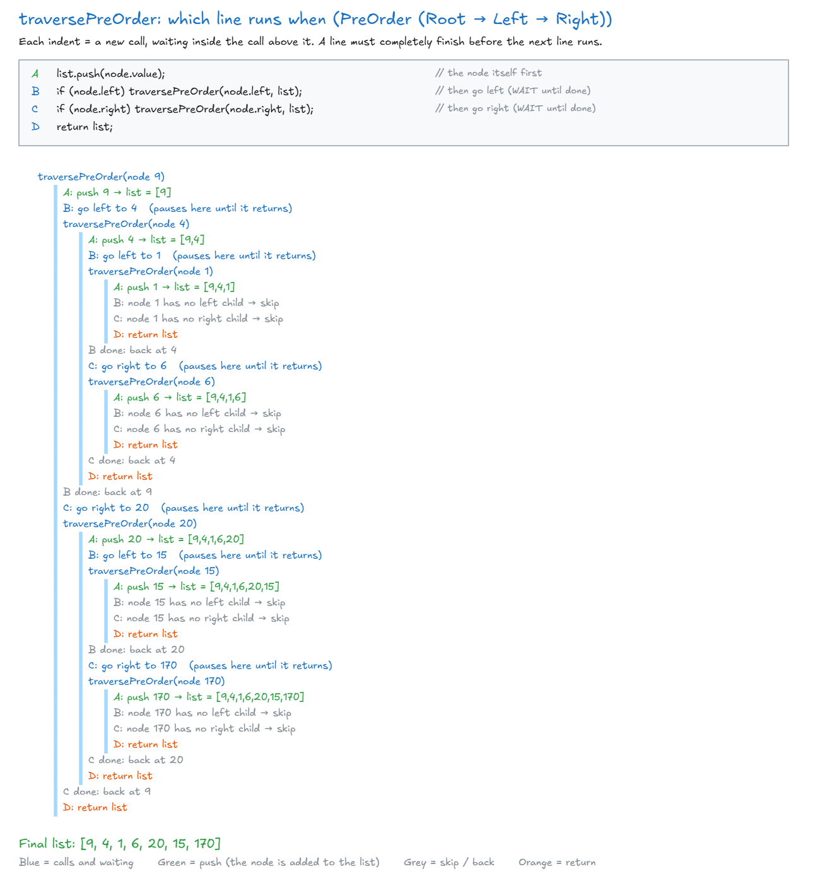
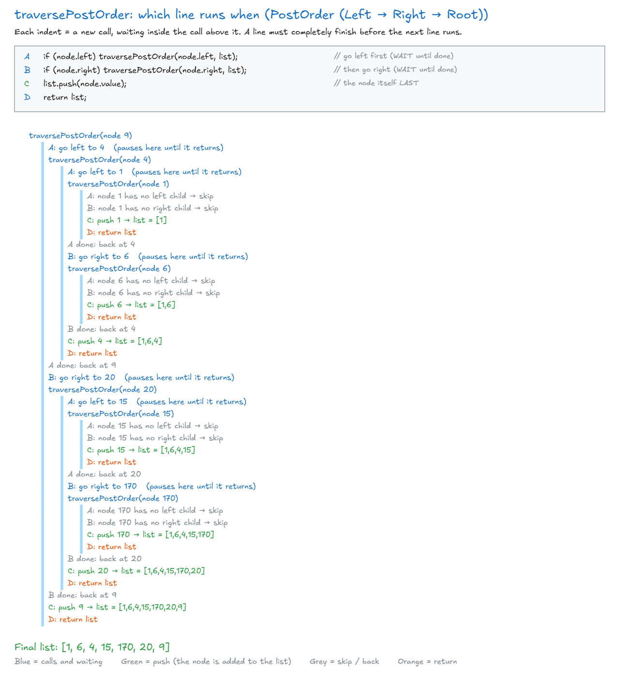

# Depth First Search

## PreOrder, InOrder, PostOrder

- DFS has **3 orders**. All of them go deep first. They only differ in **when the parent (root) is visited**.

| Order | Rule | Our BST (9 / 4, 20 / 1, 6, 15, 170) gives |
| --- | --- | --- |
| **PreOrder** | **Root → Left → Right** (parent first) | [9, 4, 1, 6, 20, 15, 170] |
| **InOrder** | **Left → Root → Right** (parent in the middle) | [1, 4, 6, 9, 15, 20, 170] |
| **PostOrder** | **Left → Right → Root** (parent last) | [1, 6, 4, 15, 170, 20, 9] |



- **InOrder on a BST gives the numbers sorted** (smallest to biggest).
- **PreOrder** is useful to **copy or rebuild** a tree, because the parent always comes before its children.

> **Key idea:** PreOrder = Root, Left, Right. InOrder = Left, Root, Right (sorted in a BST). PostOrder = Left, Right, Root.

## depthFirstSearch()

- DFS is usually written with **recursion**, because it's simple that way.
- Like recursive BFS, the `list` is **passed in as a parameter**. If it was created inside the function, every call would reset it.
- Each `DFS…()` method just calls a recursive helper with **`this.root`** and an empty list **`[]`**.
- Each helper does only **3 things**: check the **left** child, check the **right** child, and **push** the node. The order of these 3 is what makes it InOrder, PreOrder or PostOrder.

### Memory: O(height of the tree)

- DFS uses the **call stack**. Each recursive call is added to the stack, and comes off when it returns (no more left or right children).
- The deepest the stack gets = the **height of the tree**.
- So DFS memory is **O(h)**, where `h` = the height of the tree. BFS instead uses a **queue**, which can hold a whole level.
- **Bonus:** once you know this, you also know how to traverse a **graph**.

> **Key idea:** DFS is recursive: left, right and push, in a different order for each type. Its memory is O(height of the tree), because of the call stack.

### My code

<!-- prettier-ignore -->
```js
// inside BinarySearchTreeClass
DFSInOrder() {
  return traverseInOrder(this.root, []);
}
DFSPreOrder() {
  return traversePreOrder(this.root, []);
}
DFSPostOrder() {
  return traversePostOrder(this.root, []);
}

function traverseInOrder(node, list) {
  if (node.left) {
    traverseInOrder(node.left, list);
  }
  list.push(node.value);
  if (node.right) {
    traverseInOrder(node.right, list);
  }
  return list;
}

function traversePreOrder(node, list) {
  list.push(node.value);
  if (node.left) {
    traversePreOrder(node.left, list);
  }
  if (node.right) {
    traversePreOrder(node.right, list);
  }
  return list;
}

function traversePostOrder(node, list) {
  if (node.left) {
    traversePostOrder(node.left, list);
  }
  if (node.right) {
    traversePostOrder(node.right, list);
  }
  list.push(node.value);
  return list;
}
```

- All 3 functions are the **same code**. Only the **place of `list.push(node.value)`** changes:
  - **PreOrder:** push **before** going left and right.
  - **InOrder:** push **between** left and right.
  - **PostOrder:** push **after** left and right.

### InOrder, line by line



### PreOrder, line by line



### PostOrder, line by line



👉 Code file: [code/depth-first-search.js](code/depth-first-search.js)

## Optional Exercise: Validate A BST

- **Task:** check if a binary tree is a **valid BST**. A very common interview question.
- **Rule of a BST:** **every** node in the left subtree is **smaller** than the node, and **every** node in the right subtree is **bigger**.

### The trap

- Checking only **parent vs its own children** is **not enough**:

```
       9
     /   \
    4     20
   / \
  1   12      ← 12 > 4, so it looks fine for its parent,
                but 12 is on the LEFT of 9, so it must be < 9. Not valid!
```

- **Fix:** give each node a **range** (`min`, `max`) it must stay inside.
  - Going **left**: the node's value becomes the new **max**.
  - Going **right**: the node's value becomes the new **min**.

### Solution (code by Claude)

<!-- prettier-ignore -->
```js
function isValidBST(node, min = -Infinity, max = Infinity) {
  if (node === null) return true;                       // empty spot: fine
  if (node.value <= min || node.value >= max) return false; // out of range
  return (
    isValidBST(node.left, min, node.value) &&           // left must be < node
    isValidBST(node.right, node.value, max)             // right must be > node
  );
}

isValidBST(tree.root); // true for 9 / 4, 20 / 1, 6, 15, 170
```

**How `min` and `max` get their values** (tree 9 / 4, 20 / 1, 6):

| Call            | min    | max    | Must be between |
| --------------- | ------ | ------ | --------------- |
| 9 (root)        | −∞     | +∞     | anything        |
| 4 (left of 9)   | −∞     | **9**  | less than 9     |
| 20 (right of 9) | **9**  | +∞     | more than 9     |
| 1 (left of 4)   | −∞     | **4**  | less than 4     |
| 6 (right of 4)  | **4**  | **9**  | between 4 and 9 |

- The **first call** uses the default values `-Infinity` and `Infinity`. After that, each call gets its `min` and `max` from the call above it.
- Node 6 gets `min = 4` from its **parent** and `max = 9` from its **grandparent**. In the bad tree, 12 sits where 6 is. 12 isn't less than 9, so it returns `false`.

- **O(n) time:** it visits every node once. **O(h) space** for the call stack (`h` = tree height).
- The exercise hints at **BFS**. That works too: put `[node, min, max]` in the queue instead of just the node, and check the same range. The recursive DFS version above is the most common answer.

> **Key idea:** To validate a BST, check every node against a min and max range, not just against its parent.
