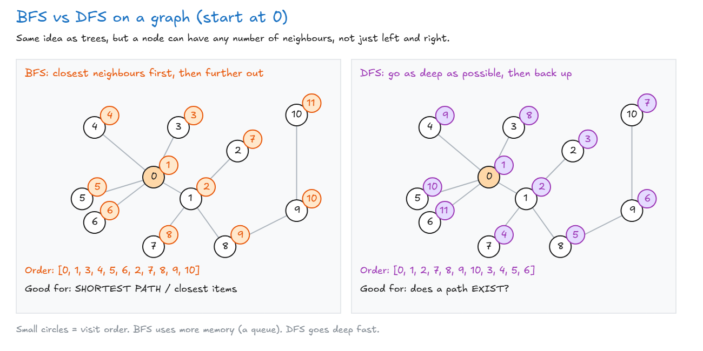
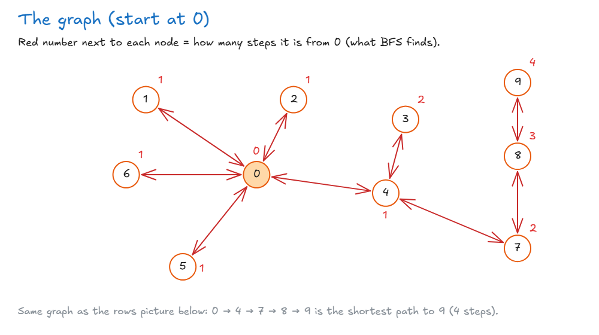
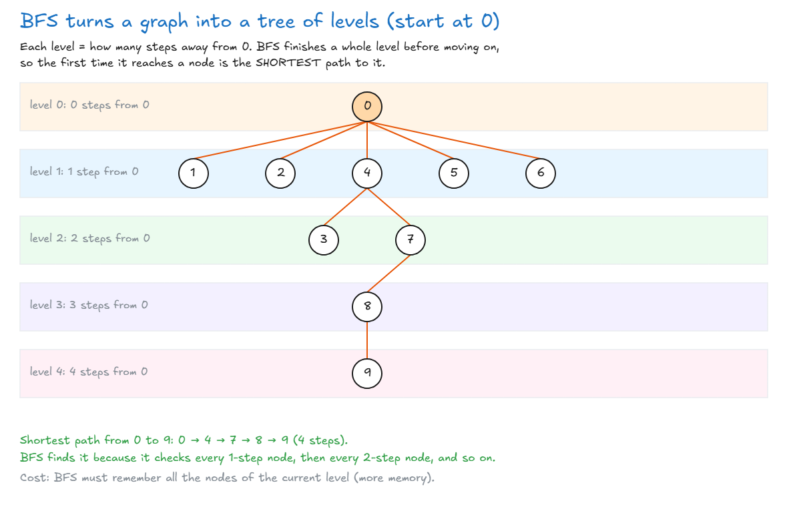
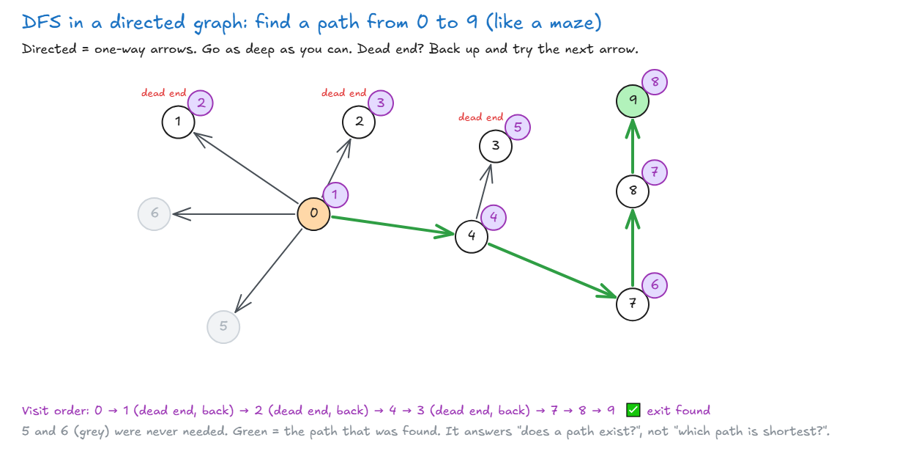

# Graph Traversals

## Graph Traversals

- A **tree is just a type of graph**, so graph traversal works **the same way**: BFS and DFS, visiting every node, **O(n)**.
- The only difference: a node can have **any number of neighbours** (say 10), not just `left` and `right`.

|              | BFS                                               | DFS                                 |
| ------------ | ------------------------------------------------- | ----------------------------------- |
| **How**      | Closest neighbours first, then further out        | As deep as possible, then back up   |
| **Good for** | **Shortest path**: what's closest or most related | **Does it exist?** Is there a path? |
| **Memory**   | More (a queue)                                    | Less, and goes deep fast            |

### Real-world uses

- **Amazon recommendations (BFS):** items most closely related to the last book you bought.
- **Facebook friend suggestions (BFS):** your closest connections.
- **LinkedIn (DFS):** do you have **any** connection to that important CEO?
- Graph traversal is also the base of **peer-to-peer networks** and **Google Maps**.

> **Key idea:** Graphs are traversed with the same BFS and DFS as trees. BFS finds the shortest path (closest first). DFS checks if something exists (goes deep fast).

## BFS in Graphs

- BFS is great for the **shortest path** between nodes, for example "what's the **closest** node to 0?"
- **BFS turns a graph into a tree:** the start node's neighbours become its "children", their neighbours the "grandchildren", and so on, level by level.

| 😀 Good                      | 😐 Bad                                                             |
| ---------------------------- | ------------------------------------------------------------------ |
| **Shortest path**            | **More memory**: it keeps track of every node on the current level |
| Finds **closer nodes** first |                                                                    |

- **Used in:** recommendation engines, peer-to-peer networks, Google Maps, Facebook friend requests, Instagram recommendations.
- **Interview tip:** if the question is about the **shortest path** between 2 nodes, or a target that's **close by**, think **BFS**.

> **Key idea:** BFS explores a graph level by level from the start, so it finds the shortest path and close nodes first, at the cost of more memory.

## DFS in Graphs

- **DFS is exactly like solving a maze:** go as deep as you can. At a dead end, **backtrack** and try a different route. Keep going until you find the target (the exit).
- That's why DFS uses **recursion**: backtracking after a dead end and walking down the next path is the same small step, repeated.

### Directed vs undirected graphs

- **Undirected:** you can go **both ways** along an edge (the graph above).
- **Directed:** each edge is a **one-way** arrow. This graph is directed, so starting at 1 goes nowhere, because 1 has no arrows out.

- It found the exit (9) **before** even looking at 5 and 6.

| 😀 Good | 😐 Bad |
| --- | --- |
| Answers **"does a path exist?"** | Does **not** tell you the **shortest** path |
| Uses **less memory** than BFS | Can get **slow** on a very **deep** graph |

- **Why deep is slow:** the deeper the graph, the more recursive calls are waiting on the **call stack**, so the more space it uses.

> **Key idea:** DFS solves a graph like a maze: go deep, backtrack at dead ends. It tells you if a path exists, uses less memory, but isn't the shortest path and gets slow on very deep graphs.
