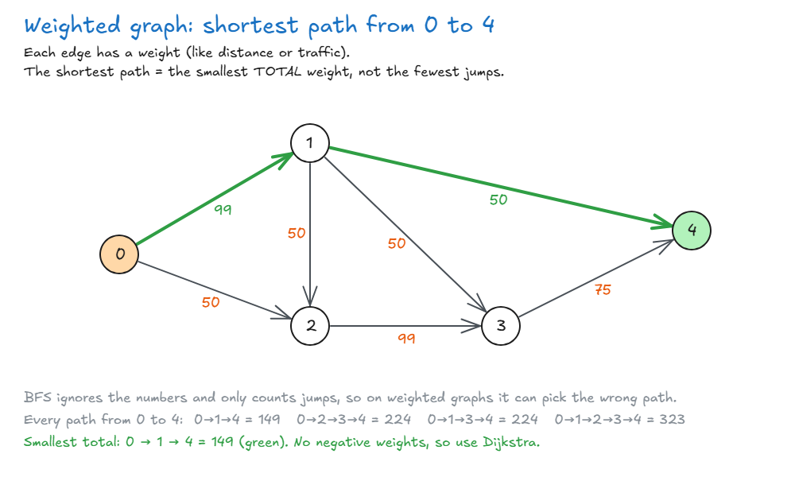

# Dijkstra And Bellman-Ford

## Dijkstra + Bellman-Ford Algorithms

- BFS finds the shortest path, but it assumes **every edge costs the same**. It just counts jumps.
- In real life, edges have **weights**. For example, in Google Maps some roads are longer or have more traffic.
- A **weighted graph** has a number on each edge. (Reminder: a node is a **vertex**, a connection is an **edge**.)
- For the shortest path in a **weighted graph**, use **Dijkstra's** or **Bellman-Ford**.

### Which one to use

| | Dijkstra's | Bellman-Ford |
| --- | --- | --- |
| **Negative weights** | ❌ Can't handle them | ✅ Can handle them |
| **Speed** | ✅ Faster, more efficient | ❌ Slower (worst case about **O(n²)**) |
| **Use when** | Weighted graph, **no negative weights** | Weighted graph **with negative weights** |

- **Interview example:** "Find the shortest path from 0 to 4" on the graph above. It's weighted with no negative weights, so the answer is **Dijkstra's**.
- **In interviews:** you almost never have to **code** these, because they're complex. Just know they exist and when to use them.
- **Fun fact:** Richard **Bellman** also came up with **dynamic programming**, which comes later in the course.

| Graph | Shortest path with |
| --- | --- |
| Unweighted (all edges equal) | **BFS** |
| Weighted, no negative weights | **Dijkstra's** |
| Weighted, with negative weights | **Bellman-Ford** |

> **Key idea:** BFS can't handle weights. For a weighted graph, use Dijkstra's (faster), or Bellman-Ford if there are negative weights.
